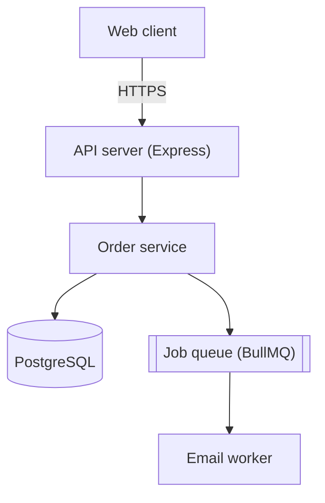
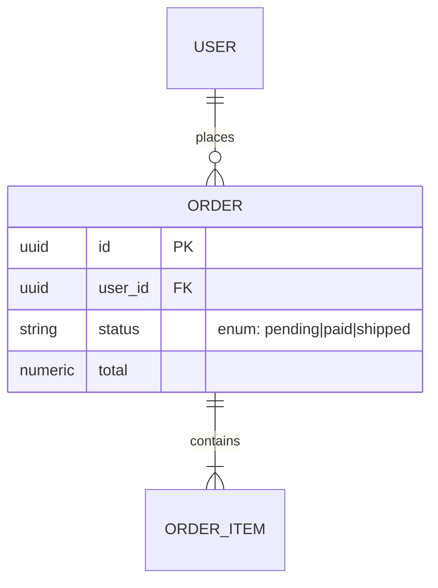
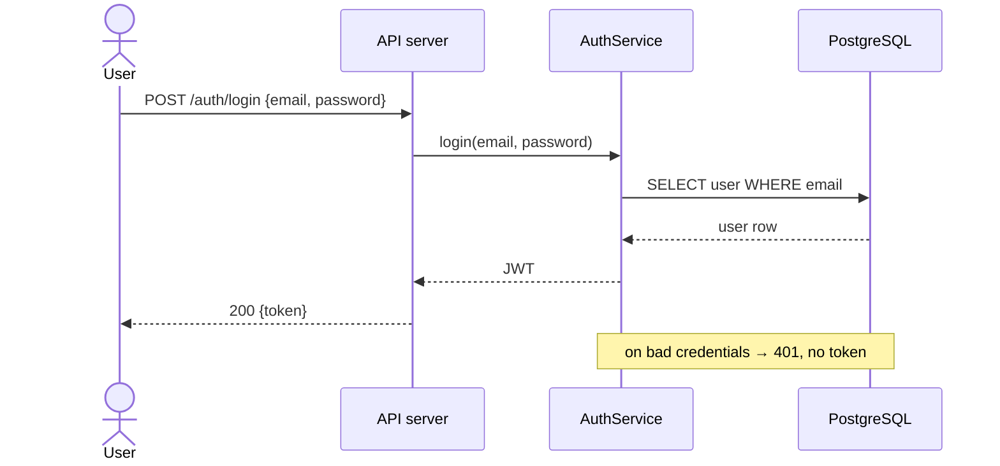
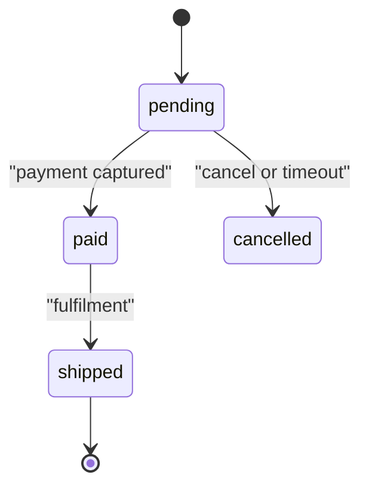
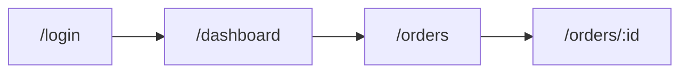

# Doc templates & mermaid examples

Section skeletons for each file. Follow the structure, fill from what you read,
delete inapplicable sections. Tables and diagrams over prose.

## Contents
- [OVERVIEW.md](#overviewmd)
- [ARCHITECTURE.md](#architecturemd)
- [TECHSTACK.md](#techstackmd)
- [DATAMODEL.md](#datamodelmd)
- [COREFEATURE.md](#corefeaturemd)
- [BUSINESSRULE.md](#businessrulemd)
- [API.md](#apimd)
- [DESIGN.md](#designmd)

## OVERVIEW.md

Elevator pitch plus orientation: a reader learns what this is and how to run it
in two minutes.

Sections: `## What it is` (1–3 sentences — problem and audience) ·
`## Status & purpose` (type, primary users, core value) ·
`## Key capabilities` · `## Repository layout` (path → purpose table) ·
`## Running it locally` (the real commands from README, package scripts, or
Makefile) · `## Where to go next` (relative links to the sibling docs).

## ARCHITECTURE.md

How the pieces relate at runtime. Lead with the diagram, then explain the boxes.

Sections: `## System diagram` · `## Components` (component → responsibility →
location) · `## Layering & boundaries` (dependency direction) ·
`## Runtime data flow` (path of a typical request) ·
`## External integrations` (system → used for → failure handling) ·
`## Cross-cutting concerns` (auth, logging, error handling, config — only what
you found in the code).

````markdown

````

`flowchart TD` (top-down) or `graph LR` (left-right); `[(text)]` = datastore,
`[[text]]` = queue, `{text}` = decision.

## TECHSTACK.md

Sourced from manifests and lockfiles. Real versions, and the *why* where the
code or README reveals it.

Sections: `## Languages & runtime` (version + the manifest it came from) ·
`## Frameworks & key libraries` (library → version → role) ·
`## Data stores` · `## Build, test & tooling` ·
`## Infrastructure & deployment` (from `Dockerfile` and CI workflows) ·
`## Notable choices`.

## DATAMODEL.md

Sourced from migrations, ORM models, or schema files. Real fields, types, keys.

Sections: `## Entity-relationship diagram` · `## Entities` (one subsection per
entity, naming its table and migration, with a field → type → constraints →
notes table) · `## Relationships & integrity` (FKs, cascade rules, unique
constraints as actually defined) · `## Notable invariants` (status enums,
soft-delete columns, anything enforced in schema or code).

````markdown

````

Cardinality: `||--o{` one-to-many (zero+), `||--|{` one-to-many (one+),
`}o--o{` many-to-many. Quote any attribute comment containing spaces.

## COREFEATURE.md

The centrepiece. Pick the 3–6 flows that define the product, one sequence
diagram each, drawn by tracing the real call chain.

Per flow: a heading, **Entry** (route + file), one line on what it does, the
diagram, **Key files**, and **Edge cases** from the code.

````markdown

````

Declare `participant`/`actor` before use; `->>` is a call, `-->>` a return;
quote labels with punctuation; use `Note over A,B:` for boundary behaviour and
`alt`/`else`/`opt` for branching that matters.

## BUSINESSRULE.md

The domain rules the code enforces, from validators, domain services,
conditionals, enums, and named constants — not policies that "should" exist. A
rule you cannot point at in code does not go in.

Sections: `## Domain glossary` (term → meaning as the code uses it → defined
in) · `## Rules` (ID → rule → condition → effect → source line, e.g. `BR-1 | An
order must contain at least one item | items.length === 0 → reject
EmptyOrderError | src/services/order.ts:42`) · `## Validation rules` (field →
constraint → validator) · `## Calculations & derived values` (the actual
formula and its file, not an idealised one) · `## State transitions` (only when
an entity genuinely has a state machine) · `## Authorization & eligibility`
(action → allowed when → source) · `## Thresholds & constants` (constant →
value → meaning → source; never a secret value).

````markdown

````

Quote labels with spaces. Drop any sub-section with no real instances; a thin
CRUD project may have no `BUSINESSRULE.md` at all.

## API.md

The published surface a client codes against, from routes, controllers, or an
OpenAPI/GraphQL schema. Group by resource.

Sections: `## Conventions` (base URL, auth mechanism from the code, content
type, the real error envelope) · `## Endpoints`, one subsection per resource and
one entry per endpoint with auth, request shape or query parameters, the real
status codes, and the source file.

If a schema file exists, summarise and link it rather than transcribing every
field. State the real status codes and error shape, not idealised ones.

## DESIGN.md

The UX/UI surface, produced only for a project with a frontend and sourced from
the theme/token file, component directory, and router. Document the design
language the UI uses, never a framework's defaults.

Sections: `## Design language` (1–2 sentences evidenced by code) ·
`## Design tokens` (colour, typography, spacing/radius/shadow, theming — real
token names and values, with the file) · `## Component inventory` (component →
variants/role → location, reusable blocks only) · `## Screen & navigation map`
· `## Key screens & states` (per screen: purpose and the loading / empty /
error / loaded states) · `## Interaction & feedback patterns` (as implemented,
by file) · `## Accessibility` (what the code does; name honest gaps such as
"custom dropdown has no keyboard support in the reviewed files") ·
`## Responsive behaviour` (breakpoints from the config, mobile-nav pattern).

````markdown

````

One node per route labelled with the real path; a `stateDiagram-v2`
(`idle --> loading --> loaded` / `--> error`) is often clearer than prose for a
single screen's lifecycle. Cite the file that defines each token and component
so a reader can verify, and mark anything you could not find rather than
inventing it.
