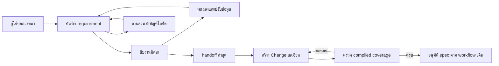

# Design

## Work type

feature

## Current state

Investigation v1 เก็บ problem facts hypotheses options decisions และ changeIntent โดยไม่มี requirement history คำถามเปิดถูกบังคับเป็นหลายทางเลือก Change ตรวจ source digest แต่ยังไม่มี requirement coverage ต้นทาง

## User flow

เก็บความต้องการระหว่างสืบและส่งต่อเข้า agreement



## Failure matrix

| Failure | User sees | Recovery |
|---|---|---|
| record อ้าง requirement ที่ไม่มีหรือทำบริบทเดิมหาย | รายการที่ agent ต้องซ่อมพร้อมเส้นทางทำต่อ | agent ซ่อม record โดยเก็บผลวิจัยที่ยังใช้ได้ |
| requirement เปลี่ยนหลังสร้าง handoff | ข้อค้นพบว่า handoff ล้าสมัย | agent สร้าง handoff จาก record ล่าสุด |
| compiled coverage ตกหล่น requirement สำคัญ | ID ต้นทางที่ยังไม่มีปลายทาง | agent ซ่อม semantic draft และ compile ใหม่ |

## File map

| Path | Change | Responsibility | Tasks |
|---|---|---|---|
| .claude/harness/runtime/workflow/ | change | พัฒนา schema ประวัติ revision persistence และ validation พร้อม regression | T001; T002; T003 |
| .claude/harness/tests/ | change | พัฒนา schema ประวัติ revision persistence และ validation พร้อม regression | T001; T002; T003; T005 |
| .claude/harness/protocol.json | change | พัฒนา schema ประวัติ revision persistence และ validation พร้อม regression | T001 |
| .claude/harness/runtime/version.mjs | change | พัฒนา schema ประวัติ revision persistence และ validation พร้อม regression | T001 |
| .claude/harness/foundation.mjs | change | พัฒนา schema ประวัติ revision persistence และ validation พร้อม regression | T001 |
| cli.sh | change | พัฒนา schema ประวัติ revision persistence และ validation พร้อม regression | T001 |
| .claude/harness/runtime/contracts/ | change | พัฒนารายงาน การส่งรายละเอียดสู่ Change และ compiled coverage พร้อม seam tests | T003 |
| .claude/skills/investigate/ | change | ปรับ skills commands canonical documentation อังกฤษไทย และ protocol compatibility checks | T004 |
| .claude/skills/change/ | change | ปรับ skills commands canonical documentation อังกฤษไทย และ protocol compatibility checks | T004 |
| .claude/commands/investigate.md | change | ปรับ skills commands canonical documentation อังกฤษไทย และ protocol compatibility checks | T004 |
| README.md | change | ปรับ skills commands canonical documentation อังกฤษไทย และ protocol compatibility checks | T004 |
| README.th.md | change | ปรับ skills commands canonical documentation อังกฤษไทย และ protocol compatibility checks | T004 |
| WORKFLOW.md | change | ปรับ skills commands canonical documentation อังกฤษไทย และ protocol compatibility checks | T004 |
| .claude/harness/README.md | change | ปรับ skills commands canonical documentation อังกฤษไทย และ protocol compatibility checks | T004 |
| .claude/tests/ | change | ปรับ skills commands canonical documentation อังกฤษไทย และ protocol compatibility checks | T004; T005 |

`+` add · `~` change · `-` remove

```text
.
├── .claude/
│   ├── commands/
│   │   └── ~ investigate.md
│   ├── harness/
│   │   ├── ~ foundation.mjs
│   │   ├── ~ protocol.json
│   │   ├── ~ README.md
│   │   ├── runtime/
│   │   │   ├── ~ contracts/
│   │   │   ├── ~ version.mjs
│   │   │   └── ~ workflow/
│   │   └── ~ tests/
│   ├── skills/
│   │   ├── ~ change/
│   │   └── ~ investigate/
│   └── ~ tests/
├── ~ cli.sh
├── ~ README.md
├── ~ README.th.md
└── ~ WORKFLOW.md
```

## Test map

| Scenario | Level | Check | Task |
|---|---|---|---|
| เก็บความต้องการและบทสนทนา; ขอบเขตของเก็บความต้องการและบทสนทนา; รายการสำคัญหาย; คำแก้ไขบางส่วน; ประวัติที่เข้าถึงไม่ได้; รองรับรุ่นเก่าและ shipping; ขอบเขตของรองรับรุ่นเก่าและ shipping; handoff รุ่นเดิม; workspace ไม่สด | task check | `node --test .claude/harness/tests/investigation-runtime.test.mjs` | T001 |
| สอบถามโดยทำงานต่อได้; ขอบเขตของสอบถามโดยทำงานต่อได้; คำถามปลายเปิด; งานอิสระระหว่างรอ; ยังไม่ได้ยอมรับ; ไม่ถามซ้ำ; ทดลองตาม requirement; ขอบเขตของทดลองตาม requirement; ผลทดลองเฉพาะส่วน; ข้อจำกัดต้นแบบ; ส่งต่อข้อมูลล่าสุด; ขอบเขตของส่งต่อข้อมูลล่าสุด; ไม่บังคับอนุมัติทุกข้อ; ข้อมูลล่าสุดเปลี่ยน | task check | `node --test .claude/harness/tests/investigation-runtime.test.mjs` | T002 |
| รายงานบริบทครบ; ขอบเขตของรายงานบริบทครบ; กู้รายงาน; เอกสาร Change ละเอียด; ขอบเขตของเอกสาร Change ละเอียด; รายละเอียดหลัง compile; ไม่เพิ่มเอกสารว่าง; ตรวจความครบใน packet; ขอบเขตของตรวจความครบใน packet; ปลายทางไม่มีอยู่จริง; coverage หลายต่อหลาย; coverage หลังแก้ agreement | task check | `node --test .claude/harness/tests/investigation-runtime.test.mjs .claude/harness/tests/semantic-draft.test.mjs` | T003 |
| เก็บความต้องการและบทสนทนา; ขอบเขตของเก็บความต้องการและบทสนทนา; รายการสำคัญหาย; คำแก้ไขบางส่วน; ประวัติที่เข้าถึงไม่ได้; สอบถามโดยทำงานต่อได้; ขอบเขตของสอบถามโดยทำงานต่อได้; คำถามปลายเปิด; งานอิสระระหว่างรอ; ยังไม่ได้ยอมรับ; ไม่ถามซ้ำ; ทดลองตาม requirement; ขอบเขตของทดลองตาม requirement; ผลทดลองเฉพาะส่วน; ข้อจำกัดต้นแบบ; ส่งต่อข้อมูลล่าสุด; ขอบเขตของส่งต่อข้อมูลล่าสุด; ไม่บังคับอนุมัติทุกข้อ; ข้อมูลล่าสุดเปลี่ยน; รายงานบริบทครบ; ขอบเขตของรายงานบริบทครบ; กู้รายงาน; เอกสาร Change ละเอียด; ขอบเขตของเอกสาร Change ละเอียด; รายละเอียดหลัง compile; ไม่เพิ่มเอกสารว่าง; ตรวจความครบใน packet; ขอบเขตของตรวจความครบใน packet; ปลายทางไม่มีอยู่จริง; coverage หลายต่อหลาย; coverage หลังแก้ agreement; รองรับรุ่นเก่าและ shipping; ขอบเขตของรองรับรุ่นเก่าและ shipping; handoff รุ่นเดิม; workspace ไม่สด | task check | `bash .claude/tests/docs/run-doc-consistency.sh` | T004 |
| เก็บความต้องการและบทสนทนา; ขอบเขตของเก็บความต้องการและบทสนทนา; รายการสำคัญหาย; คำแก้ไขบางส่วน; ประวัติที่เข้าถึงไม่ได้; สอบถามโดยทำงานต่อได้; ขอบเขตของสอบถามโดยทำงานต่อได้; คำถามปลายเปิด; งานอิสระระหว่างรอ; ยังไม่ได้ยอมรับ; ไม่ถามซ้ำ; ทดลองตาม requirement; ขอบเขตของทดลองตาม requirement; ผลทดลองเฉพาะส่วน; ข้อจำกัดต้นแบบ; ส่งต่อข้อมูลล่าสุด; ขอบเขตของส่งต่อข้อมูลล่าสุด; ไม่บังคับอนุมัติทุกข้อ; ข้อมูลล่าสุดเปลี่ยน; รายงานบริบทครบ; ขอบเขตของรายงานบริบทครบ; กู้รายงาน; เอกสาร Change ละเอียด; ขอบเขตของเอกสาร Change ละเอียด; รายละเอียดหลัง compile; ไม่เพิ่มเอกสารว่าง; ตรวจความครบใน packet; ขอบเขตของตรวจความครบใน packet; ปลายทางไม่มีอยู่จริง; coverage หลายต่อหลาย; coverage หลังแก้ agreement; รองรับรุ่นเก่าและ shipping; ขอบเขตของรองรับรุ่นเก่าและ shipping; handoff รุ่นเดิม; workspace ไม่สด | task check | `bash .claude/tests/run-all.sh` | T005 |

## Decisions

- **Decision ID:** DEC-001
  - **Status:** accepted
  - **Decision:** เพิ่ม investigation record รุ่นใหม่และ reader รองรับรุ่นเดิม โดยเก็บประวัติอยู่ใน record เดียว
  - **Why:** ข้อมูลที่ผู้ใช้บอกต้องอยู่ข้าม session และตามการแก้ไขได้ ใช้ requirements ที่มี ID/revision คงที่ conversation events อ้างรายการที่ได้รับผล และ supersedes/cancelled ที่มีเหตุผล Harness ตรวจเทียบ previous validated state กับ incoming record เพื่อคืน agent-owned repair เมื่อรายการหรือ event หาย ห้ามเติม user confirmation ให้ legacy records การเขียน machine state ต้องรักษาข้อมูลก่อนหน้าที่ใช้ได้เมื่อ incoming record invalid และไม่เอา state ที่ผิดเป็น baseline ใหม่
  - **Rejected:** none
  - **Consequences:** Not stated in the draft
- **Decision ID:** DEC-002
  - **Status:** accepted
  - **Decision:** แยก provenance ของเจตนาผู้ใช้ออกจาก source-grounded facts และเก็บ current view แยกจาก history ภายใน record เดียว
  - **Why:** conversation events เก็บผู้พูดข้อความต้นทางที่จำเป็นและ source reference ที่มีจริง requirement แต่ละข้อระบุ kind พฤติกรรม/constraint/example/exception/non-goal/success criterion และสถานะชัดเจน agent ต้องบันทึกหลังคำตอบหรือคำแก้ไขสำคัญก่อนใช้ข้อมูลสร้าง Change รายงานต้องแสดง history gaps แทนการอ้าง transcript ครบ ไม่บังคับให้เจตนาผู้ใช้มี repository fact รองรับ
  - **Rejected:** none
  - **Consequences:** Not stated in the draft
- **Decision ID:** DEC-003
  - **Status:** accepted
  - **Decision:** คำถามระบุ materiality และ dependent work พร้อม next action ที่เปิดเผย independent work
  - **Why:** คำถาม requirement ไม่ต้องมีสอง alternatives หรือ fact-backed recommendation คำถามที่ตอบแล้วต้องเชื่อมคำตอบใน conversation และไม่ถามซ้ำ unresolved material meaning ป้องกันการผูกเป็น agreement เฉพาะส่วนนั้น agent สืบหรือทดลองงานอิสระต่อได้ ปัญหา record/source/report เป็น agent หรือ harness repair ตามเจ้าของ ไม่ส่งให้ผู้ใช้เลือก technical recovery ห้าม requirement blanket-confirmation gate และห้ามปล่อย changeIntent ข้าม unresolved material questions ด้วย legacy explicit ready status ใน record ใหม่
  - **Rejected:** none
  - **Consequences:** Not stated in the draft
- **Decision ID:** DEC-004
  - **Status:** accepted
  - **Decision:** แต่ละ experiment ผูก requirement IDs/revisions และเก็บคำถาม assumption criteria result limitations
  - **Why:** เปลี่ยนเฉพาะ requirement ที่สัมพันธ์กับ experiment ต้องทำให้ผลที่ขึ้นกับ revision เก่าถูกระบุ needs-review ขณะที่ผลอื่นใช้ต่อได้ compare ยังรักษา 3–5 alternatives และ selection.md เดิม prototype artifacts อยู่ในพื้นที่เดิมและไม่ใช้เป็น proof การพร้อมส่งต่อขึ้นกับ unresolved material experimental questions ไม่ใช่การบังคับทำ PoC ทุกงาน
  - **Rejected:** none
  - **Consequences:** Not stated in the draft
- **Decision ID:** DEC-005
  - **Status:** accepted
  - **Decision:** handoff ผูก validated requirement revision/digest และ Change อ่านข้อมูลต้นทางจาก state ที่ตรวจ freshness แล้ว
  - **Why:** เก็บ coverage references ใน semantic draft/compiled packet เดิม ไม่สร้าง ledger แยก mapping รองรับหลายต่อหลาย ตรวจ source IDs และ target requirement/scenario/non-goal/design ที่มีอยู่จริง ข้อเสนอของ agent และ superseded/cancelled rows ไม่ถูกบังคับให้สร้าง task ถ้า latest requirement ไม่มี mapping หรือมี conflict คืน agent-owned repair หลัง compile ตรวจ rendered targets/content loss และให้ agent ตรวจความหมายโดยไม่อ้างว่า structural validation พิสูจน์ความถูกต้องทางภาษาได้ การ revise/amend ต้องรักษา mapping และไม่ทำให้ legacy compiled changes ต้อง migrate
  - **Rejected:** none
  - **Consequences:** Not stated in the draft
- **Decision ID:** DEC-006
  - **Status:** accepted
  - **Decision:** เอกสารละเอียดใช้ native draft fields และ compiled packet เดิม พร้อมการร้องขอระดับรายละเอียดที่ไม่เปลี่ยน assurance lane
  - **Why:** proposal ต้องรักษา why before/after scope nonGoals constraints specs ต้องมี outcomes examples exceptions scenarios success/failure/boundary design เมื่อจำเป็นต้องอธิบาย boundaries interfaces choices rejected alternatives experiment limitations recovery tasks ต้องมี outcome dependencies affected paths และ verify ตรวจ violation ได้ detail preference ห้ามเป็นข้ออ้างเติมหัวข้อว่าง filler หรือสร้าง design เมื่อไม่มีเหตุผล renderer และ context budgets ต้องรองรับข้อมูลครบโดยใช้ current view และตาม history เมื่อจำเป็น
  - **Rejected:** none
  - **Consequences:** Not stated in the draft
- **Decision ID:** DEC-007
  - **Status:** accepted
  - **Decision:** รักษา command syntax รุ่นเก่า การ binding workspace และ recoverable state โดยเปลี่ยน protocol pins ตาม wire contract จริง
  - **Why:** ใช้ version-dispatched readers/digest validation เพื่อให้ v1 bindings ที่ยัง valid ไม่ถูก reject เพียงเพราะ template ใหม่เปลี่ยนรุ่น ตรวจ v2 binding tamper stale record stale sources และ stale sandbox แยกกัน generated reports ยังไม่เป็น sources report failure รักษาวิจัยและไม่โฆษณา handoff เก่า rollback code ไม่ลบ records ใหม่ ต้องมี compatibility reader หรือ forward fix เมื่อย้อน schema ไม่ได้ Full suite และ upgrade coverage ต้องตรวจทั้ง legacy และ new records
  - **Rejected:** none
  - **Consequences:** Not stated in the draft

## Compatibility and migration

record state handoff รุ่นเดิมต้องอ่านได้โดยไม่ปลอมการยืนยันจากผู้ใช้ legacy compiled changes ไม่ต้อง migrate

## Risks

| Risk | Mitigation | Evidence owner |
|---|---|---|
| agent ไม่เห็น transcript บางช่วง | บันทึกหลัง semantic updates และก่อน handoff ระบุ gaps อย่างตรงไปตรงมา เก็บ reference เฉพาะที่เข้าถึงได้ | agent |
| record โตและเพิ่ม context cost | ใช้ current view ใน runtime outputs เก็บ history แต่เปิดอ่านเมื่อจำเป็น ตรวจ context budgets และ fixture การสนทนายาว | agent |
| schema ใหม่ทำให้ state เดิมหรือ history ที่ valid สูญหาย | อ่านตาม version รักษา previous validated baseline เมื่อ input ผิด ทดสอบ interrupted recovery และ upgrade ไม่เขียนทับ records เก่าแบบสูญข้อมูล | harness |
