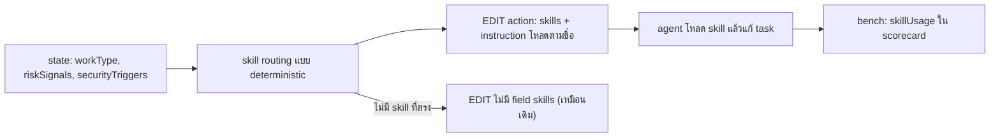

# Design

## Work type

feature

## Current state

buildAction() ใน advance-runtime.mjs สร้าง EDIT envelope ที่มี tasks, allowedPaths, verification, execution และ instructions; withContext() เพิ่ม contextFiles, newFiles, contextScope โดยมี changePath และ loadRuntime อยู่แล้ว ไม่มี mapping จาก workType หรือ riskSignals ไปยัง skill; workType ได้จาก changeWorkTypes(changePath) และ riskSignals/securityTriggers อยู่ใน state. run.mjs ของ bench นับ tool_use ใน hostToolCalls แต่ไม่แยกการโหลด skill และ scorecard schema ใช้ additionalProperties false. AGENT.md (300/300 คำ), build-policy.md (874/875) และ /dev bundle (1123/1125) เต็ม budget

## User flow

Build สั่งให้ agent โหลด skill ที่ตรงกับงานก่อนแก้ และ bench บันทึกว่าโหลดจริง



## Failure matrix

| Failure | User sees | Recovery | Covers |
|---|---|---|---|
| skill ที่ไม่มีในโปรเจกต์ถูกกรอง | skills ไม่มี debug-fundamentals และ action ยังทำงานต่อได้ | ไม่ต้องทำอะไร; agent แก้ task ต่อได้ตามปกติ | edit-action-skills |

## File map

| Path | Change | Responsibility | Tasks |
|---|---|---|---|
| .claude/harness/runtime/workflow/skill-routing.mjs | add | module mapping แบบ pure และ withContext เพิ่ม skills กับคำสั่งใน EDIT ของ Build พร้อม test ทุกแถว | T001 |
| .claude/harness/runtime/workflow/advance-runtime.mjs | change | module mapping แบบ pure และ withContext เพิ่ม skills กับคำสั่งใน EDIT ของ Build พร้อม test ทุกแถว | T001 |
| .claude/harness/foundation.mjs | change | module mapping แบบ pure และ withContext เพิ่ม skills กับคำสั่งใน EDIT ของ Build พร้อม test ทุกแถว | T001 |
| .claude/harness/tests/advance-runtime.test.mjs | change | module mapping แบบ pure และ withContext เพิ่ม skills กับคำสั่งใน EDIT ของ Build พร้อม test ทุกแถว | T001 |
| .claude/harness/tests/skill-routing.test.mjs | add | module mapping แบบ pure และ withContext เพิ่ม skills กับคำสั่งใน EDIT ของ Build พร้อม test ทุกแถว | T001 |
| .claude/tests/run-all.sh | change | module mapping แบบ pure และ withContext เพิ่ม skills กับคำสั่งใน EDIT ของ Build พร้อม test ทุกแถว | T001 |
| .claude/tests/README.md | change | module mapping แบบ pure และ withContext เพิ่ม skills กับคำสั่งใน EDIT ของ Build พร้อม test ทุกแถว | T001 |
| .claude/tests/affected-suite-selector.mjs | change | module mapping แบบ pure และ withContext เพิ่ม skills กับคำสั่งใน EDIT ของ Build พร้อม test ทุกแถว | T001 |
| WORKFLOW.md | change | module mapping แบบ pure และ withContext เพิ่ม skills กับคำสั่งใน EDIT ของ Build พร้อม test ทุกแถว | T001 |
| .claude/tests/bench/openspec-native/run.mjs | change | run.mjs และ scorecard.mjs บันทึก skillUsage และ schema รองรับ พร้อม test | T002 |
| .claude/tests/bench/openspec-native/scorecard.mjs | change | run.mjs และ scorecard.mjs บันทึก skillUsage และ schema รองรับ พร้อม test | T002 |
| .claude/tests/bench/config/openspec-native-scorecard.schema.json | change | run.mjs และ scorecard.mjs บันทึก skillUsage และ schema รองรับ พร้อม test | T002 |
| .claude/tests/bench/tests/openspec-native-runner.test.mjs | change | run.mjs และ scorecard.mjs บันทึก skillUsage และ schema รองรับ พร้อม test | T002 |
| .claude/tests/bench/tests/openspec-native-scorecard.test.mjs | change | run.mjs และ scorecard.mjs บันทึก skillUsage และ schema รองรับ พร้อม test | T002 |

`+` add · `~` change · `-` remove

```text
.
├── .claude/
│   ├── harness/
│   │   ├── ~ foundation.mjs
│   │   ├── runtime/
│   │   │   └── workflow/
│   │   │       ├── ~ advance-runtime.mjs
│   │   │       └── + skill-routing.mjs
│   │   └── tests/
│   │       ├── ~ advance-runtime.test.mjs
│   │       └── + skill-routing.test.mjs
│   └── tests/
│       ├── ~ affected-suite-selector.mjs
│       ├── bench/
│       │   ├── config/
│       │   │   └── ~ openspec-native-scorecard.schema.json
│       │   ├── openspec-native/
│       │   │   ├── ~ run.mjs
│       │   │   └── ~ scorecard.mjs
│       │   └── tests/
│       │       ├── ~ openspec-native-runner.test.mjs
│       │       └── ~ openspec-native-scorecard.test.mjs
│       ├── ~ README.md
│       └── ~ run-all.sh
└── ~ WORKFLOW.md
```

## Test map

| Scenario | Level | Check | Task |
|---|---|---|---|
| bugfix ได้ debug และ testing; performance-slo ได้ performance-investigation; access-control ได้ security; งานเอกสารไม่มี skill; cap 4; prose ไม่มีผล; skill ที่ไม่มีในโปรเจกต์ถูกกรอง | task check | `node --test .claude/harness/tests/skill-routing.test.mjs .claude/harness/tests/advance-runtime.test.mjs` | T001 |
| นับจาก stream; ไม่มี stream; scorecard เก่ายัง valid | task check | `node --test .claude/tests/bench/tests/openspec-native-runner.test.mjs .claude/tests/bench/tests/openspec-native-scorecard.test.mjs` | T002 |

## Decisions

- **Decision ID:** DEC-001
  - **Status:** accepted
  - **Decision:** คำสั่งใน EDIT action (field skills + instruction โหลดตามชื่อ)
  - **Why:** ผู้ใช้เลือก; หลักฐานจาก bench: agent ข้าม contextFiles แต่ทำตาม instructions ของ advance
  - **Rejected:** [object Object], [object Object]
  - **Consequences:** ได้ผลเมื่อ agent ทำตามคำสั่ง; วัดด้วย skillUsage ใน bench
  - **Decided by:** user
- **Decision ID:** DEC-002
  - **Status:** accepted
  - **Decision:** mapping คงที่จากแถว router ใน fundamentals.md ตาม details ของ edit-action-skills, cap 4, testing-fundamentals สำหรับงาน behavior, financial → queue-fundamentals
  - **Why:** ไม่มี skill เฉพาะสำหรับการเงิน; queue-fundamentals ถือ idempotency layer และ Principle 5 ลิงก์อยู่แล้ว
  - **Rejected:** none
  - **Consequences:** feature ทั่วไปได้แค่ testing-fundamentals; programming-fundamentals ไม่ถูกเพิ่มอัตโนมัติเพราะกว้างเกิน
  - **Decided by:** agent

## Compatibility and migration

field skills เป็น optional ใน EDIT envelope ของ protocol 6 และไม่ปรากฏเมื่อไม่มี skill ที่ตรง host เดิมที่ไม่รู้จัก field นี้ยังทำงานเหมือนเดิม คำสั่งเพิ่มเป็นบรรทัดหนึ่งใน instructions เดิม scorecard เพิ่ม skillUsage แบบ optional และ scorecard เดิมยัง validate ได้
