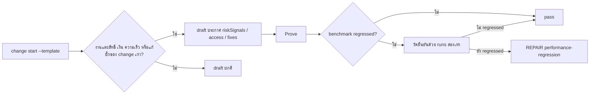

# Design

## Work type

feature

## Current state

rapidStartTemplate (change-lifecycle.mjs) คืน minimalDraft, minimalDraftCapability, minimalDraftDecisions และ semanticDraftTemplate โดยไม่มี riskSignals, access หรือ fixes; benchmark-runtime.mjs วัดครั้งเดียวแล้วคืน fail ทันทีเมื่อ regressionPercent เกิน threshold

## User flow

agent อ่าน template แล้วประกาศความเสี่ยงเอง และ benchmark ยืนยัน regression ก่อน repair



## Failure matrix

| Failure | User sees | Recovery | Covers |
|---|---|---|---|
| regression จริงได้ REPAIR | Prove คืน REPAIR stage performance-regression | agent แก้ product code แล้ว advance ต่อ | benchmark-confirms-regression |

## File map

| Path | Change | Responsibility | Tasks |
|---|---|---|---|
| .claude/harness/runtime/workflow/change-lifecycle.mjs | change | rapidStartTemplate เพิ่ม minimalDraftRiskSignals และ minimalDraftFixes | T001 |
| .claude/harness/tests/change-atomic-start.test.mjs | change | rapidStartTemplate เพิ่ม minimalDraftRiskSignals และ minimalDraftFixes | T001 |
| .claude/harness/runtime/evidence/benchmark-runtime.mjs | change | benchmark วัดยืนยันด้วย runs สองเท่าก่อนตัดสิน regression และเก็บ confirmation ใน receipt | T002 |
| .claude/harness/tests/benchmark-evidence.test.mjs | change | benchmark วัดยืนยันด้วย runs สองเท่าก่อนตัดสิน regression และเก็บ confirmation ใน receipt | T002 |
| .claude/harness/EVIDENCE.md | change | benchmark วัดยืนยันด้วย runs สองเท่าก่อนตัดสิน regression และเก็บ confirmation ใน receipt | T002 |

`+` add · `~` change · `-` remove

```text
.
└── .claude/
    └── harness/
        ├── ~ EVIDENCE.md
        ├── runtime/
        │   ├── evidence/
        │   │   └── ~ benchmark-runtime.mjs
        │   └── workflow/
        │       └── ~ change-lifecycle.mjs
        └── tests/
            ├── ~ benchmark-evidence.test.mjs
            └── ~ change-atomic-start.test.mjs
```

## Test map

| Scenario | Level | Check | Task |
|---|---|---|---|
| template มีคำแนะนำ riskSignals; template มีคำแนะนำ fixes; คำแนะนำไม่เปลี่ยน minimal draft | task check | `node --test .claude/harness/tests/change-atomic-start.test.mjs` | T001 |
| regression จริงได้ REPAIR; noise ครั้งเดียวผ่าน; ไม่ regressed ไม่วัดซ้ำ | task check | `node --test .claude/harness/tests/benchmark-evidence.test.mjs` | T002 |

## Decisions

- **Decision ID:** DEC-001
  - **Status:** accepted
  - **Decision:** แนวทาง (ข): ใส่คำแนะนำใน template แทนการให้ harness อ่าน prose
  - **Why:** ผู้ใช้เลือก (ข)
  - **Rejected:** [object Object]
  - **Consequences:** ได้ผลเฉพาะเมื่อ agent อ่านและทำตาม template ต้องยืนยันด้วย paid run
  - **Decided by:** user
- **Decision ID:** DEC-002
  - **Status:** accepted
  - **Decision:** วัดยืนยันหนึ่งครั้งด้วย runs สองเท่า และตัดสินจากการวัดยืนยัน
  - **Why:** กัน noise โดยไม่ต้องถาม user และจำกัดต้นทุนไว้ที่ 2x ของการวัดแรก
  - **Rejected:** none
  - **Consequences:** regression จริงใช้เวลาวัดมากขึ้นราวสามเท่าของเดิม
  - **Decided by:** agent

## Compatibility and migration

เพิ่ม key คำแนะนำใน template output เท่านั้น draft และ change เดิมไม่ได้รับผลกระทบ benchmark receipt เพิ่ม field confirmation เมื่อมีการวัดยืนยัน ส่วน receipt ที่ไม่ regressed เหมือนเดิม
