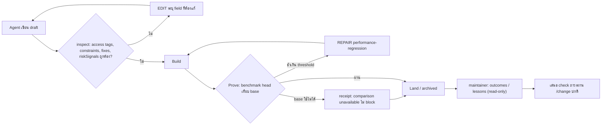
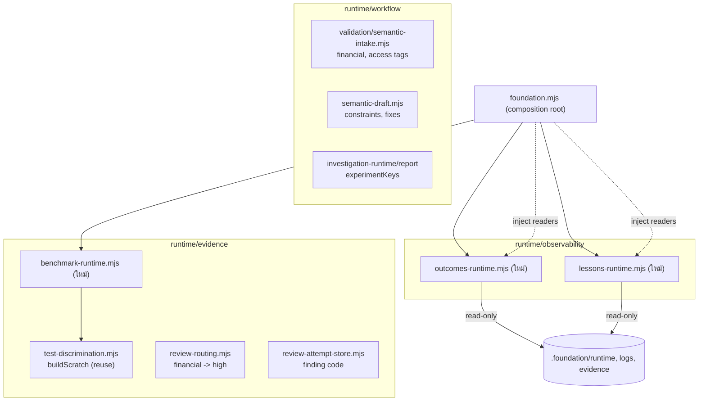
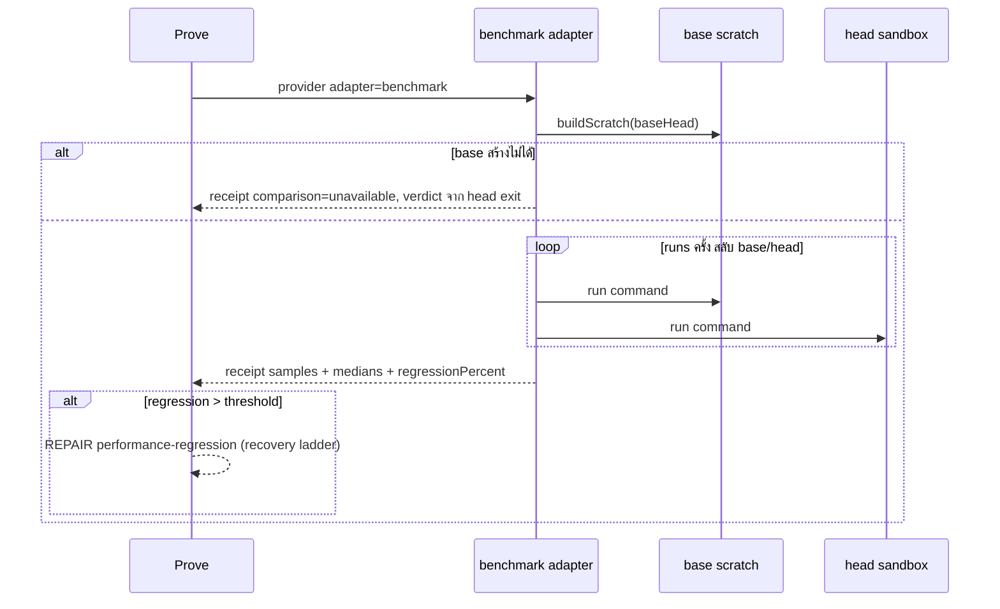

# Design

## Work type

feature

## Current state

provider-catalog.mjs มี contract performance แต่ไม่มี adapter เฉพาะ จึงรันเป็น command adapter ที่ผ่าน/ไม่ผ่านตาม exit code; test-discrimination.mjs รันคำสั่ง test บน base เพียงครั้งเดียวเพื่อตรวจ tests-not-discriminating. RISK_SIGNAL_DIMENSIONS ใน semantic-intake.mjs ไม่มี financial และ review-routing.mjs ยก tier จากคำว่า money/payment เฉพาะเมื่อมี declared review risk. access-control ต้องมีแค่ coverage row ของ permission-rejection และ scenario ไม่มี field typed สำหรับ allow/deny. metrics/feedback อ่านทีละ change; review finding ไม่มี code (99 findings บนดิสก์ ไม่มี code เลย) ขณะที่ blocker rows มี code ตาม BLOCKER_KINDS. ไม่มีข้อมูลเชื่อม change หลังกับ change ที่ archive แล้ว. investigation hypothesis ไม่อ้าง experiment และ draft v4 ไม่มี field constraints (field ที่ไม่รู้จักถูกส่งผ่านแบบเงียบ)

## User flow

เส้นทางของ agent ตั้งแต่ draft ถึง proof และ maintainer ที่อ่าน rollup ข้าม change รวมทางที่ไม่ผ่าน



## Failure matrix

| Failure | User sees | Recovery | Covers |
|---|---|---|---|
| head ช้าเกิน threshold | Prove คืน REPAIR stage performance-regression พร้อม finding ที่ระบุ provider, baseMedianMs, headMedianMs และ regressionPercent | agent แก้ product code แล้ว advance ต่อ; ถ้าซ้ำโดยไม่มี progress จะเข้า recovery ladder เดิม (TRY_ALTERNATE_APPROACH แล้ว no-progress decision) | benchmark-base-head-comparison |
| base ใช้ไม่ได้ไม่ block | receipt บันทึก comparison unavailable พร้อม reason และตัดสินจาก exit code ของ head เท่านั้น | ไม่ต้องทำอะไร; Prove ดำเนินต่อและ receipt แสดงว่ายังไม่มีการเทียบ | benchmark-base-head-comparison |
| head run ล้มเหลว | Prove คืน REPAIR stage evidence-failed เหมือน provider ทั่วไป | agent แก้แล้ว advance ต่อ | benchmark-base-head-comparison |
| runs ต่ำกว่าขั้นต่ำ | intake คืน EDIT ระบุว่า runs ต้องไม่น้อยกว่า 3 | agent แก้ค่าใน draft แล้ว rerun | benchmark-base-head-comparison |
| ขาด allow | intake คืน EDIT ข้อความระบุว่าต้องมี scenario access allow อย่างน้อยหนึ่ง | agent เพิ่ม scenario allow แล้ว rerun | access-control-allow-deny |
| ขาด deny | intake คืน EDIT ข้อความระบุว่าต้องมี scenario access deny อย่างน้อยหนึ่ง | agent เพิ่ม scenario deny แล้ว rerun | access-control-allow-deny |
| ค่า access ไม่รู้จัก | intake คืน EDIT ระบุว่า access ต้องเป็น allow หรือ deny | agent แก้ค่าแล้ว rerun | access-control-allow-deny |
| signal ไม่รู้จักยังถูกปฏิเสธ | intake คืน EDIT ที่ list known signals รวม financial | agent เปลี่ยนเป็น financial แล้ว rerun | financial-risk-signal |
| ชนิดผิด | intake คืน EDIT ระบุ field constraints | agent แก้เป็น array ของข้อความแล้ว rerun | draft-constraints |
| coverage อ้าง constraint ที่ไม่มี | intake คืน EDIT invalid target | agent แก้ key หรือเพิ่ม constraint แล้ว rerun | draft-constraints |
| อ้าง change ที่ไม่มี | intake คืน EDIT ระบุ fixes zzz ไม่ใช่ change ที่ archive แล้ว | agent แก้ id หรือลบออกแล้ว rerun | draft-fixes-link |
| state เสียหนึ่งตัว | change นั้นอยู่ใน skipped พร้อม reason และ change อื่นยังถูกสรุป | ไม่ต้องทำอะไร; รายงานยังใช้ได้และบอกว่าข้ามอะไร | outcomes-rollup |
| min-changes ผิด | exit ไม่ใช่ 0 พร้อมข้อความว่า min-changes ต้องเป็นจำนวนเต็มอย่างน้อย 2 | เรียกใหม่ด้วยค่าที่ถูก | lessons-rollup |
| code ผิดรูปแบบไม่ block | attempt ถูกบันทึกและ finding ไม่มี code | ไม่ต้องทำอะไร; finding นับเป็น uncoded | review-finding-code |
| อ้าง experiment ที่ไม่มี | คืน EDIT repair-record ระบุ hypothesis และ key ที่ไม่มี | agent แก้ key หรือเพิ่ม experiment แล้ว rerun | hypothesis-next-check |
| อ้าง experiment ที่ถูก supersede | คืน EDIT repair-record ให้อ้าง e2 | agent เปลี่ยนเป็น e2 แล้ว rerun | hypothesis-next-check |

## File map

| Path | Change | Responsibility | Tasks |
|---|---|---|---|
| .claude/harness/runtime/evidence/benchmark-runtime.mjs | add | adapter benchmark สลับรัน base/head, บันทึก samples/median/regression ใน receipt, คืน REPAIR performance-regression ผ่าน convergent repair และ base unavailable ไม่ block | T001 |
| .claude/harness/runtime/evidence/provider-catalog.mjs | change | adapter benchmark สลับรัน base/head, บันทึก samples/median/regression ใน receipt, คืน REPAIR performance-regression ผ่าน convergent repair และ base unavailable ไม่ block | T001 |
| .claude/harness/runtime/evidence/adapter-runtime.mjs | change | adapter benchmark สลับรัน base/head, บันทึก samples/median/regression ใน receipt, คืน REPAIR performance-regression ผ่าน convergent repair และ base unavailable ไม่ block | T001 |
| .claude/harness/runtime/evidence/test-discrimination.mjs | change | adapter benchmark สลับรัน base/head, บันทึก samples/median/regression ใน receipt, คืน REPAIR performance-regression ผ่าน convergent repair และ base unavailable ไม่ block | T001 |
| .claude/harness/runtime/evidence/receipt-runtime.mjs | change | adapter benchmark สลับรัน base/head, บันทึก samples/median/regression ใน receipt, คืน REPAIR performance-regression ผ่าน convergent repair และ base unavailable ไม่ block | T001 |
| .claude/harness/runtime/evidence/proof-execution-runtime.mjs | change | adapter benchmark สลับรัน base/head, บันทึก samples/median/regression ใน receipt, คืน REPAIR performance-regression ผ่าน convergent repair และ base unavailable ไม่ block | T001 |
| .claude/harness/runtime/workflow/semantic-draft.mjs | change | adapter benchmark สลับรัน base/head, บันทึก samples/median/regression ใน receipt, คืน REPAIR performance-regression ผ่าน convergent repair และ base unavailable ไม่ block | T001; T002; T004 |
| .claude/harness/foundation.mjs | change | adapter benchmark สลับรัน base/head, บันทึก samples/median/regression ใน receipt, คืน REPAIR performance-regression ผ่าน convergent repair และ base unavailable ไม่ block | T001; T006 |
| .claude/harness/tests/benchmark-evidence.test.mjs | add | adapter benchmark สลับรัน base/head, บันทึก samples/median/regression ใน receipt, คืน REPAIR performance-regression ผ่าน convergent repair และ base unavailable ไม่ block | T001 |
| .claude/tests/run-all.sh | change | adapter benchmark สลับรัน base/head, บันทึก samples/median/regression ใน receipt, คืน REPAIR performance-regression ผ่าน convergent repair และ base unavailable ไม่ block | T001; T006 |
| .claude/tests/README.md | change | adapter benchmark สลับรัน base/head, บันทึก samples/median/regression ใน receipt, คืน REPAIR performance-regression ผ่าน convergent repair และ base unavailable ไม่ block | T001; T006 |
| .claude/tests/harness/affected-suite-selector.mjs | add | adapter benchmark สลับรัน base/head, บันทึก samples/median/regression ใน receipt, คืน REPAIR performance-regression ผ่าน convergent repair และ base unavailable ไม่ block | T001; T006 |
| .claude/harness/runtime/workflow/validation/semantic-intake.mjs | change | scenario access allow\|deny ถูก validate, บังคับคู่เมื่อมี access-control และ derive coverage permission-rejection | T002; T003 |
| .claude/harness/runtime/workflow/validation/derived-coverage.mjs | change | scenario access allow\|deny ถูก validate, บังคับคู่เมื่อมี access-control และ derive coverage permission-rejection | T002 |
| .claude/harness/tests/semantic-intake.test.mjs | change | scenario access allow\|deny ถูก validate, บังคับคู่เมื่อมี access-control และ derive coverage permission-rejection | T002; T003 |
| .claude/harness/runtime/workflow/validation/semantic-intake-intelligence.mjs | change | riskSignals financial map dimensions, มี risk weight และเลือก review tier high | T003 |
| .claude/harness/runtime/evidence/review-routing.mjs | change | riskSignals financial map dimensions, มี risk weight และเลือก review tier high | T003 |
| .claude/harness/tests/review-policy.test.mjs | change | riskSignals financial map dimensions, มี risk weight และเลือก review tier high | T003 |
| .claude/harness/runtime/workflow/change-lifecycle.mjs | change | draft v4 รับ constraints และ fixes, validate, persist, render ใน proposal และ coverage target constraint | T004 |
| .claude/harness/runtime/workflow/semantic-amendment.mjs | change | draft v4 รับ constraints และ fixes, validate, persist, render ใน proposal และ coverage target constraint | T004 |
| .claude/harness/runtime/workflow/validation/packet-overview.mjs | change | draft v4 รับ constraints และ fixes, validate, persist, render ใน proposal และ coverage target constraint | T004 |
| .claude/harness/runtime/workflow/validation/investigation-coverage.mjs | change | draft v4 รับ constraints และ fixes, validate, persist, render ใน proposal และ coverage target constraint | T004 |
| .claude/harness/tests/semantic-draft.test.mjs | change | draft v4 รับ constraints และ fixes, validate, persist, render ใน proposal และ coverage target constraint | T004 |
| .claude/harness/runtime/evidence/review-attempt-store.mjs | change | review-attempt-store เก็บ finding code ที่ถูกรูปแบบและทิ้ง code ผิดรูปแบบโดยไม่ปฏิเสธ attempt | T005 |
| .claude/harness/tests/review-repair-attempt.test.mjs | change | review-attempt-store เก็บ finding code ที่ถูกรูปแบบและทิ้ง code ผิดรูปแบบโดยไม่ปฏิเสธ attempt | T005 |
| .claude/harness/runtime/observability/outcomes-runtime.mjs | add | คำสั่ง read-only outcomes และ lessons ใน runtime/observability, ลงทะเบียน CLI, inject reader ผ่าน composition root และไม่เขียน store | T006 |
| .claude/harness/runtime/observability/lessons-runtime.mjs | add | คำสั่ง read-only outcomes และ lessons ใน runtime/observability, ลงทะเบียน CLI, inject reader ผ่าน composition root และไม่เขียน store | T006 |
| .claude/harness/runtime/core/cli-router.mjs | change | คำสั่ง read-only outcomes และ lessons ใน runtime/observability, ลงทะเบียน CLI, inject reader ผ่าน composition root และไม่เขียน store | T006 |
| .claude/harness/commands.json | change | คำสั่ง read-only outcomes และ lessons ใน runtime/observability, ลงทะเบียน CLI, inject reader ผ่าน composition root และไม่เขียน store | T006 |
| .claude/harness/cli.sh | add | คำสั่ง read-only outcomes และ lessons ใน runtime/observability, ลงทะเบียน CLI, inject reader ผ่าน composition root และไม่เขียน store | T006 |
| .claude/harness/fixtures/public-command-contract-v1.json | change | คำสั่ง read-only outcomes และ lessons ใน runtime/observability, ลงทะเบียน CLI, inject reader ผ่าน composition root และไม่เขียน store | T006 |
| .claude/harness/tests/outcomes-lessons.test.mjs | add | คำสั่ง read-only outcomes และ lessons ใน runtime/observability, ลงทะเบียน CLI, inject reader ผ่าน composition root และไม่เขียน store | T006 |
| .claude/harness/tests/command-registry.test.mjs | change | คำสั่ง read-only outcomes และ lessons ใน runtime/observability, ลงทะเบียน CLI, inject reader ผ่าน composition root และไม่เขียน store | T006 |
| .claude/harness/tests/public-command-golden.test.mjs | change | คำสั่ง read-only outcomes และ lessons ใน runtime/observability, ลงทะเบียน CLI, inject reader ผ่าน composition root และไม่เขียน store | T006 |
| .claude/harness/runtime/workflow/investigation-runtime.mjs | change | investigation hypothesis รับ experimentKeys, validate อ้างอิง และรายงานแสดง next check ทั้งไทยและอังกฤษ | T007 |
| .claude/harness/runtime/workflow/investigation-report.mjs | change | investigation hypothesis รับ experimentKeys, validate อ้างอิง และรายงานแสดง next check ทั้งไทยและอังกฤษ | T007 |
| .claude/harness/tests/investigation-runtime.test.mjs | change | investigation hypothesis รับ experimentKeys, validate อ้างอิง และรายงานแสดง next check ทั้งไทยและอังกฤษ | T007 |
| WORKFLOW.md | change | เอกสาร canonical และ mirror ไทย/อังกฤษอธิบาย benchmark adapter, access tag, financial, constraints, fixes, finding code, experimentKeys, outcomes และ lessons | T008 |
| .claude/harness/README.md | change | เอกสาร canonical และ mirror ไทย/อังกฤษอธิบาย benchmark adapter, access tag, financial, constraints, fixes, finding code, experimentKeys, outcomes และ lessons | T008 |
| .claude/harness/EVIDENCE.md | change | เอกสาร canonical และ mirror ไทย/อังกฤษอธิบาย benchmark adapter, access tag, financial, constraints, fixes, finding code, experimentKeys, outcomes และ lessons | T008 |
| .claude/skills/change/references/semantic-intake.md | change | เอกสาร canonical และ mirror ไทย/อังกฤษอธิบาย benchmark adapter, access tag, financial, constraints, fixes, finding code, experimentKeys, outcomes และ lessons | T008 |
| .claude/skills/change/references/workflow.md | change | เอกสาร canonical และ mirror ไทย/อังกฤษอธิบาย benchmark adapter, access tag, financial, constraints, fixes, finding code, experimentKeys, outcomes และ lessons | T008 |
| .claude/skills/investigate/references/workflow.md | change | เอกสาร canonical และ mirror ไทย/อังกฤษอธิบาย benchmark adapter, access tag, financial, constraints, fixes, finding code, experimentKeys, outcomes และ lessons | T008 |
| README.md | change | เอกสาร canonical และ mirror ไทย/อังกฤษอธิบาย benchmark adapter, access tag, financial, constraints, fixes, finding code, experimentKeys, outcomes และ lessons | T008 |
| README.th.md | change | เอกสาร canonical และ mirror ไทย/อังกฤษอธิบาย benchmark adapter, access tag, financial, constraints, fixes, finding code, experimentKeys, outcomes และ lessons | T008 |
| website/docs/src/content/docs/loop/change.md | change | เอกสาร canonical และ mirror ไทย/อังกฤษอธิบาย benchmark adapter, access tag, financial, constraints, fixes, finding code, experimentKeys, outcomes และ lessons | T008 |
| website/docs/src/content/docs/th/loop/change.md | change | เอกสาร canonical และ mirror ไทย/อังกฤษอธิบาย benchmark adapter, access tag, financial, constraints, fixes, finding code, experimentKeys, outcomes และ lessons | T008 |
| website/docs/src/content/docs/loop/investigate.md | change | เอกสาร canonical และ mirror ไทย/อังกฤษอธิบาย benchmark adapter, access tag, financial, constraints, fixes, finding code, experimentKeys, outcomes และ lessons | T008 |
| website/docs/src/content/docs/th/loop/investigate.md | change | เอกสาร canonical และ mirror ไทย/อังกฤษอธิบาย benchmark adapter, access tag, financial, constraints, fixes, finding code, experimentKeys, outcomes และ lessons | T008 |

`+` add · `~` change · `-` remove

```text
.
├── .claude/
│   ├── harness/
│   │   ├── + cli.sh
│   │   ├── ~ commands.json
│   │   ├── ~ EVIDENCE.md
│   │   ├── fixtures/
│   │   │   └── ~ public-command-contract-v1.json
│   │   ├── ~ foundation.mjs
│   │   ├── ~ README.md
│   │   ├── runtime/
│   │   │   ├── core/
│   │   │   │   └── ~ cli-router.mjs
│   │   │   ├── evidence/
│   │   │   │   ├── ~ adapter-runtime.mjs
│   │   │   │   ├── + benchmark-runtime.mjs
│   │   │   │   ├── ~ proof-execution-runtime.mjs
│   │   │   │   ├── ~ provider-catalog.mjs
│   │   │   │   ├── ~ receipt-runtime.mjs
│   │   │   │   ├── ~ review-attempt-store.mjs
│   │   │   │   ├── ~ review-routing.mjs
│   │   │   │   └── ~ test-discrimination.mjs
│   │   │   ├── observability/
│   │   │   │   ├── + lessons-runtime.mjs
│   │   │   │   └── + outcomes-runtime.mjs
│   │   │   └── workflow/
│   │   │       ├── ~ change-lifecycle.mjs
│   │   │       ├── ~ investigation-report.mjs
│   │   │       ├── ~ investigation-runtime.mjs
│   │   │       ├── ~ semantic-amendment.mjs
│   │   │       ├── ~ semantic-draft.mjs
│   │   │       └── validation/
│   │   │           ├── ~ derived-coverage.mjs
│   │   │           ├── ~ investigation-coverage.mjs
│   │   │           ├── ~ packet-overview.mjs
│   │   │           ├── ~ semantic-intake-intelligence.mjs
│   │   │           └── ~ semantic-intake.mjs
│   │   └── tests/
│   │       ├── + benchmark-evidence.test.mjs
│   │       ├── ~ command-registry.test.mjs
│   │       ├── ~ investigation-runtime.test.mjs
│   │       ├── + outcomes-lessons.test.mjs
│   │       ├── ~ public-command-golden.test.mjs
│   │       ├── ~ review-policy.test.mjs
│   │       ├── ~ review-repair-attempt.test.mjs
│   │       ├── ~ semantic-draft.test.mjs
│   │       └── ~ semantic-intake.test.mjs
│   ├── skills/
│   │   ├── change/
│   │   │   └── references/
│   │   │       ├── ~ semantic-intake.md
│   │   │       └── ~ workflow.md
│   │   └── investigate/
│   │       └── references/
│   │           └── ~ workflow.md
│   └── tests/
│       ├── harness/
│       │   └── + affected-suite-selector.mjs
│       ├── ~ README.md
│       └── ~ run-all.sh
├── ~ README.md
├── ~ README.th.md
├── website/
│   └── docs/
│       └── src/
│           └── content/
│               └── docs/
│                   ├── loop/
│                   │   ├── ~ change.md
│                   │   └── ~ investigate.md
│                   └── th/
│                       └── loop/
│                           ├── ~ change.md
│                           └── ~ investigate.md
└── ~ WORKFLOW.md
```

## Test map

| Scenario | Level | Check | Task |
|---|---|---|---|
| head ไม่ช้ากว่า threshold; head ช้าเกิน threshold; ช้าเท่า threshold พอดี; threshold ที่ผู้เขียนกำหนด; base ใช้ไม่ได้ไม่ block; head run ล้มเหลว; runs ต่ำกว่าขั้นต่ำ | task check | `node --test .claude/harness/tests/benchmark-evidence.test.mjs` | T001 |
| มีทั้ง allow และ deny; ขาด allow; ขาด deny; ค่า access ไม่รู้จัก; ไม่มี signal ไม่บังคับ | task check | `node --test .claude/harness/tests/semantic-intake.test.mjs` | T002 |
| financial ได้ dimensions; ภาษาไม่เปลี่ยนผล; signal ไม่รู้จักยังถูกปฏิเสธ; financial ได้ high; ไม่มี signal คงพฤติกรรมเดิม | task check | `node --test .claude/harness/tests/semantic-intake.test.mjs .claude/harness/tests/review-policy.test.mjs` | T003 |
| render constraints; ไม่มี constraints; ชนิดผิด; coverage ไปยัง constraint; coverage อ้าง constraint ที่ไม่มี; อ้าง change ที่ archive แล้ว; อ้าง change ที่ไม่มี; ไม่มี fixes | task check | `node --test .claude/harness/tests/semantic-draft.test.mjs` | T004 |
| code ถูกเก็บ; code ผิดรูปแบบไม่ block; ไม่มี code | task check | `node --test .claude/harness/tests/review-repair-attempt.test.mjs` | T005 |
| สรุป change ที่ archive; ค่าที่ไม่รู้เป็น null; escaped defect จาก fixes; ไม่เขียน state; ไม่มีประวัติ; state เสียหนึ่งตัว; code เกิดซ้ำ; ต่ำกว่าเกณฑ์; uncoded แยกรายงาน; min-changes ผิด | task check | `node --test .claude/harness/tests/outcomes-lessons.test.mjs .claude/harness/tests/command-registry.test.mjs .claude/harness/tests/public-command-golden.test.mjs` | T006 |
| แสดง next check; ไม่มี next check; อ้าง experiment ที่ไม่มี; อ้าง experiment ที่ถูก supersede | task check | `node --test .claude/harness/tests/investigation-runtime.test.mjs` | T007 |
| head ไม่ช้ากว่า threshold; head ช้าเกิน threshold; ช้าเท่า threshold พอดี; threshold ที่ผู้เขียนกำหนด; base ใช้ไม่ได้ไม่ block; head run ล้มเหลว; runs ต่ำกว่าขั้นต่ำ; มีทั้ง allow และ deny; ขาด allow; ขาด deny; ค่า access ไม่รู้จัก; ไม่มี signal ไม่บังคับ; financial ได้ dimensions; ภาษาไม่เปลี่ยนผล; signal ไม่รู้จักยังถูกปฏิเสธ; render constraints; ไม่มี constraints; ชนิดผิด; coverage ไปยัง constraint; coverage อ้าง constraint ที่ไม่มี; อ้าง change ที่ archive แล้ว; อ้าง change ที่ไม่มี; ไม่มี fixes; สรุป change ที่ archive; ค่าที่ไม่รู้เป็น null; escaped defect จาก fixes; ไม่เขียน state; ไม่มีประวัติ; state เสียหนึ่งตัว; code เกิดซ้ำ; ต่ำกว่าเกณฑ์; uncoded แยกรายงาน; min-changes ผิด; แสดง next check; ไม่มี next check; อ้าง experiment ที่ไม่มี; อ้าง experiment ที่ถูก supersede | task check | `sh .claude/tests/docs/run-doc-consistency.sh` | T008 |

## Decisions

- **Decision ID:** DEC-001
  - **Status:** accepted
  - **Decision:** ข้อจำกัดการ implement: (1) ไม่เปลี่ยน protocol.json, semanticDraftSchema 4, investigationStateSchema 2 หรือ runtime API pin ทั้งสี่ เพราะทุก field ใหม่ optional; (2) module ใหม่ใน runtime/observability import ได้เฉพาะ contracts, core, observability และรับ reader จาก workflow/evidence ผ่าน foundation.mjs; (3) outcomes/lessons ห้ามเรียก syncClaudeTelemetry หรือ path ที่เขียน telemetry; (4) ห้ามสแกน prose หา keyword เพื่อตัดสิน risk หรือ allow/deny; (5) ค่าที่ไม่รู้เป็น null พร้อม availability/reason ไม่ใช่ 0
  - **Why:** field constraints ยังไม่มีใน compiler ปัจจุบัน (เป็นสิ่งที่ change นี้เพิ่ม) จึงบันทึกเป็น design decision เพื่อไม่ให้หลุดจาก packet
  - **Rejected:** none
  - **Consequences:** Build และ review ใช้ข้อจำกัดนี้เป็นเกณฑ์; architecture/wiring checks บังคับข้อ 2
  - **Decided by:** agent
- **Decision ID:** DEC-002
  - **Status:** accepted
  - **Decision:** ทำทั้ง 4 กลุ่มใน change เดียว
  - **Why:** ผู้ใช้เลือกใน /change
  - **Rejected:** none
  - **Consequences:** review/prove รอบเดียว; task แยก verify ให้ harness แบ่ง budget
  - **Decided by:** user
- **Decision ID:** DEC-003
  - **Status:** accepted
  - **Decision:** field fixes ใน draft (declared-only)
  - **Why:** ผู้ใช้เลือก แม่นยำและไม่เดา
  - **Rejected:** [object Object], [object Object]
  - **Consequences:** change เก่าก่อน field นี้ไม่มีข้อมูล จึงรายงาน availability declared-only
  - **Decided by:** user
- **Decision ID:** DEC-004
  - **Status:** accepted
  - **Decision:** typed tag access allow|deny และ EDIT เมื่อขาด
  - **Why:** ผู้ใช้เลือก; prose ไม่ถูกสแกนตามหลักเดิม
  - **Rejected:** [object Object]
  - **Consequences:** draft ใหม่ที่มี access-control ต้องเพิ่ม tag; agent แก้เองได้
  - **Decided by:** user
- **Decision ID:** DEC-005
  - **Status:** accepted
  - **Decision:** ค่าเริ่มต้น median ช้าลงไม่เกิน 10% กับอย่างน้อย 5 รอบสลับ
  - **Why:** ผู้ใช้เลือก
  - **Rejected:** [object Object], [object Object]
  - **Consequences:** regression เกิน threshold ได้ REPAIR ปกติ; base ใช้ไม่ได้ไม่ block
  - **Decided by:** user
- **Decision ID:** DEC-006
  - **Status:** accepted
  - **Decision:** คำสั่งใหม่ outcomes และ lessons แทนการเพิ่ม flag ให้ metrics
  - **Why:** metrics <change> เป็น compatibility contract และเขียน telemetry; คำสั่งใหม่ read-only แยกชัด
  - **Rejected:** none
  - **Consequences:** golden fixture เพิ่มจาก 73 เป็น 75
  - **Decided by:** agent
- **Decision ID:** DEC-007
  - **Status:** accepted
  - **Decision:** recurring เมื่อเกิดใน change ต่างกันอย่างน้อย 3 (ปรับด้วย --min-changes ขั้นต่ำ 2)
  - **Why:** ลด noise ตามหลัก lean-checks
  - **Rejected:** none
  - **Consequences:** ปัญหาที่เกิดสองครั้งยังไม่ขึ้นเป็น lesson เว้นแต่ลด --min-changes เป็น 2
  - **Decided by:** agent
- **Decision ID:** DEC-008
  - **Status:** accepted
  - **Decision:** code ผิดรูปแบบถูกทิ้งแทนการปฏิเสธ attempt
  - **Why:** ตามข้อกำหนด never-block ไม่ให้ review ติดเพราะ metadata
  - **Rejected:** none
  - **Consequences:** finding ที่ code ผิดรูปแบบนับเป็น uncoded และไม่เข้า lessons
  - **Decided by:** agent

## Compatibility and migration

ชื่อคำสั่งและอาร์กิวเมนต์เดิมทั้งหมดคงเดิม; เพิ่มคำสั่ง read-only ใหม่ outcomes และ lessons. field ใหม่ทุกตัว optional: draft v4 เดิม (ไม่มี constraints, fixes, access) และ investigation record v1/v2 เดิม (ไม่มี experimentKeys) compile และ validate เหมือนเดิม ยกเว้น draft ที่ประกาศ riskSignals access-control ใหม่ต้องมี access tag. change ที่ start ไปแล้วไม่ถูก revalidate ย้อนหลัง. provider adapter command เดิมของ performance ยังทำงานเหมือนเดิม; benchmark เป็น adapter ใหม่ที่ต้องเลือกเอง. review finding เก่าที่ไม่มี code นับเป็น uncoded

## Diagrams

### ขอบเขต component ที่เปลี่ยน

แสดง module ใหม่และที่แก้ในแต่ละ domain และการ inject reader ผ่าน composition root



### ลำดับการเทียบ performance

แสดงลำดับสลับรัน base/head และทาง failure/recovery ของ benchmark


