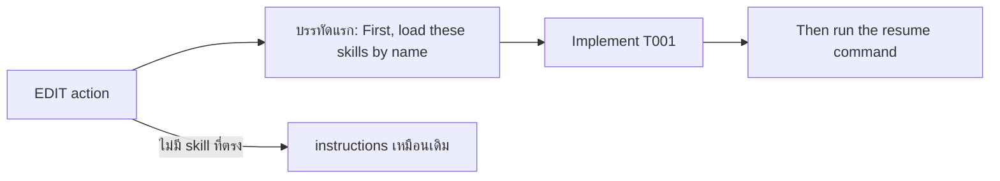

# Design

## Work type

feature

## Current state

advance-runtime.mjs เพิ่มคำสั่ง Before implementing, load these skills by name เป็นบรรทัดสุดท้ายของ instructions; skill-routing.mjs ส่ง access-control, input-domain และ securityTriggers ไปที่ security-fundamentals

## User flow

agent อ่านคำสั่งโหลด skill ก่อนคำสั่งให้ลงมือแก้



## Failure matrix

| Failure | User sees | Recovery | Covers |
|---|---|---|---|
| skill ที่ไม่มีในโปรเจกต์ถูกกรอง | skills ไม่มี debug-fundamentals และ action ยังทำงานต่อได้ | ไม่ต้องทำอะไร; agent แก้ task ต่อได้ตามปกติ | edit-action-skills |

## File map

| Path | Change | Responsibility | Tasks |
|---|---|---|---|
| .claude/harness/runtime/workflow/skill-routing.mjs | change | คำสั่งโหลด skill เป็นบรรทัดแรกด้วยถ้อยคำ First, และ input-domain ส่ง testing-fundamentals พร้อม test | T001 |
| .claude/harness/runtime/workflow/advance-runtime.mjs | change | คำสั่งโหลด skill เป็นบรรทัดแรกด้วยถ้อยคำ First, และ input-domain ส่ง testing-fundamentals พร้อม test | T001 |
| .claude/harness/tests/skill-routing.test.mjs | change | คำสั่งโหลด skill เป็นบรรทัดแรกด้วยถ้อยคำ First, และ input-domain ส่ง testing-fundamentals พร้อม test | T001 |
| .claude/harness/tests/advance-runtime.test.mjs | change | คำสั่งโหลด skill เป็นบรรทัดแรกด้วยถ้อยคำ First, และ input-domain ส่ง testing-fundamentals พร้อม test | T001 |
| WORKFLOW.md | change | คำสั่งโหลด skill เป็นบรรทัดแรกด้วยถ้อยคำ First, และ input-domain ส่ง testing-fundamentals พร้อม test | T001 |

`+` add · `~` change · `-` remove

```text
.
├── .claude/
│   └── harness/
│       ├── runtime/
│       │   └── workflow/
│       │       ├── ~ advance-runtime.mjs
│       │       └── ~ skill-routing.mjs
│       └── tests/
│           ├── ~ advance-runtime.test.mjs
│           └── ~ skill-routing.test.mjs
└── ~ WORKFLOW.md
```

## Test map

| Scenario | Level | Check | Task |
|---|---|---|---|
| bugfix ได้ debug และ testing; performance-slo ได้ performance-investigation; access-control ได้ security; งานเอกสารไม่มี skill; cap 4; prose ไม่มีผล; skill ที่ไม่มีในโปรเจกต์ถูกกรอง; input-domain ได้ testing ไม่ใช่ security | task check | `node --test .claude/harness/tests/skill-routing.test.mjs .claude/harness/tests/advance-runtime.test.mjs` | T001 |

## Decisions

- **Decision ID:** DEC-001
  - **Status:** accepted
  - **Decision:** ย้ายคำสั่งเป็นบรรทัดแรกและขึ้นต้นด้วย First,
  - **Why:** ผู้ใช้สั่งปรับ; หลักฐาน 12 runs: คำสั่งท้ายสุดถูกข้ามทุกครั้ง
  - **Rejected:** none
  - **Consequences:** ถ้ายังไม่ trigger แปลว่าคำสั่งแบบชื่อ skill ไม่พอใน flow นี้ และต้องพิจารณาทางอื่น
  - **Decided by:** user
- **Decision ID:** DEC-002
  - **Status:** accepted
  - **Decision:** input-domain → testing-fundamentals
  - **Why:** input-domain หมายถึงขอบเขตของค่าที่ผู้เรียกส่งมา ซึ่งเป็นเรื่องการทดสอบ partition ไม่ใช่ trust boundary; security ยังได้จาก access-control และ securityTriggers
  - **Rejected:** none
  - **Consequences:** งาน search หรือคำนวณที่ประกาศ input-domain ไม่ได้ security-fundamentals อีก
  - **Decided by:** agent

## Compatibility and migration

เปลี่ยนเฉพาะลำดับและถ้อยคำของบรรทัดโหลด skill และ mapping ของ input-domain host ที่ไม่ได้ใช้ field skills ไม่ได้รับผลกระทบ
