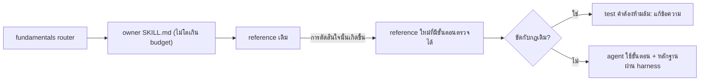

# Design

## Work type

docs

## Current state

performance-investigation มี references/measurement.md (364 คำ) ที่สอนวัดสลับรอบ แต่ไม่มี stop predicate, ลำดับ mantra หรือกฎ inconclusive เมื่อไม่รู้ limiter; benchmark provider ตรวจแค่ regression. debug-fundamentals พูดถึง falsifying experiment แค่ในบรรทัดเดียวของ SKILL.md และไม่มี reference สำหรับ root cause. testing-fundamentals/references/test-design.md (248 บรรทัด) ไม่มีการทดสอบด้วยการแก้สองแบบในใจหรือรายการ hollow assertion. change-impact-analysis มีแค่ SKILL.md (206 คำ) ไม่มี proof ladder. concurrency-fundamentals มี Principle 5 idempotent แต่ไม่มีสามคำถามหรือกฎ temp-then-rename. coding-discipline และ programming-fundamentals ไม่มี build-the-lever หรือ skip signal ของ domain model. ไม่มี skill ใดมีแนวทางการเขียนหรือ catalog ภาษาแบบ AI. lessons เสนอ check ด้วย mapping คงที่ 4 แบบโดยไม่มี enforcement ladder. pstack-adoption.md pin port 5062f28 และ test บังคับตาราง 58 แถว

## User flow

agent โหลด skill เดิมตาม router แล้วอ่าน reference ใหม่เฉพาะเมื่อการตัดสินใจนั้นเกิดขึ้น



## Failure matrix

| Failure | User sees | Recovery | Covers |
|---|---|---|---|
| ไม่สั่ง commit ต่อ attempt | test คำต้องห้าม fail | แก้ข้อความเป็น raw run evidence แล้วรันใหม่ | perf-hillclimb |
| ไม่ขัด no bundled cleanup | test fail เพราะไม่มีข้อความจำกัดขอบเขตและ follow-up | เพิ่มขอบเขตและ follow-up แล้วรันใหม่ | debug-premise-root-cause |
| ไม่สั่ง commit แยก | test คำต้องห้าม fail | แก้เป็นการส่งผ่าน /change แล้วรันใหม่ | lessons-enforcement-ladder |
| ไม่ทำลาย marker ของ parser | test fail เพราะไม่มีข้อความคุ้มครอง parser marker | เพิ่มข้อความคุ้มครองแล้วรันใหม่ | writing-guidance |
| คำต้องห้ามถูกจับ | test fail ระบุไฟล์และคำ | แก้ข้อความแล้วรันใหม่ | no-contradiction-guard |
| เกิน budget | test คืน CONTEXT_BUDGET_USER_DECISION_REQUIRED | ย้ายข้อความไป reference แทนการเพิ่มใน SKILL.md แล้วรันใหม่ | budget-neutral |

## File map

| Path | Change | Responsibility | Tasks |
|---|---|---|---|
| .claude/skills/performance-investigation/references/hillclimb.md | add | performance-investigation: hillclimb.md ใหม่ (ลิงก์จาก measurement.md) และกฎ claim ใน measurement.md พร้อม test pin | T001 |
| .claude/skills/performance-investigation/references/measurement.md | change | performance-investigation: hillclimb.md ใหม่ (ลิงก์จาก measurement.md) และกฎ claim ใน measurement.md พร้อม test pin | T001 |
| .claude/tests/docs/skill-catalog.test.mjs | change | performance-investigation: hillclimb.md ใหม่ (ลิงก์จาก measurement.md) และกฎ claim ใน measurement.md พร้อม test pin | T001; T002; T003; T004; T005; T006 |
| .claude/skills/debug-fundamentals/references/root-cause.md | add | debug-fundamentals: root-cause.md ใหม่ (ลิงก์จาก reproduction.md); testing-fundamentals: สองการแก้และ hollow assertion ใน test-design.md พร้อม test pin | T002 |
| .claude/skills/debug-fundamentals/references/reproduction.md | change | debug-fundamentals: root-cause.md ใหม่ (ลิงก์จาก reproduction.md); testing-fundamentals: สองการแก้และ hollow assertion ใน test-design.md พร้อม test pin | T002 |
| .claude/skills/testing-fundamentals/references/test-design.md | change | debug-fundamentals: root-cause.md ใหม่ (ลิงก์จาก reproduction.md); testing-fundamentals: สองการแก้และ hollow assertion ใน test-design.md พร้อม test pin | T002 |
| .claude/skills/change-impact-analysis/SKILL.md | change | change-impact-analysis: proof-ladder.md ใหม่ + ลิงก์หนึ่งบรรทัดใน SKILL.md; concurrency Principle 5 สามคำถาม; queue idempotency ลิงก์มา พร้อม test pin | T003 |
| .claude/skills/change-impact-analysis/references/proof-ladder.md | add | change-impact-analysis: proof-ladder.md ใหม่ + ลิงก์หนึ่งบรรทัดใน SKILL.md; concurrency Principle 5 สามคำถาม; queue idempotency ลิงก์มา พร้อม test pin | T003 |
| .claude/skills/concurrency-fundamentals/references/shared-state-and-async.md | change | change-impact-analysis: proof-ladder.md ใหม่ + ลิงก์หนึ่งบรรทัดใน SKILL.md; concurrency Principle 5 สามคำถาม; queue idempotency ลิงก์มา พร้อม test pin | T003 |
| .claude/skills/queue-fundamentals/references/idempotency.md | change | change-impact-analysis: proof-ladder.md ใหม่ + ลิงก์หนึ่งบรรทัดใน SKILL.md; concurrency Principle 5 สามคำถาม; queue idempotency ลิงก์มา พร้อม test pin | T003 |
| .claude/skills/coding-discipline/references/details.md | change | coding-discipline details.md: enforcement ladder และ build-the-lever; programming-fundamentals module-design.md: domain skip signals และ reader test พร้อม test pin | T004 |
| .claude/skills/programming-fundamentals/references/module-design.md | change | coding-discipline details.md: enforcement ladder และ build-the-lever; programming-fundamentals module-design.md: domain skip signals และ reader test พร้อม test pin | T004 |
| .claude/skills/init-project-docs/references/writing.md | add | init-project-docs/references/writing.md ใหม่และลิงก์จากห้า reference ที่เขียน prose พร้อม test pin | T005 |
| .claude/skills/init-project-docs/references/documentation-workflow.md | change | init-project-docs/references/writing.md ใหม่และลิงก์จากห้า reference ที่เขียน prose พร้อม test pin | T005 |
| .claude/skills/git-workflow/references/commit-messages.md | change | init-project-docs/references/writing.md ใหม่และลิงก์จากห้า reference ที่เขียน prose พร้อม test pin | T005 |
| .claude/skills/git-workflow/references/pull-requests.md | change | init-project-docs/references/writing.md ใหม่และลิงก์จากห้า reference ที่เขียน prose พร้อม test pin | T005 |
| .claude/skills/harness-html-report/references/report.md | change | init-project-docs/references/writing.md ใหม่และลิงก์จากห้า reference ที่เขียน prose พร้อม test pin | T005 |
| .claude/skills/claude-md/references/guide-workflow.md | change | init-project-docs/references/writing.md ใหม่และลิงก์จากห้า reference ที่เขียน prose พร้อม test pin | T005 |
| .claude/skills/skill-suite-auditor/references/pstack-adoption.md | change | test คำต้องห้ามสำหรับเนื้อหาใหม่ทุกไฟล์, provenance e5136d8 ใน pstack-adoption.md และยืนยัน budget กับ governance | T006 |

`+` add · `~` change · `-` remove

```text
.
└── .claude/
    ├── skills/
    │   ├── change-impact-analysis/
    │   │   ├── references/
    │   │   │   └── + proof-ladder.md
    │   │   └── ~ SKILL.md
    │   ├── claude-md/
    │   │   └── references/
    │   │       └── ~ guide-workflow.md
    │   ├── coding-discipline/
    │   │   └── references/
    │   │       └── ~ details.md
    │   ├── concurrency-fundamentals/
    │   │   └── references/
    │   │       └── ~ shared-state-and-async.md
    │   ├── debug-fundamentals/
    │   │   └── references/
    │   │       ├── ~ reproduction.md
    │   │       └── + root-cause.md
    │   ├── git-workflow/
    │   │   └── references/
    │   │       ├── ~ commit-messages.md
    │   │       └── ~ pull-requests.md
    │   ├── harness-html-report/
    │   │   └── references/
    │   │       └── ~ report.md
    │   ├── init-project-docs/
    │   │   └── references/
    │   │       ├── ~ documentation-workflow.md
    │   │       └── + writing.md
    │   ├── performance-investigation/
    │   │   └── references/
    │   │       ├── + hillclimb.md
    │   │       └── ~ measurement.md
    │   ├── programming-fundamentals/
    │   │   └── references/
    │   │       └── ~ module-design.md
    │   ├── queue-fundamentals/
    │   │   └── references/
    │   │       └── ~ idempotency.md
    │   ├── skill-suite-auditor/
    │   │   └── references/
    │   │       └── ~ pstack-adoption.md
    │   └── testing-fundamentals/
    │       └── references/
    │           └── ~ test-design.md
    └── tests/
        └── docs/
            └── ~ skill-catalog.test.mjs
```

## Test map

| Scenario | Level | Check | Task |
|---|---|---|---|
| reference มีขั้นตอนครบ; เข้าถึงได้จาก reference เดิม; ไม่สั่ง commit ต่อ attempt; มีกฎ claim; pin เดิมคงอยู่ | task check | `node --test .claude/tests/docs/skill-catalog.test.mjs` | T001 |
| มี stop rule; ไม่ขัด no bundled cleanup; pin bisection คงอยู่; มีสองการแก้และ hollow assertion; ไม่ซ้ำกับ programming-fundamentals testing | task check | `node --test .claude/tests/docs/skill-catalog.test.mjs` | T002 |
| มี ladder; pin เดิมคงอยู่; มีสามคำถาม; Contents ยังลิงก์ได้ | task check | `node --test .claude/tests/docs/skill-catalog.test.mjs` | T003 |
| มี ladder; ไม่สั่ง commit แยก; มี lever และ skip signals; pin programming-fundamentals คงอยู่ | task check | `node --test .claude/tests/docs/skill-catalog.test.mjs` | T004 |
| มี Diátaxis และ catalog; เข้าถึงได้ทุก bundle ที่เขียน prose; ไม่ทำลาย marker ของ parser | task check | `node --test .claude/tests/docs/skill-catalog.test.mjs` | T005 |
| เนื้อหาสะอาด; คำต้องห้ามถูกจับ; ตาราง adoption ไม่เปลี่ยน; budget ผ่าน; เกิน budget | task check | `node --test .claude/tests/docs/skill-catalog.test.mjs` | T006 |

## Decisions

- **Decision ID:** DEC-001
  - **Status:** accepted
  - **Decision:** ตารางความขัดแย้งก่อนเขียน: (1) fix every instance → จำกัดในขอบเขตของ change ส่วนที่เหลือเป็น follow-up ตาม Do not bundle cleanup; (2) guard legitimacy → การลบ guard ยังต้องพิสูจน์ตาม coding-discipline และ cleanup.md; (3) hillclimb commit ต่อ attempt → ใช้ raw run log นอก managed skills ตาม not a status ledger; (4) correct one commit each → ส่งผ่าน /change; (5) migrate-then-delete → ไม่นำเข้า คงใช้ expand-migrate-contract; (6) never-block-on-the-human, outcome-oriented-execution, subtract-before-you-add → ไม่นำเข้า; (7) arena/swarm/interrogate fan-out → ไม่นำเข้า; (8) unslop → ไม่แก้ข้อความ quote, parser marker หรือภาษาเอกสารที่ผู้ใช้กำหนด
  - **Why:** ผู้ใช้กำชับว่าเนื้อหาใหม่ต้องไม่ขัดกันเอง (u6) และกฎเดิมที่ยืนยันจาก source: fundamentals.md:16, coding-discipline/SKILL.md:8-9, cleanup.md:13,22-23, large-scale.md:35-40,52-55, performance-investigation/SKILL.md:21,24-25, pstack-adoption.md:82-101, change/references/workflow.md:138, git-workflow/SKILL.md:37-38
  - **Rejected:** none
  - **Consequences:** บางขั้นตอนของ pstack ถูกตัดหรือจำกัดขอบเขต จึงไม่เหมือนต้นฉบับทุกคำ
  - **Decided by:** agent
- **Decision ID:** DEC-002
  - **Status:** accepted
  - **Decision:** ลิงก์ reference ใหม่จาก reference เดิม ยกเว้น change-impact-analysis ที่ใช้หนึ่งบรรทัดใน SKILL.md
  - **Why:** SKILL.md เหลือ 37 คำ และ reference governance ยอมรับ reachability ผ่าน reference อื่น
  - **Rejected:** none
  - **Consequences:** agent อ่าน reference ใหม่ผ่าน reference เดิมหนึ่งชั้น
  - **Decided by:** agent
- **Decision ID:** DEC-003
  - **Status:** accepted
  - **Decision:** writing.md อยู่ใน init-project-docs และ bundle อื่นลิงก์ข้าม bundle
  - **Why:** one home per fact และ duplicate check ของ governance
  - **Rejected:** none
  - **Consequences:** bundle อื่นต้องลิงก์ด้วย path ข้าม bundle ที่ต้อง resolve
  - **Decided by:** agent
- **Decision ID:** DEC-004
  - **Status:** accepted
  - **Decision:** หลัง Land วัดด้วย paid e2e งบ 100$ แบบก่อน/หลังบน scenario ที่ตรงกลุ่ม (speed-up-search, regression-fix-with-fixes, multi-service-event-flow, idempotent-refund) อย่างน้อย 2 รอบต่อแขน แล้ว checkpoint ก่อน release v3.6.4
  - **Why:** ผู้ใช้กำหนด paid e2e งบ 100$ (u4) และ release +0.0.1 หลังทดสอบ (u3)
  - **Rejected:** none
  - **Consequences:** change นี้ถึง archived ได้ก่อน paid e2e; release รอผลการวัด
  - **Decided by:** user

## Compatibility and migration

เปลี่ยนเฉพาะไฟล์ reference ที่ติดตั้งผ่าน MANAGED .claude/skills และ SKILL.md ของ change-impact-analysis หนึ่งบรรทัด ไม่มีคำสั่ง, field, protocol หรือ runtime เปลี่ยน ข้อความที่ test pin ไว้เดิม (เช่น /never the active target or Build workspace/ ใน bisection.md, /not a status ledger/ และ /Never fabricate missing measurements/ ใน performance-investigation, /OpenSpec/, /not receipts/, /never hand-edit/ ใน change-impact-analysis, Design deep, cohesive modules ใน programming-fundamentals) ต้องคงอยู่
