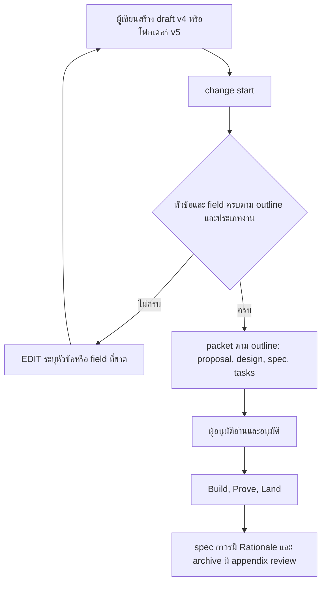

# Design

## Work type

feature

## Current state

draft อ่านเป็น JSON v3/v4 (change-lifecycle.mjs:963) และ renderer สร้าง proposal/design จาก field แบบตายตัว (renderDraftProposal 481, renderDraftDesign 568, renderDesignBlueprints design-blueprints.mjs:312); WORK_TYPES มี 11 ประเภทและไม่มี test (design-blueprints.mjs:7) ขณะที่ LIGHT_WORK มี 3 ชุดไม่ตรงกัน; amendment ต่อท้าย proposal ทุกครั้งและไม่แตะ design (semantic-amendment.mjs:1163); decision rejected ที่เป็น object แสดงเป็น [object Object] (change-lifecycle.mjs:433); ไม่มีโค้ดนำ decision ไป spec ถาวร; capability ของหลักฐานมาจาก path เท่านั้น (change-policy.mjs:153) และไม่มี evaluation, release-health, parity, plan-check, experiment-guardrail; budget เอกสาร 900/1400/900 หรือ 1600/2600/1600 พร้อมคำเตือนให้ตัดเนื้อหา; intent ภาษาไทยได้ change id เป็น change

## User flow

ผู้เขียนสร้าง draft แล้ว harness ตรวจตาม outline รวมเป็น packet ที่ผู้อนุมัติอ่าน โดยมีทางที่ตรวจไม่ผ่าน



## Failure matrix

| Failure | User sees | Recovery | Covers |
|---|---|---|---|
| ขาดหัวข้อบังคับ | ได้ EDIT ที่ระบุ infraPlan และรูปแบบ | ผู้เขียนเพิ่ม field แล้วรันใหม่ | required-sections |
| หัวข้อไม่รู้จัก | ได้ EDIT ที่ระบุหัวข้อและรายการหัวข้อที่รับ | แก้ชื่อหัวข้อ | v5-draft-folder |
| เขียนหัวข้อที่ harness สร้าง | ได้ EDIT ว่าหัวข้อนี้ harness สร้างเอง | ลบหัวข้อนั้น | v5-draft-folder |
| ไม่มี change.json | ได้ EDIT ที่ระบุไฟล์ที่ขาด | No separate step; the outcome is the handling | v5-draft-folder |
| หัวข้อผิดลำดับ | ได้ EDIT ที่ระบุลำดับที่ถูก | ย้ายหัวข้อ | v5-prose-merge |
| prose ที่มี TODO | ได้ EDIT ที่ระบุหัวข้อ | No separate step; the outcome is the handling | v5-prose-merge |
| impact high ไม่มี coverage | ได้ EDIT ที่ระบุ dimension ที่ขาด | No separate step; the outcome is the handling | v5-intake-gate |
| amend ด้วยหัวข้อไม่รู้จัก | amend ถูกปฏิเสธและ packet ไม่เปลี่ยน | No separate step; the outcome is the handling | v5-revise-amend |
| draft version ไม่รู้จัก | ได้ EDIT ที่ระบุ version ที่รับคือ 3, 4 และ 5 | No separate step; the outcome is the handling | draft-versions |
| boundary ขาด timeout | ได้ EDIT ที่ระบุ boundaries[0].timeout | No separate step; the outcome is the handling | architecture-fields |
| module ไม่มี interface | ได้ EDIT ที่ระบุ field | No separate step; the outcome is the handling | domain-fields |
| idempotency ไม่ครบ | ได้ EDIT ที่ระบุ scope | No separate step; the outcome is the handling | contract-fields |
| NFR ไม่มีเกณฑ์ | ได้ EDIT ที่ระบุ measure | No separate step; the outcome is the handling | quality-fields |
| rollback ไม่มีหลักฐาน | ได้ EDIT ที่ระบุ rollbackProof | No separate step; the outcome is the handling | delivery-fields |
| งานที่ผู้ใช้เห็นไม่มี release note | ได้ EDIT ที่ระบุ releaseNote | No separate step; the outcome is the handling | process-fields |
| ผู้อนุมัติเป็นผู้ทำ | ได้ EDIT ที่ระบุ compliance.approver | No separate step; the outcome is the handling | archive-appendices |
| oracle จับ seed ที่ยังไม่แก้ | oracle fail ที่ critical case | No separate step; the outcome is the handling | bench-work-types |
| ช้าเกินเกณฑ์ | ผลเทียบเป็นไม่ผ่านพร้อมตัวเลข | รายงานให้ผู้ใช้ตัดสิน | bench-packet-metrics |
| dependency ไม่มี provenance | ได้ EDIT ที่ระบุ dependencyChange.provenance | No separate step; the outcome is the handling | work-type-detail-fields |
| ประเภทไม่รู้จัก | ได้ EDIT พร้อมรายชื่อประเภทที่รับ | No separate step; the outcome is the handling | work-type-catalog |
| ไม่มี provider | advance คืน action ของ agent ให้ตั้ง provider พร้อม resume route โดยไม่ส่งงานนี้ให้ผู้ใช้ | agent ตั้ง provider แล้ว advance ต่อจากจุดเดิม | work-type-evidence |
| ไม่มี gate ที่ไม่มีเจ้าของ | test fail และระบุ gate นั้น | แก้ gate ให้คืน owner และ resume | gates-always-resumable |
| evaluation ต่ำกว่าเกณฑ์ | claim ไม่ผ่านพร้อมคะแนนและ threshold | แก้แล้วรันใหม่ | new-capabilities |
| สถานะไม่รู้จัก | ได้ EDIT พร้อมสถานะที่รับ | No separate step; the outcome is the handling | decision-status |
| เนื้อหาหายถูกจับ | test fail และระบุชิ้นที่หาย | แก้ renderer | completeness-guard |
| ข้อความเตือนใหม่ | คำเตือนบอกให้ย้ายส่วนซ้ำหรือข้อมูลสำหรับเครื่องไป appendix | ลดส่วนซ้ำหรือยอมรับคำเตือน | complete-budgets |
| ภาษาไม่ตรงกัน | fail พร้อมชื่อหน้า | No separate step; the outcome is the handling | docs-describe-packets |

## File map

| Path | Change | Responsibility | Tasks |
|---|---|---|---|
| .claude/harness/runtime/workflow/validation/outline-contract.mjs | add | outline contract module และ test | T001 |
| .claude/harness/tests/outline-contract.test.mjs | add | outline contract module และ test | T001 |
| .claude/harness/runtime/workflow/validation/design-blueprints.mjs | change | WORK_TYPES ครบตาม catalog และชุดงานเบาชุดเดียว | T002; T003; T009; T020 |
| .claude/harness/runtime/workflow/validation/dev-document.mjs | change | WORK_TYPES ครบตาม catalog และชุดงานเบาชุดเดียว | T002; T003; T010; T020 |
| .claude/harness/runtime/workflow/validation/packet-overview.mjs | change | WORK_TYPES ครบตาม catalog และชุดงานเบาชุดเดียว | T002; T019; T021 |
| .claude/harness/runtime/evidence/test-discrimination.mjs | change | WORK_TYPES ครบตาม catalog และชุดงานเบาชุดเดียว | T002 |
| .claude/harness/runtime/workflow/task-change.mjs | change | WORK_TYPES ครบตาม catalog และชุดงานเบาชุดเดียว | T002 |
| .claude/harness/tests/design-blueprints.test.mjs | change | WORK_TYPES ครบตาม catalog และชุดงานเบาชุดเดียว | T002; T010 |
| .claude/harness/tests/test-discrimination.test.mjs | change | WORK_TYPES ครบตาม catalog และชุดงานเบาชุดเดียว | T002 |
| .claude/harness/tests/required-sections.test.mjs | add | ตรวจหัวข้อบังคับต่อประเภทงานพร้อม EDIT ที่ระบุ field | T003 |
| .claude/harness/runtime/workflow/semantic-draft.mjs | change | คำเตือน field ที่ไม่รู้จักใน task พร้อมชื่อที่น่าจะหมายถึง | T004; T016; T029; T031 |
| .claude/harness/tests/semantic-draft.test.mjs | change | คำเตือน field ที่ไม่รู้จักใน task พร้อมชื่อที่น่าจะหมายถึง | T004; T029; T031 |
| .claude/harness/runtime/workflow/skill-routing.mjs | change | skill routing ของประเภทงานใหม่ | T005 |
| .claude/harness/tests/skill-routing.test.mjs | change | skill routing ของประเภทงานใหม่ | T005 |
| .claude/harness/runtime/evidence/provider-catalog.mjs | change | capability ใหม่ห้าตัวใน provider catalog พร้อมกติกาผ่าน และหลักฐานหลังปล่อยเป็น gate ของ rollout | T006 |
| .claude/harness/runtime/evidence/evidence-bootstrap.mjs | change | capability ใหม่ห้าตัวใน provider catalog พร้อมกติกาผ่าน และหลักฐานหลังปล่อยเป็น gate ของ rollout | T006 |
| .claude/harness/runtime/evidence/adapter-runtime.mjs | change | capability ใหม่ห้าตัวใน provider catalog พร้อมกติกาผ่าน และหลักฐานหลังปล่อยเป็น gate ของ rollout | T006 |
| .claude/harness/tests/required-providers.test.mjs | change | capability ใหม่ห้าตัวใน provider catalog พร้อมกติกาผ่าน และหลักฐานหลังปล่อยเป็น gate ของ rollout | T006 |
| .claude/harness/tests/new-capabilities.test.mjs | add | capability ใหม่ห้าตัวใน provider catalog พร้อมกติกาผ่าน และหลักฐานหลังปล่อยเป็น gate ของ rollout | T006 |
| .claude/harness/runtime/workflow/change-policy.mjs | change | การผูกประเภทงานกับ capability | T007 |
| .claude/harness/tests/change-policy-surface.test.mjs | change | การผูกประเภทงานกับ capability | T007 |
| .claude/harness/runtime/workflow/validation/architecture-fields.mjs | add | field boundaries, tenancy และ domain พร้อม validator และ renderer | T008 |
| .claude/harness/tests/architecture-fields.test.mjs | add | field boundaries, tenancy และ domain พร้อม validator และ renderer | T008 |
| .claude/harness/runtime/workflow/validation/contract-fields.mjs | add | รายละเอียด apiContracts และ eventContracts | T009; T010 |
| .claude/harness/tests/contract-fields.test.mjs | add | รายละเอียด apiContracts และ eventContracts | T009; T010 |
| .claude/harness/runtime/workflow/validation/quality-fields.mjs | add | nfr, threatModel, observability, trackingPlan และ capacity | T011 |
| .claude/harness/runtime/workflow/change-validation.mjs | change | nfr, threatModel, observability, trackingPlan และ capacity | T011; T023 |
| .claude/harness/tests/quality-fields.test.mjs | add | nfr, threatModel, observability, trackingPlan และ capacity | T011 |
| .claude/harness/runtime/workflow/validation/delivery-fields.mjs | add | rollout, testStrategy, dependencies และ recovery | T012 |
| .claude/harness/tests/delivery-fields.test.mjs | add | rollout, testStrategy, dependencies และ recovery | T012 |
| .claude/harness/runtime/workflow/validation/work-type-fields.mjs | add | field รายละเอียดของ bugfix (รวม security และ hotfix), refactor, library, migration, integration และ performance | T013; T014 |
| .claude/harness/tests/work-type-fields.test.mjs | add | field รายละเอียดของ bugfix (รวม security และ hotfix), refactor, library, migration, integration และ performance | T013; T014 |
| .claude/harness/runtime/workflow/validation/process-fields.mjs | add | decisionLog, communication, releaseNote และ demo | T015; T018 |
| .claude/harness/tests/process-fields.test.mjs | add | decisionLog, communication, releaseNote และ demo | T015 |
| .claude/harness/runtime/workflow/change-lifecycle.mjs | change | decision มีสถานะ ตัวเลือกเป็นข้อความ และ Rationale ใน spec delta | T016; T019; T020; T023; T025; T026; T027; T028; T029; T031 |
| .claude/harness/tests/durable-decision-metadata.test.mjs | change | decision มีสถานะ ตัวเลือกเป็นข้อความ และ Rationale ใน spec delta | T016 |
| .claude/harness/runtime/workflow/apply-runtime.mjs | change | Rationale คงอยู่หลัง archive | T017; T018 |
| .claude/harness/tests/apply-runtime-archive.test.mjs | change | Rationale คงอยู่หลัง archive | T017 |
| .claude/harness/tests/archive-appendices.test.mjs | add | appendix ผล review และ compliance ใน proposal ที่ archive และการตรวจ compliance ตอน start | T018 |
| .claude/harness/runtime/workflow/validation/reader-guide.mjs | change | proposal ตาม outline: ลำดับ ส่วนหัว investigation appendix เดียว discovery และ story ตามภาษา | T019 |
| .claude/harness/runtime/workflow/validation/investigation-coverage.mjs | change | proposal ตาม outline: ลำดับ ส่วนหัว investigation appendix เดียว discovery และ story ตามภาษา | T019 |
| .claude/harness/tests/reader-guide.test.mjs | change | proposal ตาม outline: ลำดับ ส่วนหัว investigation appendix เดียว discovery และ story ตามภาษา | T019; T021 |
| .claude/harness/tests/design-render.test.mjs | add | design ตาม outline และ file map ครั้งเดียว | T020 |
| .claude/harness/runtime/workflow/semantic-amendment.mjs | change | amendment แทนที่ส่วนเดิมใน proposal และ design | T022 |
| .claude/harness/tests/amendment-invalidation.test.mjs | change | amendment แทนที่ส่วนเดิมใน proposal และ design | T022 |
| .claude/harness/tests/change-validation-phases.test.mjs | change | budget ใหม่ คำเตือนใหม่ และ change id จาก capability | T023 |
| .claude/harness/tests/change-atomic-start.test.mjs | change | budget ใหม่ คำเตือนใหม่ และ change id จาก capability | T023 |
| .claude/harness/tests/change-draft-materialization.test.mjs | change | test ความครบของ packet v4 และ v5 | T024 |
| .claude/harness/tests/fixtures/complete-packets/ | add | test ความครบของ packet v4 และ v5 | T024 |
| .claude/harness/runtime/workflow/draft-folder.mjs | add | อ่านและตรวจโฟลเดอร์ draft v5 | T025; T026 |
| .claude/harness/tests/draft-folder.test.mjs | add | อ่านและตรวจโฟลเดอร์ draft v5 | T025; T026 |
| .claude/harness/runtime/workflow/validation/semantic-intake.mjs | change | intake gate ครอบคลุม v5 | T027 |
| .claude/harness/tests/semantic-intake.test.mjs | change | intake gate ครอบคลุม v5 | T027 |
| .claude/harness/tests/change-revise.test.mjs | change | revise ของ v5 ใช้ prose จากโฟลเดอร์ | T028 |
| .claude/harness/runtime/workflow/budget.mjs | change | check version ทุกจุดรองรับ 5 และ v3/v4 ยังผ่าน | T029 |
| .claude/harness/runtime/workflow/validation/ | change | check version ทุกจุดรองรับ 5 และ v3/v4 ยังผ่าน | T029 |
| .claude/harness/runtime/evidence/review-protocol.mjs | change | check version ทุกจุดรองรับ 5 และ v3/v4 ยังผ่าน | T029 |
| .claude/harness/protocol.json | change | protocol semanticDraftSchema 5 โดยคง runtime API 41 และ upgrade matrix | T030 |
| .claude/harness/tests/public-command-golden.test.mjs | change | protocol semanticDraftSchema 5 โดยคง runtime API 41 และ upgrade matrix | T030 |
| .claude/tests/harness/upgrade-matrix.test.mjs | change | protocol semanticDraftSchema 5 โดยคง runtime API 41 และ upgrade matrix | T030 |
| .claude/tests/harness/run-upgrade-compat-tests.sh | change | protocol semanticDraftSchema 5 โดยคง runtime API 41 และ upgrade matrix | T030 |
| openspec/schemas/foundation-standard/templates/design.md | change | template มีคำแนะนำการเขียน ตัวอย่างทุกประเภทงาน และโครง v5 | T031 |
| WORKFLOW.md | change | WORKFLOW.md, harness README, EVIDENCE.md, AGENTS.md และ skill change | T032 |
| .claude/harness/README.md | change | WORKFLOW.md, harness README, EVIDENCE.md, AGENTS.md และ skill change | T032 |
| .claude/harness/EVIDENCE.md | change | WORKFLOW.md, harness README, EVIDENCE.md, AGENTS.md และ skill change | T032 |
| AGENTS.md | change | WORKFLOW.md, harness README, EVIDENCE.md, AGENTS.md และ skill change | T032 |
| .claude/skills/change/references/workflow.md | change | WORKFLOW.md, harness README, EVIDENCE.md, AGENTS.md และ skill change | T032 |
| .claude/skills/change/references/semantic-intake.md | change | WORKFLOW.md, harness README, EVIDENCE.md, AGENTS.md และ skill change | T032 |
| .claude/tests/run-all.sh | change | ลงทะเบียน test ไฟล์ใหม่ทั้งหมดใน run-all.sh และ tests README ครั้งเดียว | T033 |
| .claude/tests/README.md | change | ลงทะเบียน test ไฟล์ใหม่ทั้งหมดใน run-all.sh และ tests README ครั้งเดียว | T033 |
| .claude/tests/bench/tasks/29-*/ | change | scenario library, migration, integration, config และ dependency พร้อม seed oracle และ matrix | T034 |
| .claude/tests/bench/tasks/30-*/ | change | scenario library, migration, integration, config และ dependency พร้อม seed oracle และ matrix | T034 |
| .claude/tests/bench/tasks/31-*/ | change | scenario library, migration, integration, config และ dependency พร้อม seed oracle และ matrix | T034 |
| .claude/tests/bench/tasks/32-*/ | change | scenario library, migration, integration, config และ dependency พร้อม seed oracle และ matrix | T034 |
| .claude/tests/bench/tasks/33-*/ | change | scenario library, migration, integration, config และ dependency พร้อม seed oracle และ matrix | T034 |
| .claude/tests/bench/config/openspec-native-matrix.json | change | scenario library, migration, integration, config และ dependency พร้อม seed oracle และ matrix | T034; T035 |
| .claude/tests/bench/tests/openspec-native-matrix.test.mjs | change | scenario library, migration, integration, config และ dependency พร้อม seed oracle และ matrix | T034; T035 |
| .claude/tests/bench/tasks/34-*/ | change | scenario deprecation, infra, observability, privacy, experiment, client-release, ml และ security-hotfix พร้อม seed oracle และ matrix | T035 |
| .claude/tests/bench/tasks/35-*/ | change | scenario deprecation, infra, observability, privacy, experiment, client-release, ml และ security-hotfix พร้อม seed oracle และ matrix | T035 |
| .claude/tests/bench/tasks/36-*/ | change | scenario deprecation, infra, observability, privacy, experiment, client-release, ml และ security-hotfix พร้อม seed oracle และ matrix | T035 |
| .claude/tests/bench/tasks/37-*/ | change | scenario deprecation, infra, observability, privacy, experiment, client-release, ml และ security-hotfix พร้อม seed oracle และ matrix | T035 |
| .claude/tests/bench/tasks/38-*/ | change | scenario deprecation, infra, observability, privacy, experiment, client-release, ml และ security-hotfix พร้อม seed oracle และ matrix | T035 |
| .claude/tests/bench/tasks/39-*/ | change | scenario deprecation, infra, observability, privacy, experiment, client-release, ml และ security-hotfix พร้อม seed oracle และ matrix | T035 |
| .claude/tests/bench/tasks/40-*/ | change | scenario deprecation, infra, observability, privacy, experiment, client-release, ml และ security-hotfix พร้อม seed oracle และ matrix | T035 |
| .claude/tests/bench/tasks/41-*/ | change | scenario deprecation, infra, observability, privacy, experiment, client-release, ml และ security-hotfix พร้อม seed oracle และ matrix | T035 |
| .claude/tests/bench/openspec-native/scorecard.mjs | change | scorecard วัดคุณภาพเอกสารและเทียบความเร็วด้วยเกณฑ์ 20% | T036 |
| .claude/tests/bench/openspec-native/quality.mjs | change | scorecard วัดคุณภาพเอกสารและเทียบความเร็วด้วยเกณฑ์ 20% | T036 |
| .claude/tests/bench/openspec-native/time-gate.mjs | change | scorecard วัดคุณภาพเอกสารและเทียบความเร็วด้วยเกณฑ์ 20% | T036 |
| .claude/tests/bench/tests/openspec-native-scorecard.test.mjs | change | scorecard วัดคุณภาพเอกสารและเทียบความเร็วด้วยเกณฑ์ 20% | T036 |
| .claude/tests/bench/tests/openspec-native-time-gate.test.mjs | change | scorecard วัดคุณภาพเอกสารและเทียบความเร็วด้วยเกณฑ์ 20% | T036 |
| .claude/tests/bench/README.md | change | scorecard วัดคุณภาพเอกสารและเทียบความเร็วด้วยเกณฑ์ 20% | T036 |
| README.md | change | README ทั้งสองภาษาและ website ทั้งสองภาษา | T037 |
| README.th.md | change | README ทั้งสองภาษาและ website ทั้งสองภาษา | T037 |
| website/docs/src/content/docs/loop/change.md | change | README ทั้งสองภาษาและ website ทั้งสองภาษา | T037 |
| website/docs/src/content/docs/th/loop/change.md | change | README ทั้งสองภาษาและ website ทั้งสองภาษา | T037 |
| website/docs/src/content/docs/cli.md | change | README ทั้งสองภาษาและ website ทั้งสองภาษา | T037 |
| website/docs/src/content/docs/th/cli.md | change | README ทั้งสองภาษาและ website ทั้งสองภาษา | T037 |

`+` add · `~` change · `-` remove

```text
.
├── .claude/
│   ├── harness/
│   │   ├── ~ EVIDENCE.md
│   │   ├── ~ protocol.json
│   │   ├── ~ README.md
│   │   ├── runtime/
│   │   │   ├── evidence/
│   │   │   │   ├── ~ adapter-runtime.mjs
│   │   │   │   ├── ~ evidence-bootstrap.mjs
│   │   │   │   ├── ~ provider-catalog.mjs
│   │   │   │   ├── ~ review-protocol.mjs
│   │   │   │   └── ~ test-discrimination.mjs
│   │   │   └── workflow/
│   │   │       ├── ~ apply-runtime.mjs
│   │   │       ├── ~ budget.mjs
│   │   │       ├── ~ change-lifecycle.mjs
│   │   │       ├── ~ change-policy.mjs
│   │   │       ├── ~ change-validation.mjs
│   │   │       ├── + draft-folder.mjs
│   │   │       ├── ~ semantic-amendment.mjs
│   │   │       ├── ~ semantic-draft.mjs
│   │   │       ├── ~ skill-routing.mjs
│   │   │       ├── ~ task-change.mjs
│   │   │       └── ~ validation/
│   │   │           ├── + architecture-fields.mjs
│   │   │           ├── + contract-fields.mjs
│   │   │           ├── + delivery-fields.mjs
│   │   │           ├── ~ design-blueprints.mjs
│   │   │           ├── ~ dev-document.mjs
│   │   │           ├── ~ investigation-coverage.mjs
│   │   │           ├── + outline-contract.mjs
│   │   │           ├── ~ packet-overview.mjs
│   │   │           ├── + process-fields.mjs
│   │   │           ├── + quality-fields.mjs
│   │   │           ├── ~ reader-guide.mjs
│   │   │           ├── ~ semantic-intake.mjs
│   │   │           └── + work-type-fields.mjs
│   │   └── tests/
│   │       ├── ~ amendment-invalidation.test.mjs
│   │       ├── ~ apply-runtime-archive.test.mjs
│   │       ├── + architecture-fields.test.mjs
│   │       ├── + archive-appendices.test.mjs
│   │       ├── ~ change-atomic-start.test.mjs
│   │       ├── ~ change-draft-materialization.test.mjs
│   │       ├── ~ change-policy-surface.test.mjs
│   │       ├── ~ change-revise.test.mjs
│   │       ├── ~ change-validation-phases.test.mjs
│   │       ├── + contract-fields.test.mjs
│   │       ├── + delivery-fields.test.mjs
│   │       ├── ~ design-blueprints.test.mjs
│   │       ├── + design-render.test.mjs
│   │       ├── + draft-folder.test.mjs
│   │       ├── ~ durable-decision-metadata.test.mjs
│   │       ├── fixtures/
│   │       │   └── + complete-packets/
│   │       ├── + new-capabilities.test.mjs
│   │       ├── + outline-contract.test.mjs
│   │       ├── + process-fields.test.mjs
│   │       ├── ~ public-command-golden.test.mjs
│   │       ├── + quality-fields.test.mjs
│   │       ├── ~ reader-guide.test.mjs
│   │       ├── ~ required-providers.test.mjs
│   │       ├── + required-sections.test.mjs
│   │       ├── ~ semantic-draft.test.mjs
│   │       ├── ~ semantic-intake.test.mjs
│   │       ├── ~ skill-routing.test.mjs
│   │       ├── ~ test-discrimination.test.mjs
│   │       └── + work-type-fields.test.mjs
│   ├── skills/
│   │   └── change/
│   │       └── references/
│   │           ├── ~ semantic-intake.md
│   │           └── ~ workflow.md
│   └── tests/
│       ├── bench/
│       │   ├── config/
│       │   │   └── ~ openspec-native-matrix.json
│       │   ├── openspec-native/
│       │   │   ├── ~ quality.mjs
│       │   │   ├── ~ scorecard.mjs
│       │   │   └── ~ time-gate.mjs
│       │   ├── ~ README.md
│       │   ├── tasks/
│       │   │   ├── ~ 29-*/
│       │   │   ├── ~ 30-*/
│       │   │   ├── ~ 31-*/
│       │   │   ├── ~ 32-*/
│       │   │   ├── ~ 33-*/
│       │   │   ├── ~ 34-*/
│       │   │   ├── ~ 35-*/
│       │   │   ├── ~ 36-*/
│       │   │   ├── ~ 37-*/
│       │   │   ├── ~ 38-*/
│       │   │   ├── ~ 39-*/
│       │   │   ├── ~ 40-*/
│       │   │   └── ~ 41-*/
│       │   └── tests/
│       │       ├── ~ openspec-native-matrix.test.mjs
│       │       ├── ~ openspec-native-scorecard.test.mjs
│       │       └── ~ openspec-native-time-gate.test.mjs
│       ├── harness/
│       │   ├── ~ run-upgrade-compat-tests.sh
│       │   └── ~ upgrade-matrix.test.mjs
│       ├── ~ README.md
│       └── ~ run-all.sh
├── ~ AGENTS.md
├── openspec/
│   └── schemas/
│       └── foundation-standard/
│           └── templates/
│               └── ~ design.md
├── ~ README.md
├── ~ README.th.md
├── website/
│   └── docs/
│       └── src/
│           └── content/
│               └── docs/
│                   ├── ~ cli.md
│                   ├── loop/
│                   │   └── ~ change.md
│                   └── th/
│                       ├── ~ cli.md
│                       └── loop/
│                           └── ~ change.md
└── ~ WORKFLOW.md
```

## Test map

| Scenario | Level | Check | Task |
|---|---|---|---|
| หัวข้อเรียงตาม outline; หัวข้อที่เงื่อนไขไม่จริงไม่แสดง; ไม่มีข้อมูลที่เปลี่ยนหลังอนุมัติ; ไม่ซ้ำ | task check | `node --test .claude/harness/tests/outline-contract.test.mjs` | T001 |
| ประกาศ test; อนุมาน infra; ประเภทไม่รู้จัก | task check | `node --test .claude/harness/tests/design-blueprints.test.mjs .claude/harness/tests/test-discrimination.test.mjs` | T002 |
| หัวข้อครบ; งาน docs ไม่ต้องมี design; ขาดหัวข้อบังคับ | task check | `node --test .claude/harness/tests/required-sections.test.mjs` | T003 |
| depends แทน dependsOn; field ถูกต้องไม่มีคำเตือน | task check | `node --test .claude/harness/tests/semantic-draft.test.mjs` | T004 |
| route infra; งานเบาไม่ route | task check | `node --test .claude/harness/tests/skill-routing.test.mjs` | T005 |
| evaluation ผ่านเกณฑ์; evaluation ต่ำกว่าเกณฑ์; release-health จากภายนอก; ขาด field ได้ action ของ agent; หลักฐานหลังปล่อยไม่ขวาง Land; compliance ขาดผู้อนุมัติ; ไม่มี gate ที่ไม่มีเจ้าของ | task check | `node --test .claude/harness/tests/new-capabilities.test.mjs .claude/harness/tests/required-providers.test.mjs` | T006 |
| ml ต้อง evaluation; ไม่มี provider; ขาด field ได้ action ของ agent; หลักฐานหลังปล่อยไม่ขวาง Land; compliance ขาดผู้อนุมัติ; ไม่มี gate ที่ไม่มีเจ้าของ | task check | `node --test .claude/harness/tests/change-policy-surface.test.mjs` | T007 |
| แสดง boundary; boundary ขาด timeout; แสดง domain; module ไม่มี interface | task check | `node --test .claude/harness/tests/architecture-fields.test.mjs` | T008 |
| API ครบ; field เดิมยังผ่าน; idempotency ไม่ครบ | task check | `node --test .claude/harness/tests/contract-fields.test.mjs` | T009 |
| API ครบ; field เดิมยังผ่าน; idempotency ไม่ครบ | task check | `node --test .claude/harness/tests/contract-fields.test.mjs .claude/harness/tests/design-blueprints.test.mjs` | T010 |
| แสดง threat model; v5 derive grounding; NFR ไม่มีเกณฑ์ | task check | `node --test .claude/harness/tests/quality-fields.test.mjs` | T011 |
| แสดงการเปิดปิด; rollback ไม่มีหลักฐาน | task check | `node --test .claude/harness/tests/delivery-fields.test.mjs` | T012 |
| model card ครบ; bugfix แบบ security; dependency ไม่มี provenance; bugfix เดิมยังผ่าน | task check | `node --test .claude/harness/tests/work-type-fields.test.mjs` | T013 |
| model card ครบ; bugfix แบบ security; dependency ไม่มี provenance; bugfix เดิมยังผ่าน | task check | `node --test .claude/harness/tests/work-type-fields.test.mjs` | T014 |
| บันทึกคำตอบ; งานที่ผู้ใช้เห็นไม่มี release note | task check | `node --test .claude/harness/tests/process-fields.test.mjs` | T015 |
| option เป็น object; proposed รอตัดสิน; สถานะไม่รู้จัก; Rationale ใน spec; หลัง archive; decision ไม่ durable | task check | `node --test .claude/harness/tests/durable-decision-metadata.test.mjs` | T016 |
| Rationale ใน spec; หลัง archive; decision ไม่ durable | task check | `node --test .claude/harness/tests/apply-runtime-archive.test.mjs` | T017 |
| appendix review; compliance ปิดอยู่; ผู้อนุมัติเป็นผู้ทำ | task check | `node --test .claude/harness/tests/archive-appendices.test.mjs` | T018 |
| ไม่มี appendix ก่อน Definition of done; ส่วนที่ไม่มีข้อมูลไม่แสดง; ไม่มี Status ตายตัว; lane ไม่มีวงเล็บซ้อน; ไม่มีรายการซ้ำ; คำตอบครบ; สรุปแถว derive; ภาษาไทย; ภาษาอื่นคงเดิม | task check | `node --test .claude/harness/tests/reader-guide.test.mjs` | T019 |
| หน้าที่ครั้งเดียว; file map ที่ผู้เขียนให้มา; หัวข้อเรียงตาม outline; หัวข้อที่เงื่อนไขไม่จริงไม่แสดง; ไม่มีข้อมูลที่เปลี่ยนหลังอนุมัติ | task check | `node --test .claude/harness/tests/design-render.test.mjs` | T020 |
| ใช้ชื่อ scenario; เรียงตามชนิด; check ไม่ซ้ำทุกแถว | task check | `node --test .claude/harness/tests/reader-guide.test.mjs` | T021 |
| amend สามครั้งเหลือชุดเดียว; รวมส่วนซ้ำจากรุ่นก่อน; amend ที่ไม่เกี่ยวกับ investigation; revise คง prose; amend แก้หัวข้อ design; amend ด้วยหัวข้อไม่รู้จัก | task check | `node --test .claude/harness/tests/amendment-invalidation.test.mjs` | T022 |
| budget ใหม่; ข้อความเตือนใหม่; intent ภาษาไทย; draft มี id | task check | `node --test .claude/harness/tests/change-validation-phases.test.mjs .claude/harness/tests/change-atomic-start.test.mjs` | T023 |
| ทุกชิ้นปรากฏ; เนื้อหาหายถูกจับ | task check | `node --test .claude/harness/tests/change-draft-materialization.test.mjs` | T024 |
| คอมไพล์โฟลเดอร์; หัวข้อไม่รู้จัก; เขียนหัวข้อที่ harness สร้าง; ไม่มี change.json | task check | `node --test .claude/harness/tests/draft-folder.test.mjs` | T025 |
| prose คงเดิม; หัวข้อผิดลำดับ; prose ที่มี TODO | task check | `node --test .claude/harness/tests/draft-folder.test.mjs` | T026 |
| impact high ไม่มี coverage; new --draft ใช้ v5 | task check | `node --test .claude/harness/tests/semantic-intake.test.mjs` | T027 |
| revise คง prose; amend แก้หัวข้อ design; amend ด้วยหัวข้อไม่รู้จัก | task check | `node --test .claude/harness/tests/change-revise.test.mjs` | T028 |
| v4 เดิมผ่าน; v3 ยังอ่านได้; CLI เดิมใช้ต่อได้; draft version ไม่รู้จัก | task check | `node --test .claude/harness/tests/semantic-draft.test.mjs` | T029 |
| v4 เดิมผ่าน; v3 ยังอ่านได้; CLI เดิมใช้ต่อได้; draft version ไม่รู้จัก | task check | `node --test .claude/tests/harness/upgrade-matrix.test.mjs .claude/harness/tests/public-command-golden.test.mjs` | T030 |
| template มีคำแนะนำ | task check | `node --test .claude/harness/tests/semantic-draft.test.mjs` | T031 |
| docs consistency ผ่าน; ภาษาไม่ตรงกัน | task check | `bash .claude/tests/docs/run-doc-consistency.sh` | T032 |
| docs consistency ผ่าน; ภาษาไม่ตรงกัน | task check | `bash .claude/tests/run-all.sh --affected` | T033 |
| matrix ครบทุกประเภท; oracle จับ seed ที่ยังไม่แก้; fixture digest ไม่ตรง | task check | `node --test .claude/tests/bench/tests/openspec-native-matrix.test.mjs` | T034 |
| matrix ครบทุกประเภท; oracle จับ seed ที่ยังไม่แก้; fixture digest ไม่ตรง | task check | `node --test .claude/tests/bench/tests/openspec-native-matrix.test.mjs` | T035 |
| รายงานตัววัดเอกสาร; ช้าเกินเกณฑ์; เร็วขึ้น | task check | `node --test .claude/tests/bench/tests/openspec-native-scorecard.test.mjs .claude/tests/bench/tests/openspec-native-time-gate.test.mjs` | T036 |
| docs consistency ผ่าน; ภาษาไม่ตรงกัน | task check | `bash .claude/tests/docs/run-doc-consistency.sh` | T037 |

## Decisions

- **Decision ID:** DEC-001
  - **Status:** accepted
  - **Decision:** ส่งมอบใน change เดียวที่เขียนด้วย draft v4
  - **Why:** ผู้ใช้ต้องการ change เดียว และ cli.sh รัน runtime ที่ root ซึ่งยังไม่รู้จัก v5
  - **Rejected:** none
  - **Consequences:** change นี้ใช้ field ใหม่กับตัวเองไม่ได้
  - **Decided by:** user
- **Decision ID:** DEC-002
  - **Status:** accepted
  - **Decision:** โฟลเดอร์ draft มี change.json + proposal.md + design.md
  - **Why:** revise และ amend ไม่ทับ prose และ approval digest ใช้ได้เดิม
  - **Rejected:** markdown string ใน JSON: เขียนลำบาก, แก้ prose ใน packet ตรง ๆ: ชนกับ revise, digest, amendment และ parser ตายตัว
  - **Consequences:** ต้องมี parser หัวข้อ markdown และ merge ตาม outline
  - **Decided by:** user
- **Decision ID:** DEC-003
  - **Status:** accepted
  - **Decision:** ส่วน typed เป็น JSON
  - **Why:** ใช้ readJson เดิมและไม่เพิ่ม dependency
  - **Rejected:** none
  - **Consequences:** ตัวอย่าง YAML ในหน้าตัวอย่างเป็นเพียงการแสดงผล
  - **Decided by:** user
- **Decision ID:** DEC-004
  - **Status:** accepted
  - **Decision:** เพิ่ม capability evaluation, release-health, parity, plan-check, experiment-guardrail
  - **Why:** ผู้ใช้เลือกเพิ่ม capability แทนการใช้ของเดิม
  - **Rejected:** none
  - **Consequences:** ต้องแก้ provider catalog, EVIDENCE.md และ adapter mapping; release-health และ experiment-guardrail ใช้ external adapter
  - **Decided by:** user
- **Decision ID:** DEC-005
  - **Status:** accepted
  - **Decision:** nfr และ observability อยู่ใน change.json ของ v5 แล้ว derive grounding; v4 ใช้ grounding v2 ตามเดิม
  - **Why:** ผู้ใช้เลือก
  - **Rejected:** none
  - **Consequences:** ไม่มีข้อมูลซ้ำสองที่ใน v5
  - **Decided by:** user
- **Decision ID:** DEC-006
  - **Status:** accepted
  - **Decision:** สถานะ ผู้อนุมัติ ความสดของหลักฐาน และผล review ไม่อยู่ใน packet ก่อน Land; ผล review และ compliance record เขียนลง proposal ที่ archive ตอน Land
  - **Why:** agreementIdentity ครอบทุกไฟล์ใน packet การเขียนข้อมูลที่เปลี่ยนหลังอนุมัติจะทำให้อนุมัติเป็นโมฆะ
  - **Rejected:** none
  - **Consequences:** ต่างจาก outline เรื่อง status header และคอลัมน์ความสด ซึ่งดูได้จากคำสั่ง changes
  - **Decided by:** agent
- **Decision ID:** DEC-007
  - **Status:** accepted
  - **Decision:** ขยับเฉพาะ protocol semanticDraftSchema เป็น 5 และคง runtime API 41 ทั้ง 4 จุด
  - **Why:** runtime เป็นตัวรับโฟลเดอร์ v5 เอง CLI ไม่ต้องเปลี่ยน และถ้าขยับ runtime API CLI ที่ติดตั้งอยู่ (3.6.3 คาด 41) จะปฏิเสธ runtime ทันทีหลัง Land ทำให้ทุกคำสั่งติดค้างจนกว่าจะ release
  - **Rejected:** none
  - **Consequences:** ไม่ต้องติดตั้ง CLI ใหม่เพื่อทำงานต่อหลัง Land
  - **Decided by:** agent
- **Decision ID:** DEC-008
  - **Status:** accepted
  - **Decision:** field typed ใหม่เป็น optional ใน v4 ด้วย
  - **Why:** consumer ที่ยังใช้ v4 ได้เอกสารครบโดยไม่ต้องย้าย
  - **Rejected:** none
  - **Consequences:** validator ต้องรองรับทั้งสอง version
  - **Decided by:** agent
- **Decision ID:** DEC-009
  - **Status:** accepted
  - **Decision:** Build ใช้ทีม agent แบ่งตาม module ภายใน EDIT ของโหมด session ที่ harness ส่ง task ค้างทั้งหมดมาครั้งเดียว: lead รับ EDIT แล้วทำเป็น 13 รอบ รอบละไม่เกิน 3 agent ย่อยใน sandbox เดียวกัน โดยแต่ละไฟล์มีผู้เขียนคนเดียวต่อรอบ จากนั้น resume advance ครั้งเดียวให้ harness รัน verify และติ๊กทุก task
  - **Why:** ผู้ใช้ต้องการให้ทีม agent ช่วยกันทำ; harness ห้ามขยายกลุ่ม lease ใน workspace เดียว (build-dispatch.md) แต่โหมด session ส่งทุก task ใน EDIT เดียวโดยไม่มี lease ราย task (advance-runtime.mjs:581) จึงแบ่งงานภายในได้โดยไม่ชนการตรวจไฟล์ที่ถูกแก้; จำลองการจัดกลุ่มด้วย groupAgentTasks ได้ 13 รอบแทน 37
  - **Rejected:** none
  - **Consequences:** ทีม: A แกน draft และ lifecycle (change-lifecycle, semantic-draft, semantic-amendment, draft-folder, semantic-intake, budget, protocol); B field และ validation (outline-contract, *-fields, design-blueprints, dev-document); C renderer (packet-overview, reader-guide, investigation-coverage); D evidence, routing และ archive (provider-catalog, change-policy, skill-routing, apply-runtime); E bench; F docs และทะเบียน test. รอบ: 1 T001 T016 T006 · 2 T002 T008 T011 · 3 T003 T012 T015 · 4 T009 T013 T025 · 5 T010 T014 T019 · 6 T020 T017 T021 · 7 T029 T034 T005 · 8 T026 T030 T018 · 9 T031 T007 T022 · 10 T028 T032 T004 · 11 T023 T024 T033 · 12 T027 T035 T036 · 13 T037. agent ย่อยแก้เฉพาะไฟล์ที่ได้รับ ไม่แตะ tasks.md lease หรือ git; หลังแต่ละรอบ lead รัน verify ของรอบนั้น ถ้า agent ย่อยล้มเหลวหรือแก้นอกขอบเขต lead คืนไฟล์นั้นและทำ task เอง จึงไม่มีงานค้างที่ผู้ใช้; ถ้า harness ส่ง EDIT แบบ lease หรือ spawn-group แทน lead ทำตาม action นั้นแทนแผนนี้
  - **Decided by:** user
- **Decision ID:** DEC-010
  - **Status:** accepted
  - **Decision:** หลัง Prove ผ่านและก่อน Land รัน paid e2e จาก sandbox เทียบแขนเดิม (runtime ที่ root) กับแขนใหม่ (sandbox) ครบทุก scenario ใน matrix รวม scenario ใหม่ทุกประเภทงาน แขนละอย่างน้อย 1 รอบ และ 2 รอบเมื่องบพอ งบรวมไม่เกิน 100$ หยุดทันทีเมื่อครบงบ
  - **Why:** ผู้ใช้ต้องการ paid e2e ทุกเรื่อง ผลต้องดีขึ้น ช้าลงได้ไม่เกิน 20% และเร็วขึ้นจะดีมาก
  - **Rejected:** none
  - **Consequences:** ผ่านเมื่อ oracle pass rate ไม่ต่ำกว่าแขนเดิม หัวข้อบังคับที่ขาดเป็น 0 ส่วนซ้ำเป็น 0 และค่ามัธยฐานของเวลาและ token ต่อ scenario ไม่เกิน +20%; ถ้าไม่ผ่าน agent รายงานผลพร้อมสาเหตุและทางเลือกแล้วรอผู้ใช้ตัดสินก่อนแก้หรือ Land; ผลดิบเก็บนอก Git และสรุปเป็นรายงานใน docs/reports
  - **Decided by:** user
- **Decision ID:** DEC-011
  - **Status:** accepted
  - **Decision:** งานเล็ก 1200/2000/1200 และงานอื่น 2400/3600/2400 คำ
  - **Why:** ผู้ใช้ยอมเพิ่ม budget เพื่อความครบ
  - **Rejected:** none
  - **Consequences:** คำเตือนเกิดน้อยลงและยังไม่ block
  - **Decided by:** agent

## Compatibility and migration

draft v3/v4 คอมไพล์ได้เหมือนเดิมและได้หัวข้อใหม่เมื่อใส่ field ใหม่ที่เป็น optional; draft v5 เป็นโฟลเดอร์ใหม่; protocol semanticDraftSchema เป็น 5 และ runtime API คง 41 CLI ที่ติดตั้งอยู่จึงใช้ต่อได้ทันทีหลัง Land; change ที่ archive แล้วไม่ถูกแก้; amendment ของ change เดิมที่มีส่วนซ้ำจะถูกรวมในครั้งถัดไป
