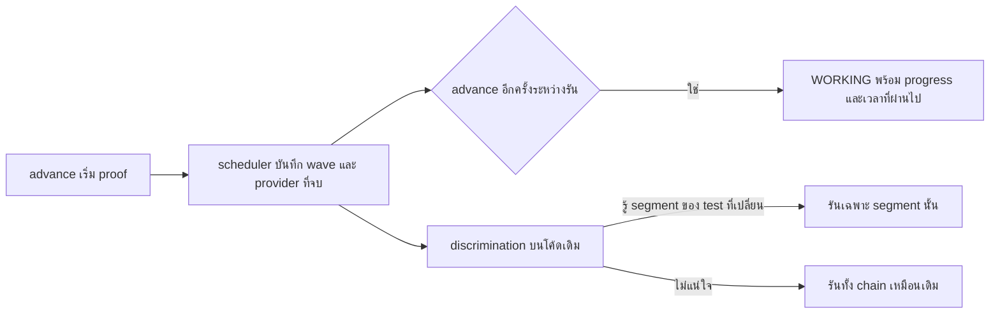

# Design

## Work type

feature

## เส้นทางผู้ใช้

agent หรือผู้ใช้ติดตาม proof ที่กำลังรัน และ proof ตรวจ test บนโค้ดเดิมเฉพาะส่วนที่จำเป็น



## Decisions

- **Decision ID:** DEC-001
  - **Status:** accepted
  - **Decision:** ทำเฉพาะการแสดงความคืบหน้าและการลด discrimination บนโค้ดเดิม ไม่ทำการ reuse task check ของ Build
  - **Why:** investigation พบว่า reuse task check ได้เพียงราว 1/N ของเวลา test เพราะผลผูกกับ code hash หลัง task นั้น ผู้ใช้เลือกทำสองข้อนี้ก่อน paid checkpoint
  - **Rejected:** none
  - **Consequences:** Prove ยังรัน test ของ change ครบหนึ่งรอบ แต่ไม่รันทั้ง chain ซ้ำบนโค้ดเดิม
  - **Decided by:** user

## ตารางความล้มเหลว

| Failure | User sees | Recovery | Covers |
|---|---|---|---|
| จับคู่ไม่ได้รันทั้งหมด | รันทั้งคำสั่งของ provider เหมือนเดิม | No separate step; the outcome is the handling | narrow-discrimination |

## แผนที่ไฟล์

| Tasks | Paths |
|---|---|
| T001 | `.claude/harness/runtime/evidence/provider-scheduler.mjs`, `.claude/harness/runtime/evidence/proof-execution-runtime.mjs`, `.claude/harness/runtime/workflow/advance-runtime.mjs`, `.claude/harness/foundation.mjs`, `.claude/harness/tests/proof-advance.test.mjs`, `.claude/harness/tests/advance-runtime.test.mjs`, `.claude/harness/README.md` |
| T002 | `.claude/harness/runtime/workflow/semantic-draft.mjs`, `.claude/harness/runtime/workflow/semantic-amendment.mjs`, `.claude/harness/runtime/evidence/test-discrimination.mjs`, `.claude/harness/tests/test-discrimination.test.mjs`, `.claude/harness/tests/semantic-draft.test.mjs`, `.claude/harness/EVIDENCE.md` |

`+` add · `~` change · `-` remove

```text
.
└── .claude/
    └── harness/
        ├── ~ EVIDENCE.md
        ├── ~ foundation.mjs
        ├── ~ README.md
        ├── runtime/
        │   ├── evidence/
        │   │   ├── ~ proof-execution-runtime.mjs
        │   │   ├── ~ provider-scheduler.mjs
        │   │   └── ~ test-discrimination.mjs
        │   └── workflow/
        │       ├── ~ advance-runtime.mjs
        │       ├── ~ semantic-amendment.mjs
        │       └── ~ semantic-draft.mjs
        └── tests/
            ├── ~ advance-runtime.test.mjs
            ├── ~ proof-advance.test.mjs
            ├── ~ semantic-draft.test.mjs
            └── ~ test-discrimination.test.mjs
```

## แผนที่ test

| Scenario | Level | Check | Task |
|---|---|---|---|
| progress ระหว่างรัน; provider ที่จบแล้ว; สถานะเดิมไม่เปลี่ยน | task check | `node --test .claude/harness/tests/proof-advance.test.mjs .claude/harness/tests/advance-runtime.test.mjs` | T001 |
| รันเฉพาะ segment ที่ test เปลี่ยน; จับคู่ไม่ได้รันทั้งหมด; ไม่มี segment ใช้แบบเดิม | task check | `node --test .claude/harness/tests/test-discrimination.test.mjs .claude/harness/tests/semantic-draft.test.mjs` | T002 |
