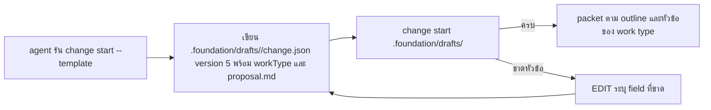

# Design

## Work type

feature

## เส้นทางผู้ใช้

เส้นทางของ agent ตั้งแต่อ่าน template จนเริ่ม change ได้ รวมทางที่ draft ไม่ครบ



## Decisions

- **Decision ID:** DEC-001
  - **Status:** accepted
  - **Decision:** คำสั่ง save และ minimal draft ใน template ชี้ไปที่โฟลเดอร์ v5 และมี workType
  - **Why:** paid e2e 2026-10-16 พบว่าทุก lane ยังได้ draft v4 และไม่ประกาศ workType เพราะ template นำด้วย minimalDraft แบบ JSON
  - **Rejected:** none
  - **Consequences:** agent ที่ทำตาม template ได้ draft v5 และหัวข้อตามประเภทงาน ส่วน consumer ที่มี draft v4 อยู่แล้วไม่ต้องเปลี่ยน
  - **Decided by:** user

## ตารางความล้มเหลว

| Failure | User sees | Recovery | Covers |
|---|---|---|---|
| work type ที่ประกาศบังคับหัวข้อของตัวเอง | harness คืน EDIT ที่ระบุ apiContracts โดยไม่เริ่ม change | No separate step; the outcome is the handling | template-leads-with-v5 |
| ไม่มีทั้ง field และ prose ยังเตือน | ยังมีคำเตือนให้เพิ่ม why หรือ summary และ appendix บันทึกว่า why มาจาก intent | No separate step; the outcome is the handling | v5-prose-counts-as-authored |

## แผนที่ไฟล์

| Tasks | Paths |
|---|---|
| T001 | `.claude/harness/runtime/workflow/validation/dev-document.mjs`, `.claude/harness/runtime/workflow/validation/reader-guide.mjs`, `.claude/harness/tests/reader-guide.test.mjs` |
| T001; T002 | `.claude/harness/runtime/workflow/draft-folder.mjs`, `.claude/harness/tests/draft-folder.test.mjs` |
| T002 | `.claude/harness/runtime/workflow/change-lifecycle.mjs`, `.claude/harness/runtime/workflow/semantic-draft.mjs`, `.claude/harness/tests/change-atomic-start.test.mjs`, `.claude/harness/tests/semantic-draft.test.mjs`, `.claude/harness/tests/public-command-golden.test.mjs` |
| T003 | `.claude/commands/change.md`, `.claude/skills/change/SKILL.md`, `.claude/skills/change/references/workflow.md`, `.claude/harness/README.md`, `website/docs/src/content/docs/loop/change.md`, `website/docs/src/content/docs/th/loop/change.md`, `.claude/harness/tests/permission-allowlist.test.mjs` |

`+` add · `~` change · `-` remove

```text
.
├── .claude/
│   ├── commands/
│   │   └── ~ change.md
│   ├── harness/
│   │   ├── ~ README.md
│   │   ├── runtime/
│   │   │   └── workflow/
│   │   │       ├── ~ change-lifecycle.mjs
│   │   │       ├── ~ draft-folder.mjs
│   │   │       ├── ~ semantic-draft.mjs
│   │   │       └── validation/
│   │   │           ├── ~ dev-document.mjs
│   │   │           └── ~ reader-guide.mjs
│   │   └── tests/
│   │       ├── ~ change-atomic-start.test.mjs
│   │       ├── ~ draft-folder.test.mjs
│   │       ├── ~ permission-allowlist.test.mjs
│   │       ├── ~ public-command-golden.test.mjs
│   │       ├── ~ reader-guide.test.mjs
│   │       └── ~ semantic-draft.test.mjs
│   └── skills/
│       └── change/
│           ├── references/
│           │   └── ~ workflow.md
│           └── ~ SKILL.md
└── website/
    └── docs/
        └── src/
            └── content/
                └── docs/
                    ├── loop/
                    │   └── ~ change.md
                    └── th/
                        └── loop/
                            └── ~ change.md
```

## แผนที่ test

| Scenario | Level | Check | Task |
|---|---|---|---|
| prose เหตุผลนับเป็น why; prose user story และเกณฑ์นับเป็นของผู้เขียน; ไม่มีทั้ง field และ prose ยังเตือน | task check | `node --test .claude/harness/tests/reader-guide.test.mjs .claude/harness/tests/draft-folder.test.mjs` | T001 |
| template นำด้วย v5; minimal draft ที่กรอกแล้วเริ่มได้; work type ที่ประกาศบังคับหัวข้อของตัวเอง; draft v4 แบบ JSON ยังใช้ได้ | task check | `node --test .claude/harness/tests/change-atomic-start.test.mjs .claude/harness/tests/semantic-draft.test.mjs .claude/harness/tests/draft-folder.test.mjs .claude/harness/tests/public-command-golden.test.mjs` | T002 |
| คำสั่ง /change สอนโฟลเดอร์ v5; ทางเขียน draft ได้รับอนุญาตล่วงหน้า; เอกสารสองภาษาตรงกัน | task check | `node --test .claude/harness/tests/permission-allowlist.test.mjs && sh .claude/tests/harness/run-context-budget-tests.sh && bash .claude/tests/docs/run-doc-consistency.sh` | T003 |
