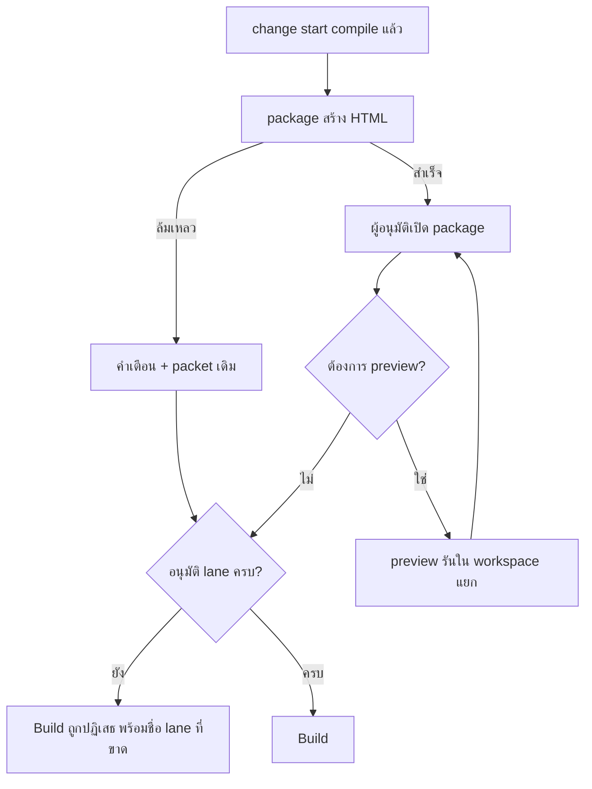
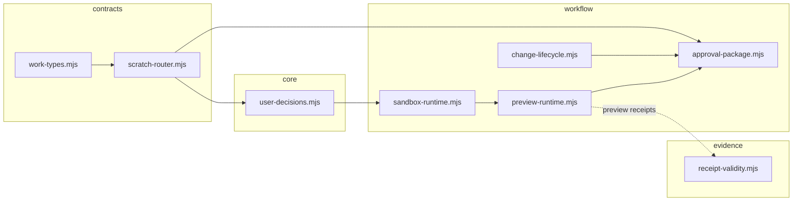
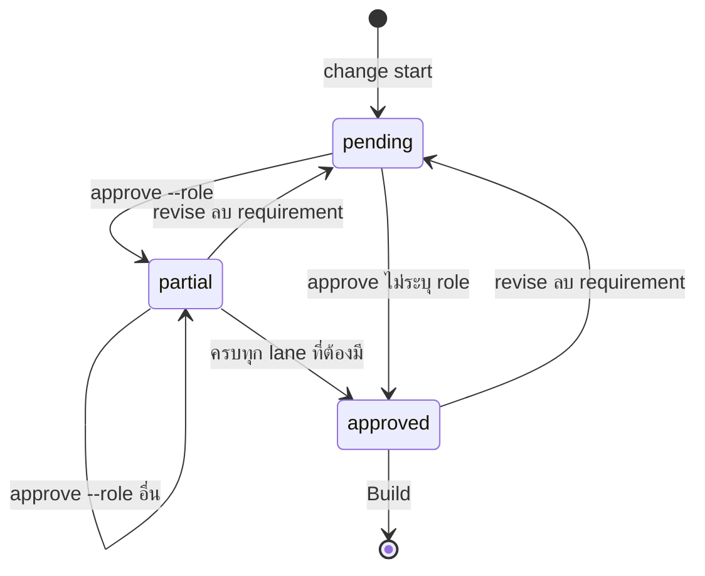
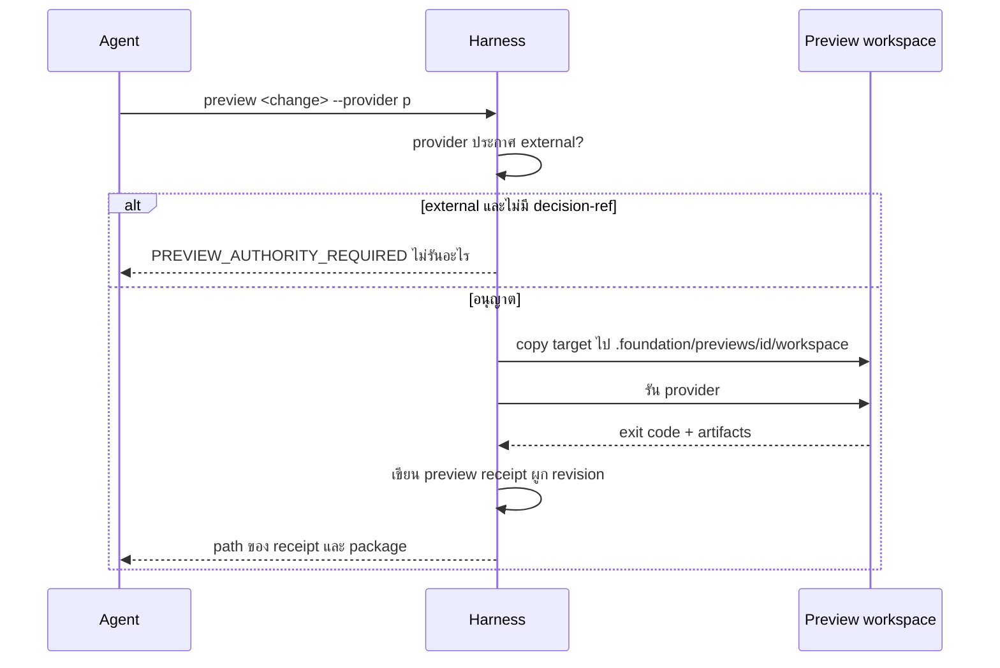

# Design

## สถานะปัจจุบัน

workType 23 ค่าใน runtime/contracts/work-types.mjs รวม intent และ domain ไว้ในรายการเดียว ส่วน design blueprints ผูก workType กับ section ของ design.md riskSignals กำหนด discovery dimension, ความลึกในการสำรวจ และระดับ review การอนุมัติ spec เป็น specApproval เดียวที่ assertSpecApproval ตรวจก่อนสร้าง sandbox provider รันเฉพาะใน Prove และ prototype จาก --compare ถูกปฏิเสธเป็นหลักฐานด้วย prototype-evidence

## Work type

feature, ui, config

## เส้นทางผู้ใช้

ผู้อนุมัติเปิด package ลอง preview ถ้าต้องการ แล้วอนุมัติตาม lane รวมเส้นทางที่ render ไม่สำเร็จ



## พฤติกรรมขณะทำงาน

package อ่าน state กับ packet แล้วเรียก routeChange() กับ renderDraftDesign() เพื่อเขียน HTML ไฟล์เดียว preview ใช้ helper คัดลอกของ sandbox-runtime สร้าง workspace ใน .foundation/previews/<id>/workspace รัน provider จาก evidence.yaml แล้วเขียน receipt ชนิด preview ใน .foundation/previews/<id>/receipts/ assertSpecApproval อ่าน approval.roles ถ้าไม่มีจะทำงานแบบเดิม ถ้ามีจะเทียบ specApproval.lanes กับบทบาทที่ routeChange() เลือก การอนุมัติที่ไม่ระบุ role จะเขียน specApproval แบบเดิม ซึ่งถือว่าครอบทุก lane

### slice-boundaries

ขอบเขตของโมดูลใหม่และจุดที่เชื่อมกับ runtime เดิม



### approval-states

สถานะการอนุมัติราย lane รวมการล้าง lane เมื่อ revision ลบ requirement



### preview-sequence

ลำดับการรัน preview และเส้นทางที่ถูกปฏิเสธ



## โมเดลโดเมนและโมดูล

| Component | Responsibility | Files | Tasks |
|---|---|---|---|
| Scratch router table | ตาราง 28 domain และ routeChange() | .claude/harness/runtime/contracts/scratch-router.mjs | T001 |
| Approval package renderer | อ่าน state กับ packet แล้วเขียน HTML self-contained | .claude/harness/runtime/workflow/approval-package.mjs | T002, T004 |
| Preview runtime | สร้าง workspace แยก รัน provider และเขียน preview receipt | .claude/harness/runtime/workflow/preview-runtime.mjs | T004 |

## สัญญา UI

### Approval package

| State | Shows | Actions |
|---|---|---|
| success | ระดับความเสี่ยง, domain, artifact แยกตามบทบาท, diagram และรายการหลักฐานพร้อมป้าย | — |
| empty | change ไม่มี domain เฉพาะ แสดงเพียง change impact กับ test map | — |
| stale | preview ที่ผูกกับ revision เก่าติดป้าย stale | — |
| error | ไม่สร้างไฟล์ และ CLI แสดงสาเหตุพร้อมคำสั่งให้รันใหม่ | — |
| legacy | change ที่ไม่มี draftSource แสดงเนื้อหาจาก packet พร้อมข้อความว่าข้อมูลมีจำกัด | — |

- **Accessibility:** ใช้ heading ตามลำดับ, ตารางมี th, ป้ายสถานะมีข้อความไม่ใช้สีอย่างเดียว, อ่านได้ทั้งธีมสว่างและมืด

## สัญญา config

| Key | ชนิด | ค่าเริ่มต้น | การตรวจค่า | ความลับ | ค่าต่อ environment | การโหลดใหม่ | เจ้าของ | Task ที่ลบ |
|---|---|---|---|---|---|---|---|---|
| approval.roles | — | ไม่ตั้ง (อนุมัติครั้งเดียวแบบเดิม) | array ของบทบาทที่ไม่ซ้ำจาก product-owner, tech-lead, qa, devops, security; ค่าอื่นทำให้ config ไม่ผ่าน | — | — | — | — | — |

## Decisions

- **Decision ID:** DEC-001
  - **Status:** accepted
  - **Decision:** เก็บตาราง router และ routeChange() ใน runtime/contracts เป็น pure data
  - **Why:** contracts นำเข้าได้จาก core, evidence และ workflow ตามกฎ architecture
  - **Rejected:** none
  - **Consequences:** ตารางห้าม import อะไรนอก contracts
- **Decision ID:** DEC-002
  - **Status:** accepted
  - **Decision:** เพิ่มคำสั่ง read ชื่อ package แทนการขยาย skill harness-html-report
  - **Why:** ผลต้อง deterministic และทดสอบได้ ส่วน skill เดิมยังเป็นรายงานรอบงาน
  - **Rejected:** none
  - **Consequences:** จำนวนคำสั่งใน golden fixture และ installer test เพิ่มขึ้น
- **Decision ID:** DEC-003
  - **Status:** accepted
  - **Decision:** ใช้คำสั่ง preview แยก ไม่เพิ่มค่า --through ใหม่
  - **Why:** --through ถูก hard-code ไว้ 5 จุด และ preview เป็นขั้นที่เลือกใช้ได้
  - **Rejected:** none
  - **Consequences:** advance ไม่รู้จัก preview และ preview ไม่เปลี่ยน status ของ change
- **Decision ID:** DEC-004
  - **Status:** accepted
  - **Decision:** เก็บ preview workspace และ receipt ใน .foundation/previews แยกจาก receipts
  - **Why:** Prove อ่านเฉพาะ receipts ของ change และ guard ซ้ำอีกชั้นกันการปนกัน
  - **Rejected:** none
  - **Consequences:** abandon และ land undo ต้องล้าง .foundation/previews ด้วย
- **Decision ID:** DEC-005
  - **Status:** accepted
  - **Decision:** เปิด lane ด้วย approval.roles ใน foundation.json โดยค่าเริ่มต้นคือปิด
  - **Why:** consumer เดิมไม่เปลี่ยนพฤติกรรม
  - **Rejected:** none
  - **Consequences:** ทีมต้องตั้ง config เองจึงจะได้ lane
- **Decision ID:** DEC-006
  - **Status:** accepted
  - **Decision:** bump runtime API pin ทั้ง 4 จุดและ schema ที่เกี่ยวข้องใน protocol.json
  - **Why:** specApproval.lanes และคำสั่งใหม่เป็นสัญญาที่ระบบอื่นมองเห็น
  - **Rejected:** none
  - **Consequences:** cli.sh รุ่นเก่ากับ runtime ใหม่จะไม่ทำงานร่วมกันจนกว่าจะ upgrade
- **Decision ID:** DEC-Q-PHASES
  - **Status:** accepted
  - **Context:** ทำ phase ไหนและส่งมอบอย่างไร
  - **Decision:** P1-P3 ใน change เดียว และ Land ทีเดียว
  - **Why:** No alternative was open; recorded as settled
  - **Rejected:** none
  - **Consequences:** Not stated in the draft
  - **Decided by:** user
- **Decision ID:** DEC-Q-TAXONOMY
  - **Status:** accepted
  - **Context:** แยก intent กับ domain ออกจาก workType ไหม
  - **Decision:** ไม่แยก ใช้ตาราง mapping ครอบ
  - **Why:** No alternative was open; recorded as settled
  - **Rejected:** none
  - **Consequences:** Not stated in the draft
  - **Decided by:** user
- **Decision ID:** DEC-Q-PREVIEW-POLICY
  - **Status:** accepted
  - **Context:** บังคับ preview ไหม
  - **Decision:** เลือกได้ทุกระดับ ไม่บังคับ
  - **Why:** No alternative was open; recorded as settled
  - **Rejected:** none
  - **Consequences:** Not stated in the draft
  - **Decided by:** user
- **Decision ID:** DEC-Q-BOUNDARY
  - **Status:** accepted
  - **Context:** preview แตะของภายนอกได้แค่ไหน
  - **Decision:** อนุญาต sandbox ภายนอก ภายใต้สิทธิ์ราย run
  - **Why:** No alternative was open; recorded as settled
  - **Rejected:** none
  - **Consequences:** Not stated in the draft
  - **Decided by:** user
- **Decision ID:** DEC-Q-IDENTITY
  - **Status:** accepted
  - **Context:** ยืนยันตัวผู้อนุมัติอย่างไร
  - **Decision:** บันทึกตามคำบอก
  - **Why:** No alternative was open; recorded as settled
  - **Rejected:** none
  - **Consequences:** Not stated in the draft
  - **Decided by:** user
- **Decision ID:** DEC-Q-SUGGEST
  - **Status:** accepted
  - **Context:** package ควรแนะนำ preview ไหม
  - **Decision:** เพิ่ม preview ที่แนะนำใน package โดยไม่บังคับ
  - **Why:** No alternative was open; recorded as settled
  - **Rejected:** none
  - **Consequences:** Not stated in the draft
  - **Decided by:** user

## ตารางความล้มเหลว

| Failure | User sees | Recovery | Covers |
|---|---|---|---|
| workType ที่ไม่รู้จัก | ไม่ throw และคืนคำเตือนที่ระบุ unknown-kind | แก้ workType ใน draft แล้ว compile ใหม่ | route-change |
| ไม่พบ change | exit ไม่เป็นศูนย์ ข้อความระบุ id และไม่เขียนไฟล์ | ใช้ id ที่ถูกต้อง | package-render |
| มีแต่ preview | artifact ติดป้าย preview ไม่ใช่ proof | รัน Prove เพื่อให้ได้ receipt จริง | package-labels |
| ยังไม่มี provider | คำแนะนำแสดงว่ายังไม่มี provider และระบุ capability data-migration | ประกาศ provider ใน evidence.yaml แล้วรัน package ใหม่ | preview-suggestions |
| render ล้มเหลว | ผลลัพธ์มีคำเตือนและยังรออนุมัติด้วย packet เดิม | รัน package <change> อีกครั้งหลังแก้สาเหตุ | approval-links-package |
| provider ไม่มี | exit ไม่เป็นศูนย์และระบุชื่อ provider | ประกาศ provider ใน evidence.yaml | preview-run |
| คัดลอก preview เข้า receipts | receipt ถูกปฏิเสธเป็น preview-evidence | Prove รัน provider ใหม่ | preview-never-proof |
| ไม่มีสิทธิ์ | ปฏิเสธด้วย PREVIEW_AUTHORITY_REQUIRED และไม่รันคำสั่งใด | ขออนุญาตผู้ใช้แล้วรันด้วย --decision-ref | preview-external-authority |
| ขาด lane | advance หยุดด้วย ASK_USER ที่ระบุ lane qa และไม่สร้าง sandbox | บันทึกการอนุมัติของ qa | approval-lanes |
| บทบาทที่ไม่รู้จัก | ปฏิเสธพร้อมรายชื่อบทบาทที่ใช้ได้และไม่บันทึกอะไร | ใช้บทบาทที่อยู่ใน approval.roles | approval-lane-record |
| revision ลบ requirement | ทุก lane กลับเป็นรออนุมัติ | อนุมัติใหม่ตาม lane | lane-carry |

## กลยุทธ์การทดสอบ

ใช้ unit test ของตาราง router กับทุก preset และ seam test แบบ fixture `mktemp` สำหรับ package, preview และ approval lanes test ต้องยืนยันว่า state digest ไม่เปลี่ยน, preview receipt ถูกปฏิเสธใน Prove และ state เก่ายังเข้า Build ได้ ก่อน Land รัน full suite ของ run-all.sh และ docs consistency

## ความเสี่ยง

ถ้า P3 แก้ไม่ครบทุกจุดที่อ่าน specApproval จะเกิดช่องให้ข้าม lane ได้ จึงต้องเพิ่ม test ที่ทุก gate (prepareBuildSandbox, sandboxCreatePreflight, Land) ส่วน working tree ที่แก้ค้างอยู่อาจทำให้ Land ต้อง merge ไฟล์เดียวกันหลายจุด

## แผนที่ไฟล์

| Tasks | Paths |
|---|---|
| T001 | `.claude/harness/runtime/contracts/scratch-router.mjs` (add), `.claude/harness/tests/scratch-router.test.mjs` (add) |
| T002; T004 | `.claude/harness/runtime/workflow/approval-package.mjs` (add), `.claude/harness/runtime/composition/bootstrap.mjs`, `.claude/harness/runtime/core/lifecycle-phase.mjs`, `.claude/harness/commands.json`, `.claude/harness/fixtures/public-command-contract-v1.json`, `.claude/harness/tests/public-command-golden.test.mjs`, `.claude/tests/harness/run-installer-tests.sh` |
| T002; T003; T006 | `.claude/harness/runtime/workflow/change-lifecycle.mjs` |
| T002; T004; T006 | `.claude/harness/runtime/core/cli-router.mjs` |
| T002; T004; T006; T007 | `.claude/harness/foundation.mjs` |
| T002; T003 | `.claude/harness/tests/approval-package.test.mjs` (add) |
| T002 | `.claude/harness/tests/command-registry.test.mjs` |
| T002; T004; T007 | `cli.sh` |
| T003 | `.claude/harness/runtime/workflow/advance-runtime.mjs`, `.claude/commands/change.md`, `.claude/harness/tests/change-atomic-start.test.mjs` |
| T004 | `.claude/harness/runtime/workflow/preview-runtime.mjs` (add), `.claude/harness/runtime/workflow/abandon-runtime.mjs`, `.claude/harness/runtime/workflow/land-undo.mjs`, `.claude/harness/tests/preview-runtime.test.mjs` (add) |
| T004; T006 | `.claude/harness/runtime/workflow/sandbox-runtime.mjs` |
| T005 | `.claude/harness/runtime/evidence/receipt-validity.mjs`, `.claude/harness/runtime/evidence/artifact-store.mjs`, `.claude/harness/tests/preview-evidence.test.mjs` (add) |
| T006 | `.claude/harness/runtime/core/user-decisions.mjs`, `.claude/harness/runtime/core/runtime-environment.mjs`, `.claude/harness/tests/approval-lanes.test.mjs` (add), `.claude/harness/tests/user-decisions.test.mjs`, `.claude/harness/tests/change-revise.test.mjs` |
| T007 | `WORKFLOW.md`, `.claude/harness/EVIDENCE.md`, `.claude/harness/README.md`, `.claude/harness/AGENT.md`, `.claude/harness/DEVELOPER-SETUP.md`, `.claude/harness/protocol.json`, `.claude/harness/runtime/version.mjs`, `.claude/tests/run-all.sh`, `.claude/tests/README.md`, `website/docs/src/content/docs/cli.md`, `website/docs/src/content/docs/th/cli.md`, `website/docs/src/content/docs/approval.md`, `website/docs/src/content/docs/th/approval.md`, `website/docs/src/content/docs/foundation-config.md`, `website/docs/src/content/docs/th/foundation-config.md` |

`+` add · `~` change · `-` remove

```text
.
├── .claude/
│   ├── commands/
│   │   └── ~ change.md
│   ├── harness/
│   │   ├── ~ AGENT.md
│   │   ├── ~ commands.json
│   │   ├── ~ DEVELOPER-SETUP.md
│   │   ├── ~ EVIDENCE.md
│   │   ├── fixtures/
│   │   │   └── ~ public-command-contract-v1.json
│   │   ├── ~ foundation.mjs
│   │   ├── ~ protocol.json
│   │   ├── ~ README.md
│   │   ├── runtime/
│   │   │   ├── composition/
│   │   │   │   └── ~ bootstrap.mjs
│   │   │   ├── contracts/
│   │   │   │   └── + scratch-router.mjs
│   │   │   ├── core/
│   │   │   │   ├── ~ cli-router.mjs
│   │   │   │   ├── ~ lifecycle-phase.mjs
│   │   │   │   ├── ~ runtime-environment.mjs
│   │   │   │   └── ~ user-decisions.mjs
│   │   │   ├── evidence/
│   │   │   │   ├── ~ artifact-store.mjs
│   │   │   │   └── ~ receipt-validity.mjs
│   │   │   ├── ~ version.mjs
│   │   │   └── workflow/
│   │   │       ├── ~ abandon-runtime.mjs
│   │   │       ├── ~ advance-runtime.mjs
│   │   │       ├── + approval-package.mjs
│   │   │       ├── ~ change-lifecycle.mjs
│   │   │       ├── ~ land-undo.mjs
│   │   │       ├── + preview-runtime.mjs
│   │   │       └── ~ sandbox-runtime.mjs
│   │   └── tests/
│   │       ├── + approval-lanes.test.mjs
│   │       ├── + approval-package.test.mjs
│   │       ├── ~ change-atomic-start.test.mjs
│   │       ├── ~ change-revise.test.mjs
│   │       ├── ~ command-registry.test.mjs
│   │       ├── + preview-evidence.test.mjs
│   │       ├── + preview-runtime.test.mjs
│   │       ├── ~ public-command-golden.test.mjs
│   │       ├── + scratch-router.test.mjs
│   │       └── ~ user-decisions.test.mjs
│   └── tests/
│       ├── harness/
│       │   └── ~ run-installer-tests.sh
│       ├── ~ README.md
│       └── ~ run-all.sh
├── ~ cli.sh
├── website/
│   └── docs/
│       └── src/
│           └── content/
│               └── docs/
│                   ├── ~ approval.md
│                   ├── ~ cli.md
│                   ├── ~ foundation-config.md
│                   └── th/
│                       ├── ~ approval.md
│                       ├── ~ cli.md
│                       └── ~ foundation-config.md
└── ~ WORKFLOW.md
```

## แผนที่ test

| Scenario | Level | Check | Task |
|---|---|---|---|
| ตัวอย่างถอนเงิน; งาน docs อย่างเดียว; workType ที่ไม่รู้จัก | task check | `node --test .claude/harness/tests/scratch-router.test.mjs` | T001 |
| สร้าง package; ไม่แก้ state; draft v3 ไม่มี draftSource; ไม่พบ change; มี receipt ใช้ได้; มีแต่ preview; Critical มี provider; ยังไม่มี provider; ระดับ Medium; ไม่บล็อก | task check | `node --test .claude/harness/tests/approval-package.test.mjs .claude/harness/tests/public-command-golden.test.mjs .claude/harness/tests/command-registry.test.mjs` | T002 |
| แนบ package; render ล้มเหลว | task check | `node --test .claude/harness/tests/approval-package.test.mjs .claude/harness/tests/change-atomic-start.test.mjs` | T003 |
| รัน provider; provider ไม่มี; Critical ไม่มี preview; ไม่มีสิทธิ์; มีสิทธิ์; revise หลัง preview | task check | `node --test .claude/harness/tests/preview-runtime.test.mjs .claude/harness/tests/public-command-golden.test.mjs` | T004 |
| คัดลอก preview เข้า receipts | task check | `node --test .claude/harness/tests/preview-evidence.test.mjs` | T005 |
| ขาด lane; ครบทุก lane; บทบาทที่ router ไม่เลือก; บันทึก lane; บทบาทที่ไม่รู้จัก; อนุมัติไม่ระบุ role; state เก่า; revision แบบเพิ่ม; revision ลบ requirement | task check | `node --test .claude/harness/tests/approval-lanes.test.mjs .claude/harness/tests/user-decisions.test.mjs .claude/harness/tests/change-revise.test.mjs` | T006 |
| สร้าง package; ไม่แก้ state; draft v3 ไม่มี draftSource; ไม่พบ change; รัน provider; provider ไม่มี; ขาด lane; ครบทุก lane; บทบาทที่ router ไม่เลือก | task check | `bash .claude/tests/docs/run-doc-consistency.sh && node .claude/tests/harness/run-single-source-tests.mjs` | T007 |
