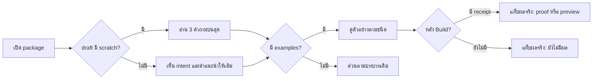

# Design

## ภาพรวม

ต่อยอด renderer เดิมใน approval-package.mjs: เพิ่ม hero 3 คำถามจาก draft.scratch, บล็อกตัวอย่างจาก draft.examples ซึ่ง render โดย module ใหม่ scratch-blocks.mjs, แท็บผลจริงต่อบล็อก และพับส่วนตามบทบาทเดิมไว้ด้านล่าง ตัวตรวจ draft อยู่ใน scratch-fields.mjs และเรียกจาก semanticDraftIssues

## สถานะปัจจุบัน

semanticDraftIssues ตรวจเฉพาะ key ที่รู้จักและปล่อย key ใหม่ผ่าน draft ถูกเก็บแทบตรงตัวใน state.draftSource.draft package อ่าน draft เมื่อ revision ตรงกัน test เดิมห้าม script และ URL ใน HTML router ใช้ workType riskSignals impact coupling และ path

## Work type

feature, ui, dependency

## เส้นทางผู้ใช้

เส้นทางของผู้อนุมัติบนหน้า package รวมกรณีที่ไม่มีข้อมูล



## พฤติกรรมขณะทำงาน

แท็บ ตกลงไว้/ผลจริง และ case ของ API ใช้ input radio กับ label และ CSS :checked จึงไม่ต้องใช้ script แท็บผลจริงหา receipt ด้วย capability ของตัวอย่าง: receipt valid และ pass ได้ proof, fail ได้ ไม่ผ่าน, preview receipt ได้ preview หรือ preview เก่า, ไม่มีได้ ยังไม่มีผล ลิงก์ artifact ใช้ path ใน .foundation/evidence หรือ .foundation/previews ของ change เท่านั้น

script element เดียวคือ `<script src="../../.claude/harness/vendor/mermaid.min.js">` ตามด้วยการเรียก render ผ่าน attribute บน element ไม่มี inline script ไฟล์ vendor เริ่ม render เองผ่าน startOnLoad ของ Mermaid ถ้าโหลดไม่ได้ pre.mermaid ยังเป็นข้อความ

## โมเดลโดเมนและโมดูล

| Component | Responsibility | Files | Tasks |
|---|---|---|---|
| Draft fields | ตรวจ scratch และ examples ใน draft | .claude/harness/runtime/workflow/semantic-draft.mjs | T001 |
| Scratch blocks | render ตัวอย่าง 29 ชนิดเป็น HTML แบบ escape | .claude/harness/runtime/workflow/scratch-blocks.mjs | T003 |
| Approval package | ประกอบหน้า ภาษา แท็บผลจริง และส่วนตามบทบาท | .claude/harness/runtime/workflow/approval-package.mjs | T003 |
| Router | เลือก domain และระดับความเสี่ยง | .claude/harness/runtime/contracts/scratch-router.mjs | T002 |

## สัญญา UI

### Approval package

| State | Shows | Actions |
|---|---|---|
| empty | ไม่มี scratch และ examples: แสดง intent และข้อความแนะนำให้ agent เติม | — |
| error | ตัวอย่างอ้าง capability ที่ไม่มี receipt: แท็บผลจริงแสดง ยังไม่มีผล ไม่ล้มหน้า | — |
| success | 3 คำถามบนสุด ตัวอย่างตามชนิด แท็บผลจริง และส่วนตามบทบาท | — |
| stale | preview จาก revision เก่าติดป้าย preview เก่า | — |

- **Accessibility:** ทุกแท็บและ case เป็น input ที่มี label เลือกด้วยคีย์บอร์ดได้ และ diagram มีข้อความ Mermaid ให้อ่านเมื่อ script ไม่ทำงาน

## การเปลี่ยน dependency

ดึง mermaid 11.4.1 จาก npm เก็บเฉพาะ dist/mermaid.min.js ตรวจ sha256 แล้วบันทึกใน THIRD-PARTY-NOTICES.md พร้อม license MIT ไฟล์อยู่ใต้ .claude/harness จึงถูก install.sh ส่งไปทุก consumer อัตโนมัติ

| ส่วน | รายละเอียด |
|---|---|
| แพ็กเกจ | mermaid (dist/mermaid.min.js) |
| จาก | ไม่มี |
| ไปยัง | 11.4.1 |
| การเปลี่ยนแปลงที่ไม่เข้ากัน | ไม่มี เป็นไฟล์ใหม่ |
| CVE | ไม่มี advisory สำหรับ 11.4.1 ใน npm audit ณ วันสร้าง |
| เวอร์ชันสำหรับ rollback | ลบไฟล์ vendor แล้ว diagram แสดงเป็นข้อความเหมือนเดิม |
| ที่มาของแพ็กเกจ (provenance) | ดึงจาก npm registry ตรวจ sha256 และเก็บไว้ใน THIRD-PARTY-NOTICES.md |
| SBOM | บันทึกชื่อ เวอร์ชัน license และ sha256 ใน .claude/harness/vendor/THIRD-PARTY-NOTICES.md |

## Decisions

- **Decision ID:** DEC-001
  - **Status:** accepted
  - **Decision:** ส่ง mermaid 11.4.1 (MIT) เป็นไฟล์ในเครื่องที่ .claude/harness/vendor/mermaid.min.js และ package อ้างแบบ relative
  - **Why:** ผู้ใช้เลือกให้ diagram เป็นรูปจริงแบบออฟไลน์โดยไม่ทำให้ทุก package ใหญ่ 3MB
  - **Rejected:** none
  - **Consequences:** harness ใหญ่ขึ้นราว 3MB และหน้า package มี script ของ harness หนึ่งตัว
- **Decision ID:** DEC-002
  - **Status:** accepted
  - **Decision:** แท็บ ก่อน/หลัง และ case ของ API ใช้ details และ radio ของ HTML ไม่ใช้ script
  - **Why:** script เดียวที่ยอมคือ Mermaid ของ harness
  - **Rejected:** none
  - **Consequences:** ทำงานใน viewer ที่ปิด script ได้ ยกเว้น diagram ที่แสดงเป็นข้อความ
- **Decision ID:** DEC-003
  - **Status:** accepted
  - **Decision:** เพิ่ม 3 คำถามและตัวอย่างไว้บนส่วนตามบทบาทเดิม ไม่ลบส่วนเดิม
  - **Why:** สัญญา package-content เดิมยังใช้ได้และไม่ต้องย้ายผู้ใช้
  - **Rejected:** none
  - **Consequences:** หน้ายาวขึ้น ส่วนตามบทบาทถูกพับไว้
- **Decision ID:** DEC-004
  - **Status:** accepted
  - **Decision:** คำเตือนใหม่ขึ้นต้นด้วย NOTE: scratch แยกจาก NOTE: coverage
  - **Why:** บรรทัด NOTE: coverage ถูก test ตรึงข้อความไว้
  - **Rejected:** none
  - **Consequences:** change start อาจพิมพ์ NOTE เพิ่มหนึ่งบรรทัด

## Threat model

ข้อความจาก draft เป็น input ที่ไม่น่าเชื่อถือ ทุกช่องผ่าน escape เดียวกันก่อนใส่ HTML ไม่มีช่องใดรับ HTML ดิบ path ของ prototype และ artifact ต้อง resolve อยู่ใต้โฟลเดอร์ของ change และไม่ตาม symlink ออกนอก script เดียวมาจากไฟล์ของ harness ไม่ใช่จาก draft

## ตารางความล้มเหลว

| Failure | User sees | Recovery | Covers |
|---|---|---|---|
| ข้อความยาวเกิน | intake คืน EDIT ที่ระบุ scratch.get และขีดจำกัด 240 | No separate step; the outcome is the handling | scratch-summary |
| scratch ไม่ใช่ object | intake คืน EDIT ที่ระบุ scratch ต้องเป็น object | No separate step; the outcome is the handling | scratch-summary |
| ชนิดไม่รู้จัก | intake คืน EDIT ที่ระบุ examples[0].type และรายชื่อชนิดที่รองรับ | No separate step; the outcome is the handling | scratch-examples |
| ขาดช่องบังคับ | intake คืน EDIT ที่ระบุ examples[1].endpoints | No separate step; the outcome is the handling | scratch-examples |
| prototype ชี้นอก previews | intake คืน EDIT ว่า path ต้องอยู่ใน .foundation/previews/<change>/ | No separate step; the outcome is the handling | scratch-examples |
| receipt ล้ม | แท็บผลจริงติดป้าย ไม่ผ่าน และไม่ติดป้าย proof | No separate step; the outcome is the handling | example-actual |
| ไม่มี script อื่น | HTML มี script element เดียวที่ src ชี้ไฟล์ vendor และไม่มี http:// หรือ https:// | No separate step; the outcome is the handling | package-offline-diagrams |

## กลยุทธ์การทดสอบ

unit test ต่อชนิดตัวอย่าง 29 ชนิด, test การ escape ด้วยข้อความ script และ img ในทุกชนิด, test แท็บผลจริง 5 สถานะ, test ภาษา, test ว่ามี script เดียวและไม่มี URL, test router 5 กรณี, test NOTE: scratch 5 กรณี และ test เดิมของ NOTE: coverage ต้องผ่านโดยไม่แก้

## แผนที่ไฟล์

| Tasks | Paths |
|---|---|
| T001 | `.claude/harness/runtime/workflow/semantic-draft.mjs`, `.claude/harness/runtime/workflow/scratch-fields.mjs` (add), `.claude/harness/tests/scratch-draft-fields.test.mjs` (add), `.claude/harness/tests/semantic-draft.test.mjs` |
| T002 | `.claude/harness/runtime/contracts/scratch-router.mjs`, `.claude/harness/tests/scratch-router.test.mjs` |
| T003 | `.claude/harness/runtime/workflow/approval-package.mjs`, `.claude/harness/runtime/workflow/scratch-blocks.mjs` (add), `.claude/harness/vendor/mermaid.min.js` (add), `.claude/harness/vendor/THIRD-PARTY-NOTICES.md` (add), `.claude/harness/tests/approval-package.test.mjs`, `.claude/harness/tests/scratch-blocks.test.mjs` (add), `.claude/harness/foundation.mjs`, `.claude/tests/run-all.sh`, `.claude/tests/README.md` |
| T004 | `.claude/harness/runtime/workflow/change-lifecycle.mjs`, `.claude/harness/tests/scratch-nudges.test.mjs` (add), `.claude/harness/tests/change-atomic-start.test.mjs` |
| T005 | `WORKFLOW.md`, `.claude/harness/README.md`, `.claude/harness/EVIDENCE.md`, `.claude/harness/commands.json`, `website/docs/src/content/docs/approval.md`, `website/docs/src/content/docs/th/approval.md`, `website/docs/src/content/docs/loop/change.md`, `website/docs/src/content/docs/th/loop/change.md` |

`+` add · `~` change · `-` remove

```text
.
├── .claude/
│   ├── harness/
│   │   ├── ~ commands.json
│   │   ├── ~ EVIDENCE.md
│   │   ├── ~ foundation.mjs
│   │   ├── ~ README.md
│   │   ├── runtime/
│   │   │   ├── contracts/
│   │   │   │   └── ~ scratch-router.mjs
│   │   │   └── workflow/
│   │   │       ├── ~ approval-package.mjs
│   │   │       ├── ~ change-lifecycle.mjs
│   │   │       ├── + scratch-blocks.mjs
│   │   │       ├── + scratch-fields.mjs
│   │   │       └── ~ semantic-draft.mjs
│   │   ├── tests/
│   │   │   ├── ~ approval-package.test.mjs
│   │   │   ├── ~ change-atomic-start.test.mjs
│   │   │   ├── + scratch-blocks.test.mjs
│   │   │   ├── + scratch-draft-fields.test.mjs
│   │   │   ├── + scratch-nudges.test.mjs
│   │   │   ├── ~ scratch-router.test.mjs
│   │   │   └── ~ semantic-draft.test.mjs
│   │   └── vendor/
│   │       ├── + mermaid.min.js
│   │       └── + THIRD-PARTY-NOTICES.md
│   └── tests/
│       ├── ~ README.md
│       └── ~ run-all.sh
├── website/
│   └── docs/
│       └── src/
│           └── content/
│               └── docs/
│                   ├── ~ approval.md
│                   ├── loop/
│                   │   └── ~ change.md
│                   └── th/
│                       ├── ~ approval.md
│                       └── loop/
│                           └── ~ change.md
└── ~ WORKFLOW.md
```

## แผนที่ test

| Scenario | Level | Check | Task |
|---|---|---|---|
| มี scratch ครบ; ไม่มี scratch; ข้อความยาวเกิน; scratch ไม่ใช่ object; ตัวอย่าง API สองกรณี; ชนิดไม่รู้จัก; ขาดช่องบังคับ; ค่าที่มี HTML; prototype ชี้นอก previews; ครบ 29 ชนิด | task check | `node --test .claude/harness/tests/scratch-draft-fields.test.mjs .claude/harness/tests/semantic-draft.test.mjs` | T001 |
| kanban ใน localStorage; migration ฝั่ง server; app CRUD ไม่ใช่รายงาน; รายงานจริง; สิทธิ์ได้ threat model | task check | `node --test .claude/harness/tests/scratch-router.test.mjs` | T002 |
| มี scratch ครบ; ไม่มี scratch; ข้อความยาวเกิน; scratch ไม่ใช่ object; ตัวอย่าง API สองกรณี; ชนิดไม่รู้จัก; ขาดช่องบังคับ; ค่าที่มี HTML; prototype ชี้นอก previews; ครบ 29 ชนิด; มี receipt ผ่าน; มีแค่ preview; preview เก่า; ยังไม่มีผล; receipt ล้ม; ภาษาไทย; ภาษาอื่น; มีไฟล์ vendor; ไม่มีไฟล์ vendor; ไม่มี script อื่น; สร้าง package; ไม่แก้ state; draft v3 ไม่มี draftSource; ไม่พบ change; API contract; test matrix; permission matrix; ไม่ได้ประกาศ | task check | `node --test .claude/harness/tests/approval-package.test.mjs .claude/harness/tests/scratch-blocks.test.mjs` | T003 |
| ไม่มีตัวอย่าง; performance ไม่มีเป้า; bugfix ไม่มีตัวเลขผลกระทบ; impact low; ครบแล้ว | task check | `node --test .claude/harness/tests/scratch-nudges.test.mjs .claude/harness/tests/change-atomic-start.test.mjs` | T004 |
| มี scratch ครบ; ไม่มี scratch; ข้อความยาวเกิน; scratch ไม่ใช่ object; ตัวอย่าง API สองกรณี; ชนิดไม่รู้จัก; ขาดช่องบังคับ; ค่าที่มี HTML; prototype ชี้นอก previews; ครบ 29 ชนิด; มี receipt ผ่าน; มีแค่ preview; preview เก่า; ยังไม่มีผล; receipt ล้ม; มีไฟล์ vendor; ไม่มีไฟล์ vendor; ไม่มี script อื่น; ไม่มีตัวอย่าง; performance ไม่มีเป้า; bugfix ไม่มีตัวเลขผลกระทบ; impact low; ครบแล้ว | task check | `bash .claude/tests/docs/run-doc-consistency.sh` | T005 |
