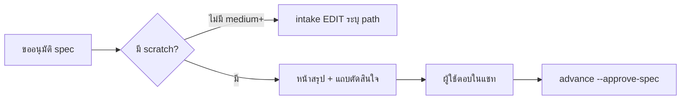

# Design

## Work type

feature, ui

## เส้นทางผู้ใช้

ผู้อนุมัติอ่านสรุป ตัดสินใจ แล้วตอบในแชท รวมทางที่ scratch หายและ approve แล้ว



## โมเดลโดเมนและโมดูล

| Component | Responsibility | Files | Tasks |
|---|---|---|---|
| approval package renderer | จัดลำดับหน้า: สรุป ขอบเขต ตัวอย่าง รายละเอียดผู้ตรวจ แถบตัดสินใจ | .claude/harness/runtime/workflow/approval-package.mjs | T001 |
| package text | ข้อความ UI ภาษาไทยและอังกฤษ | .claude/harness/runtime/workflow/scratch-blocks.mjs | T001 |

## สัญญา UI

### Approval package

| State | Shows | Actions |
|---|---|---|
| ready | สรุป 4 บรรทัด ความเสี่ยงพร้อมเหตุผล แถบขอบเขต และแถบตัดสินใจที่เปิดอยู่ | — |
| scratch-missing | กรอบเตือนว่ายังไม่มีสรุป และ intent แทน hero | — |
| approved | แถบบนบอกว่าอนุมัติแล้ว แถบตัดสินใจถูกปิด | — |
| lanes-incomplete | บรรทัดสถานะบอก role ที่ยังไม่อนุมัติ เหนือแถบตัดสินใจ | — |
| legacy | ซ่อนแถบขอบเขตที่คำนวณไม่ได้ และแสดงหมายเหตุ legacy | — |
| error | เรนเดอร์หน้าไม่ได้: แสดงคำเตือนและให้อนุมัติจาก packet ต่อได้ | — |

- **Accessibility:** ใช้ details/summary และ label ที่มีอยู่ ป้ายความเสี่ยงมีคำกำกับไม่พึ่งสีอย่างเดียว ไม่เพิ่ม script

## Decisions

- **Decision ID:** DEC-REPLY-CONTROL
  - **Status:** accepted
  - **Decision:** ใช้ textarea readonly ให้คัดลอกประโยคตอบ ไม่เพิ่ม script
  - **Why:** ผู้ใช้เลือกแบบ ก และข้อจำกัดว่ามี script ได้เฉพาะ mermaid
  - **Rejected:** none
  - **Consequences:** Not stated in the draft
  - **Decided by:** user
- **Decision ID:** DEC-SCRATCH-LEVEL
  - **Status:** accepted
  - **Decision:** บังคับ scratch ที่ medium ขึ้นไป low เป็น optional
  - **Why:** ผู้ใช้ยืนยันระดับที่บังคับ
  - **Rejected:** none
  - **Consequences:** Not stated in the draft
  - **Decided by:** user
- **Decision ID:** DEC-ROLE-LANES
  - **Status:** accepted
  - **Decision:** คง role lanes เป็น opt-in และแสดงสถานะ lane ที่ขาดเหนือแถบตัดสินใจ
  - **Why:** lane บล็อก Build จึงต้องมองเห็น
  - **Rejected:** none
  - **Consequences:** Not stated in the draft
  - **Decided by:** user

## ตารางความล้มเหลว

| Failure | User sees | Recovery | Covers |
|---|---|---|---|
| ไม่มี scratch | แสดงกรอบเตือนว่ายังไม่มีสรุปและแสดง intent แทน | agent เติม scratch ใน draft แล้วเรนเดอร์ใหม่ | decision-first-page |
| ไม่มีไฟล์ mermaid | diagram แสดงเป็นข้อความ Mermaid และหน้ายังเรนเดอร์ได้ | ติดตั้ง harness ใหม่เพื่อคืนไฟล์ | reviewer-details-collapsed |
| lane ยังไม่ครบ | แสดงรายชื่อ role ที่ขาดเหนือแถบ และไม่บอกว่าอนุมัติแล้ว | role ที่ขาดอนุมัติด้วย advance --approve-spec --role | copyable-decision-bar |
| medium ไม่มี scratch | คืน EDIT ที่ระบุ scratch.get scratch.asIs scratch.toBe scratch.ifFail ที่ขาด และไม่เริ่ม change | เติม scratch ใน draft แล้วรันซ้ำ | scratch-required-medium |

## แผนที่ไฟล์

| Tasks | Paths |
|---|---|
| T001 | `.claude/harness/runtime/workflow/approval-package.mjs`, `.claude/harness/runtime/workflow/scratch-blocks.mjs`, `.claude/harness/tests/approval-package.test.mjs`, `.claude/harness/tests/scratch-blocks.test.mjs`, `.claude/harness/tests/approval-lanes.test.mjs` |
| T002 | `.claude/harness/runtime/workflow/change-lifecycle.mjs`, `.claude/harness/runtime/workflow/semantic-draft.mjs`, `.claude/harness/runtime/workflow/scratch-fields.mjs`, `.claude/harness/runtime/workflow/advance-runtime.mjs`, `.claude/harness/tests/` |
| T003 | `WORKFLOW.md`, `website/docs/src/content/docs/approval.md`, `website/docs/src/content/docs/th/approval.md`, `.claude/commands/change.md`, `.claude/skills/change/SKILL.md` |

`+` add · `~` change · `-` remove

```text
.
├── .claude/
│   ├── commands/
│   │   └── ~ change.md
│   ├── harness/
│   │   ├── runtime/
│   │   │   └── workflow/
│   │   │       ├── ~ advance-runtime.mjs
│   │   │       ├── ~ approval-package.mjs
│   │   │       ├── ~ change-lifecycle.mjs
│   │   │       ├── ~ scratch-blocks.mjs
│   │   │       ├── ~ scratch-fields.mjs
│   │   │       └── ~ semantic-draft.mjs
│   │   └── ~ tests/
│   │       ├── ~ approval-lanes.test.mjs
│   │       ├── ~ approval-package.test.mjs
│   │       └── ~ scratch-blocks.test.mjs
│   └── skills/
│       └── change/
│           └── ~ SKILL.md
├── website/
│   └── docs/
│       └── src/
│           └── content/
│               └── docs/
│                   ├── ~ approval.md
│                   └── th/
│                       └── ~ approval.md
└── ~ WORKFLOW.md
```

## แผนที่ test

| Scenario | Level | Check | Task |
|---|---|---|---|
| สรุปมาก่อน; ไม่มี scratch; ไม่ทราบตัวเลขขอบเขต; พับรายละเอียด; ไม่มีไฟล์ mermaid; ยังไม่อนุมัติ; อนุมัติแล้ว; lane ยังไม่ครบ; ไม่มี script เพิ่ม | task check | `node --test .claude/harness/tests/approval-package.test.mjs .claude/harness/tests/scratch-blocks.test.mjs .claude/harness/tests/approval-lanes.test.mjs` | T001 |
| medium ไม่มี scratch; low ไม่มี scratch; change เดิมที่อนุมัติแล้ว | task check | `node --test .claude/harness/tests/semantic-draft.test.mjs` | T002 |
| ถามด้วยการ์ด; ใช้ถ้อยคำเดิม; medium ไม่มี scratch; low ไม่มี scratch; change เดิมที่อนุมัติแล้ว; สรุปมาก่อน; ไม่มี scratch; ไม่ทราบตัวเลขขอบเขต | task check | `bash .claude/tests/docs/run-doc-consistency.sh` | T003 |
