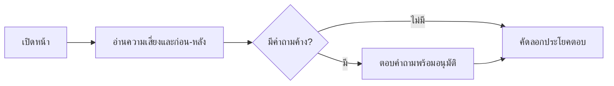

# Design

## Work type

feature, ui

## เส้นทางผู้ใช้

ผู้อนุมัติอ่านความเสี่ยง ก่อน-หลัง และคำถามที่ค้าง แล้วตัดสินใจ รวมทางที่ข้อมูลบางส่วนหาย



## โมเดลโดเมนและโมดูล

| Component | Responsibility | Files | Tasks |
|---|---|---|---|
| approval package renderer | ประกอบหัว ความเสี่ยง ก่อน-หลัง ขอบเขต คำถาม กรณีพลาด | .claude/harness/runtime/workflow/approval-package.mjs | T001 |
| package text | ข้อความ UI สองภาษาของส่วนใหม่ | .claude/harness/runtime/workflow/scratch-blocks.mjs | T001 |

## สัญญา UI

### Approval package

| State | Shows | Actions |
|---|---|---|
| ready | แถบความเสี่ยง การ์ดก่อน-หลัง แถบขอบเขต คำถามที่ค้าง การ์ดกรณีพลาด | — |
| no-open-questions | ไม่แสดงกล่องคำถาม และแถบขอบเขตแสดง 0 คำถามเมื่อ draft ระบุรายการว่าง | — |
| unknown-data | ข้อมูลที่ draft ไม่ให้แสดงว่า ไม่ทราบ และไม่แสดงการ์ดที่คำนวณไม่ได้ | — |
| mobile | การ์ดเรียงคอลัมน์เดียว แถบตัดสินใจเป็นแถบปกติท้ายหน้า | — |
| error | ส่วนที่เรนเดอร์ไม่ได้ถูกข้ามพร้อมคำเตือน หน้ายังแสดงที่เหลือ | — |

- **Accessibility:** ระดับความเสี่ยงมีทั้งคำ สัญลักษณ์ และแถบ ไม่พึ่งสีอย่างเดียว

## Decisions

- **Decision ID:** DEC-FAILURE-CARD-FIELDS
  - **Status:** accepted
  - **Decision:** การ์ดกรณีพลาดใช้ when then recovery จาก scenario ที่มีอยู่ ไม่เพิ่มฟิลด์ใหม่ใน draft
  - **Why:** ข้อมูลจริงไม่แยก ระบบทำ กับ ผู้ใช้เห็น การเพิ่มฟิลด์ใหม่เปลี่ยนสัญญา draft
  - **Rejected:** none
  - **Consequences:** Not stated in the draft
  - **Decided by:** agent
- **Decision ID:** DEC-MOBILE-BAR
  - **Status:** accepted
  - **Decision:** แถบตัดสินใจเป็นแถบปกติที่ 640px ลงมา
  - **Why:** ตรวจที่ 360px พบว่าแถบติดขอบล่างบังเกินครึ่งจอ
  - **Rejected:** none
  - **Consequences:** Not stated in the draft
  - **Decided by:** agent
- **Decision ID:** DEC-FONT-STACK
  - **Status:** accepted
  - **Decision:** ใช้ฟอนต์ในเครื่อง ไม่ดึงฟอนต์จากเครือข่าย
  - **Why:** หน้านี้ห้ามดึงข้อมูลผ่านเครือข่าย
  - **Rejected:** none
  - **Consequences:** Not stated in the draft
  - **Decided by:** agent

## ตารางความล้มเหลว

| Failure | User sees | Recovery | Covers |
|---|---|---|---|
| ไม่มีเหตุผล | แสดงแถบและคำกำกับโดยไม่แสดงรายการเหตุผลว่าง | ไม่ต้องทำอะไร ระดับยังอ่านได้จากแถบ | risk-meter |
| คำถามเป็นข้อความอันตราย | ข้อความถูก escape และแสดงเป็นตัวอักษร | ไม่ต้องทำอะไร | before-after-and-questions |
| ไม่มีสรุปก่อน-หลัง | ไม่แสดงการ์ดก่อน-หลังที่ว่าง และคำเตือนเรื่องสรุปที่ขาดยังแสดง | agent เติม scratch แล้วเรนเดอร์ใหม่ | before-after-and-questions |
| ไม่มี failure scenario | ไม่แสดงส่วนกรณีพลาด และแถบขอบเขตแสดงจำนวนตามจริง | ไม่ต้องทำอะไร | failure-cards |

## แผนที่ไฟล์

| Tasks | Paths |
|---|---|
| T001 | `.claude/harness/runtime/workflow/approval-package.mjs`, `.claude/harness/runtime/workflow/scratch-blocks.mjs`, `.claude/harness/tests/approval-package.test.mjs`, `.claude/harness/tests/scratch-blocks.test.mjs`, `.claude/harness/tests/approval-lanes.test.mjs` |
| T002 | `WORKFLOW.md`, `website/docs/src/content/docs/approval.md`, `website/docs/src/content/docs/th/approval.md` |

`+` add · `~` change · `-` remove

```text
.
├── .claude/
│   └── harness/
│       ├── runtime/
│       │   └── workflow/
│       │       ├── ~ approval-package.mjs
│       │       └── ~ scratch-blocks.mjs
│       └── tests/
│           ├── ~ approval-lanes.test.mjs
│           ├── ~ approval-package.test.mjs
│           └── ~ scratch-blocks.test.mjs
├── website/
│   └── docs/
│       └── src/
│           └── content/
│               └── docs/
│                   ├── ~ approval.md
│                   └── th/
│                       └── ~ approval.md
└── ~ WORKFLOW.md
```

## แผนที่ test

| Scenario | Level | Check | Task |
|---|---|---|---|
| ระดับสูงสุด; ระดับต่ำ; ไม่มีเหตุผล; มีคำถามค้าง; ไม่มีคำถามค้าง; คำถามเป็นข้อความอันตราย; ไม่มีสรุปก่อน-หลัง; มี failure scenario; ไม่มี recovery; ไม่มี failure scenario; มือถือ; ไม่มี script | task check | `node --test .claude/harness/tests/approval-package.test.mjs .claude/harness/tests/scratch-blocks.test.mjs .claude/harness/tests/approval-lanes.test.mjs` | T001 |
| ระดับสูงสุด; ระดับต่ำ; ไม่มีเหตุผล; มีคำถามค้าง; ไม่มีคำถามค้าง; คำถามเป็นข้อความอันตราย; ไม่มีสรุปก่อน-หลัง; มี failure scenario; ไม่มี recovery; ไม่มี failure scenario; มือถือ; ไม่มี script | task check | `bash .claude/tests/docs/run-doc-consistency.sh` | T002 |
