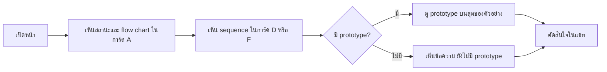

# Design

## Work type

feature, ui

## เส้นทางผู้ใช้

ผู้อนุมัติเปิดหน้า เห็นแผนภาพและ prototype ในการ์ดทันที แล้วตัดสินใจ รวมทางที่ไม่มีแผนภาพหรือวาดไม่ได้



## โมเดลโดเมนและโมดูล

| Component | Responsibility | Files | Tasks |
|---|---|---|---|
| approval package renderer | จัดวางแผนภาพและ prototype ลงการ์ดและส่วนตัวอย่าง | .claude/harness/runtime/workflow/approval-package.mjs | T001 |
| type cards | รับแผนภาพที่จัดวางแล้วและแสดงในการ์ดที่เกี่ยวข้อง พร้อมข้อความยังไม่มี prototype | .claude/harness/runtime/workflow/approval-cards.mjs | T001 |

## สัญญา UI

### Approval package

| State | Shows | Actions |
|---|---|---|
| diagram-ready | แผนภาพวาดเสร็จอยู่ในการ์ดที่เกี่ยวข้อง กางอยู่และย่อได้ | — |
| diagram-fallback | วาดไม่ได้หรือไม่มีไฟล์ Mermaid: แสดงข้อความ Mermaid ของแผนภาพนั้น | — |
| no-diagram | draft ไม่มีแผนภาพ: ไม่แสดงกรอบว่าง และการ์ดอื่นแสดงตามปกติ | — |
| no-prototype | การ์ดแบบ A ที่ไม่มี prototype บอกว่า ยังไม่มี prototype โดยไม่เป็น EDIT | — |
| mobile | แผนภาพกว้างเลื่อนแนวนอนในกรอบของมัน ไม่ทำให้หน้าล้น | — |
| error | ส่วนที่สร้างไม่ได้ถูกข้ามพร้อมคำเตือน หน้ายังแสดงที่เหลือ | — |
| status-line | บรรทัดสถานะใต้หัวหน้าบอกว่าอนุมัติแล้ว หรือยังรออนุมัติจาก role ใด ถ้าไม่มีอะไรต้องบอกก็ไม่แสดง | — |

- **Accessibility:** แผนภาพมีหัวข้อเป็นข้อความ และข้อความ Mermaid ยังอ่านได้เมื่อวาดไม่ได้

## Decisions

- **Decision ID:** DEC-SCOPE
  - **Status:** accepted
  - **Decision:** flow chart ในการ์ด A, sequence/state ในการ์ด D F E ที่เกี่ยวข้อง, prototype บนสุดของตัวอย่าง, แผนภาพกว้างเลื่อนแนวนอน และแก้สองข้อบกพร่องเดิม
  - **Why:** ผู้ใช้สั่งลุยตามข้อเสนอ 1 ถึง 5
  - **Rejected:** none
  - **Consequences:** Not stated in the draft
  - **Decided by:** user
- **Decision ID:** DEC-PLACEMENT-RULE
  - **Status:** accepted
  - **Decision:** sequenceDiagram ไป D แล้ว F แล้ว A, stateDiagram ไป F แล้ว E แล้ว A, อื่นๆไป A แล้วการ์ดแรก, แต่ละรูปที่เดียว
  - **Why:** กฎคงที่ที่ตรวจได้และไม่เปลี่ยน schema ของ draft
  - **Rejected:** none
  - **Consequences:** Not stated in the draft
  - **Decided by:** agent
- **Decision ID:** DEC-NO-NEW-GATE
  - **Status:** accepted
  - **Decision:** ไม่มี prototype หรือแผนภาพเป็นข้อความบอกบนหน้า ไม่เป็น EDIT หรือคำถามถึงผู้ใช้
  - **Why:** ผู้ใช้กำหนดว่าห้ามมีอะไรกั้นผู้ใช้และ agent และงานต้อง land ได้เสมอ
  - **Rejected:** none
  - **Consequences:** Not stated in the draft
  - **Decided by:** user
- **Decision ID:** DEC-COLLAPSIBLE
  - **Status:** accepted
  - **Decision:** แผนภาพใช้ details ที่ open เป็นค่าเริ่มต้น ย่อได้ ไม่ใช้ script
  - **Why:** แผนภาพใหญ่ย่อได้แต่ผู้อนุมัติเห็นทันที
  - **Rejected:** none
  - **Consequences:** Not stated in the draft
  - **Decided by:** agent
- **Decision ID:** DEC-REMOVE-DECISION-BAR
  - **Status:** accepted
  - **Decision:** ตัดส่วนตัดสินใจท้ายหน้า (หัวข้อ ข้อความผลการอนุมัติ ประโยคตอบ textarea) ออกทั้งหมด และย้ายสถานะอนุมัติและ lane ที่ขาดไปเป็นบรรทัดสถานะใต้หัวหน้า
  - **Why:** ผู้ใช้สั่งตัดส่วนนี้ออกจากภาพที่แนบ และการตัดสินใจทำในแชทอยู่แล้ว
  - **Rejected:** none
  - **Consequences:** Not stated in the draft
  - **Decided by:** user
- **Decision ID:** DEC-KEEP-STATUS
  - **Status:** accepted
  - **Decision:** คงสถานะอนุมัติแล้วและ lane ที่ขาดเป็นบรรทัดสถานะ ไม่ตัดทิ้ง
  - **Why:** เป็นข้อมูลสถานะที่บอกว่าอะไรบล็อก Build ไม่ใช่ UI ตัดสินใจ ผู้ใช้ตัดทิ้งได้ถ้าไม่ต้องการ
  - **Rejected:** none
  - **Consequences:** Not stated in the draft
  - **Decided by:** agent

## ตารางความล้มเหลว

| Failure | User sees | Recovery | Covers |
|---|---|---|---|
| วาดไม่ได้ | การ์ด A แสดงข้อความ Mermaid ของแผนภาพนั้นเป็นข้อความที่อ่านได้ | ติดตั้ง harness ใหม่เพื่อคืนไฟล์ ไม่ต้องทำอะไรเพื่ออนุมัติ | flow-in-card-a |
| ไม่มีการ์ดเลย | แผนภาพยังแสดงในส่วนรายละเอียดผู้ตรวจ ไม่หาย | ไม่ต้องทำอะไร | sequence-in-cards |
| ไม่กั้นการเริ่ม | ไม่ได้ EDIT เรื่อง prototype และไม่ถามผู้ใช้ | ไม่ต้องทำอะไร | prototype-visible |
| ไม่มี scratch | แสดงกรอบเตือนว่ายังไม่มีสรุปและแสดง intent แทน | agent เติม scratch แล้วเรนเดอร์ใหม่ | decision-first-page |
| คำถามเป็นข้อความอันตราย | ข้อความถูก escape และแสดงเป็นตัวอักษร | ไม่ต้องทำอะไร | before-after-and-questions |
| ไม่มีสรุปก่อน-หลัง | ไม่แสดงการ์ดก่อน-หลังที่ว่าง และคำเตือนเรื่องสรุปที่ขาดยังแสดง | agent เติม scratch แล้วเรนเดอร์ใหม่ | before-after-and-questions |
| โหมดมืด | สีของแถบความเสี่ยงและการ์ดกำหนดผ่านตัวแปรสีของโหมดมืด ไม่ใช้สีคงที่ที่อ่านไม่ออก | ไม่ต้องทำอะไร | visual-polish |

## แผนที่ไฟล์

| Tasks | Paths |
|---|---|
| T001 | `.claude/harness/runtime/workflow/approval-package.mjs`, `.claude/harness/runtime/workflow/approval-cards.mjs`, `.claude/harness/runtime/workflow/scratch-blocks.mjs`, `.claude/harness/tests/approval-package.test.mjs`, `.claude/harness/tests/scratch-blocks.test.mjs`, `.claude/harness/tests/approval-lanes.test.mjs` |
| T002 | `WORKFLOW.md`, `website/docs/src/content/docs/approval.md`, `website/docs/src/content/docs/th/approval.md` |

`+` add · `~` change · `-` remove

```text
.
├── .claude/
│   └── harness/
│       ├── runtime/
│       │   └── workflow/
│       │       ├── ~ approval-cards.mjs
│       │       ├── ~ approval-package.mjs
│       │       └── ~ scratch-blocks.mjs
│       └── tests/
│           ├── ~ approval-lanes.test.mjs
│           ├── ~ approval-package.test.mjs
│           └── ~ scratch-blocks.test.mjs
├── website/
│   └── docs/
│       └── src/
│           └── content/
│               └── docs/
│                   ├── ~ approval.md
│                   └── th/
│                       └── ~ approval.md
└── ~ WORKFLOW.md
```

## แผนที่ test

| Scenario | Level | Check | Task |
|---|---|---|---|
| มี userFlow; ไม่มี source; วาดไม่ได้; sequence กับ api; state กับ async; ไม่มีการ์ดที่ตรง; ไม่มีการ์ดเลย; prototype ไม่ใช่ตัวแรก; ไม่มี prototype; งานที่ไม่ใช่แบบ A; ไม่กั้นการเริ่ม; กรอบเลื่อนได้; ไม่มี script เพิ่ม; ไม่มีส่วนตัดสินใจ; ไม่มี form หรือ script; ถามในแชทเหมือนเดิม; อนุมัติแล้ว; lane ยังไม่ครบ; ไม่มีอะไรต้องบอก; สรุปมาก่อน; ไม่มี scratch; ไม่ทราบตัวเลขขอบเขต; มีคำถามค้าง; ไม่มีคำถามค้าง; คำถามเป็นข้อความอันตราย; ไม่มีสรุปก่อน-หลัง; แถบความเสี่ยงมีสีตามระดับ; ชิปยาวไม่ล้น; แท็กก่อนหลังพอดีตัว; โหมดมืด | task check | `node --test .claude/harness/tests/approval-package.test.mjs .claude/harness/tests/scratch-blocks.test.mjs .claude/harness/tests/approval-lanes.test.mjs` | T001 |
| มี userFlow; ไม่มี source; วาดไม่ได้; sequence กับ api; state กับ async; ไม่มีการ์ดที่ตรง; ไม่มีการ์ดเลย; prototype ไม่ใช่ตัวแรก; ไม่มี prototype; งานที่ไม่ใช่แบบ A; ไม่กั้นการเริ่ม; กรอบเลื่อนได้; ไม่มี script เพิ่ม; ป้ายกะทัดรัด; หัวข้อต่างกัน; ไม่มีส่วนตัดสินใจ; ไม่มี form หรือ script; ถามในแชทเหมือนเดิม; อนุมัติแล้ว; lane ยังไม่ครบ; ไม่มีอะไรต้องบอก; สรุปมาก่อน; ไม่มี scratch; ไม่ทราบตัวเลขขอบเขต; มีคำถามค้าง; ไม่มีคำถามค้าง; คำถามเป็นข้อความอันตราย; ไม่มีสรุปก่อน-หลัง | task check | `bash .claude/tests/docs/run-doc-consistency.sh` | T002 |
