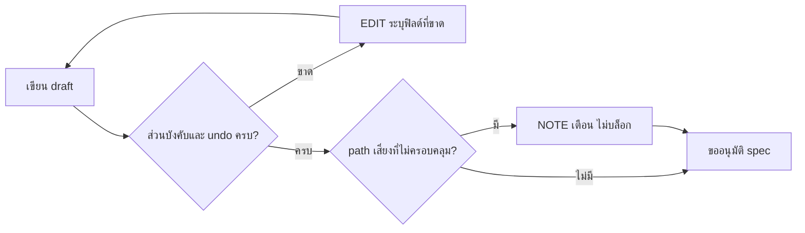

# Design

## Work type

feature

## เส้นทางผู้ใช้

ผู้เขียน draft เลือก work type ใหม่หรือเขียนงานเสี่ยงสูง ระบบตรวจ section ที่ขาดและวิธีย้อนกลับ แล้วจึงขออนุมัติ



## Decisions

- **Decision ID:** DEC-SCOPE
  - **Status:** accepted
  - **Decision:** รอบนี้รวมครบ: work type ใหม่สามชนิด บังคับ undo ที่ High และ Critical บังคับฟิลด์ที่ขาดรายชนิด และเตือนเรื่อง path เสี่ยง
  - **Why:** ผู้ใช้เลือกทุกข้อ
  - **Rejected:** none
  - **Consequences:** Not stated in the draft
  - **Decided by:** user
- **Decision ID:** DEC-COMPATIBILITY
  - **Status:** accepted
  - **Decision:** ข้อบังคับใหม่ใช้กับ draft ที่ start หรือ revise ใหม่เท่านั้น change ที่เริ่มหรืออนุมัติแล้วและ amendment ไม่ถูกบล็อก
  - **Why:** ผู้ใช้เลือกแบบเดียวกับกฎ scratch
  - **Rejected:** none
  - **Consequences:** Not stated in the draft
  - **Decided by:** user
- **Decision ID:** DEC-PATH-RISK
  - **Status:** accepted
  - **Decision:** path ที่บ่งชี้ความเสี่ยงแต่ draft ไม่ประกาศ ให้เตือนด้วย NOTE ไม่บังคับ discovery coverage
  - **Why:** ผู้ใช้เลือกเตือนอย่างเดียว
  - **Rejected:** none
  - **Consequences:** Not stated in the draft
  - **Decided by:** user
- **Decision ID:** DEC-NEW-TYPE-SECTIONS
  - **Status:** accepted
  - **Decision:** data-fix: dataFix{scope, snapshot, dryRun, rerunSafe, rollback} · security: threatModel + hardening{weakness, control, verification} · cicd: pipelinePlan{changes, permissions, blastRadius, rollback}
  - **Why:** ผู้ใช้ยืนยันตามข้อเสนอ
  - **Rejected:** none
  - **Consequences:** Not stated in the draft
  - **Decided by:** user
- **Decision ID:** DEC-CAPABILITIES
  - **Status:** accepted
  - **Decision:** data-fix ใช้ data-migration, security ใช้ security-static, cicd ไม่เพิ่ม capability นอกเหนือจาก test
  - **Why:** ใช้ capability เดิมเพื่อไม่ให้ผู้ใช้ต้องตั้ง provider ใหม่ และไม่ทำให้ proof ของ pipeline ต้องพึ่ง deployment provider
  - **Rejected:** none
  - **Consequences:** Not stated in the draft
  - **Decided by:** agent
- **Decision ID:** DEC-SHARED-UNDO
  - **Status:** accepted
  - **Decision:** กฎ undo และการ derive undo ในการ์ดใช้โมดูลเดียวกัน (undo-plan.mjs)
  - **Why:** ไม่เขียนกฎซ้ำ และกฎกับการ์ดไม่คลาดเคลื่อนกัน
  - **Rejected:** none
  - **Consequences:** Not stated in the draft
  - **Decided by:** agent
- **Decision ID:** DEC-NEVER-BLOCK
  - **Status:** accepted
  - **Decision:** ทุกข้อบังคับใหม่เป็นของ agent ผ่านได้เสมอด้วยค่า none หรือ unknown ที่มีเหตุผล ไม่ถามผู้ใช้ และไม่กั้น Land หลัง start
  - **Why:** ผู้ใช้กำหนดว่าต้องไม่มีอะไร block ผู้ใช้และ agent และงานต้อง land ได้เสมอ
  - **Rejected:** none
  - **Consequences:** Not stated in the draft
  - **Decided by:** user

## ตารางความล้มเหลว

| Failure | User sees | Recovery | Covers |
|---|---|---|---|
| ชนิดไม่รู้จัก | ได้ EDIT พร้อมรายชื่อประเภทที่รับซึ่งมี data-fix, security และ cicd | แก้เป็นประเภทที่อยู่ในรายชื่อแล้วรันซ้ำ | new-work-types |
| ขาด snapshot | ได้ EDIT ระบุ dataFix.snapshot ที่ขาด | เติม snapshot แล้วรันซ้ำ | data-fix-sections |
| ไม่มี dataFix | ได้ EDIT ระบุว่าต้องมี dataFix พร้อมรูปแบบ | เพิ่ม dataFix แล้วรันซ้ำ | data-fix-sections |
| ขาด verification | ได้ EDIT ระบุ hardening.verification ที่ขาด | เติมวิธีพิสูจน์แล้วรันซ้ำ | security-sections |
| ขาดสิทธิ์ | ได้ EDIT ระบุ pipelinePlan.permissions ที่ขาด | ระบุสิทธิ์หรือ secret ที่ใช้แล้วรันซ้ำ | cicd-sections |
| ml ขาด evaluation | ได้ EDIT ระบุ modelCard.evaluation | เติมชุดประเมินและ threshold แล้วรันซ้ำ | per-type-required-fields |
| experiment ขาด stopRules | ได้ EDIT ระบุ experimentDesign.stopRules | เติมเงื่อนไขหยุดแล้วรันซ้ำ | per-type-required-fields |
| infra ขาด costDelta | ได้ EDIT ระบุ infraPlan.costDelta | เติมค่าใช้จ่ายที่เปลี่ยนแล้วรันซ้ำ | per-type-required-fields |
| high ไม่มี undo | ได้ EDIT ระบุว่าต้องมี scratch.undo หรือ rollback field | เพิ่ม scratch.undo แล้วรันซ้ำ | undo-required-high |
| ไม่มีเหตุผล | ได้ EDIT ของ agent ที่ระบุฟิลด์นั้นและบอกรูปแบบ unknown: เหตุผล | agent เติมเหตุผลแล้วรันซ้ำ ไม่ต้องถามผู้ใช้ | never-blocks-land |

## แผนที่ไฟล์

| Tasks | Paths |
|---|---|
| T001 | `.claude/harness/runtime/contracts/work-types.mjs`, `.claude/harness/runtime/workflow/validation/work-type-fields.mjs`, `.claude/harness/runtime/workflow/validation/design-blueprints.mjs`, `.claude/harness/runtime/workflow/validation/dev-document.mjs`, `.claude/harness/runtime/workflow/validation/outline-contract.mjs`, `.claude/harness/runtime/workflow/change-policy.mjs` |
| T001; T002 | `.claude/harness/runtime/workflow/semantic-draft.mjs`, `.claude/harness/runtime/workflow/validation/explicit-absence.mjs` (add) |
| T001; T002; T003 | `.claude/harness/tests/` |
| T002 | `.claude/harness/runtime/workflow/undo-plan.mjs` (add), `.claude/harness/runtime/workflow/change-lifecycle.mjs` |
| T003 | `.claude/harness/runtime/contracts/scratch-router.mjs`, `.claude/harness/runtime/workflow/approval-cards.mjs`, `.claude/harness/runtime/workflow/scratch-blocks.mjs` |
| T004 | `WORKFLOW.md`, `website/docs/src/content/docs/approval.md`, `website/docs/src/content/docs/th/approval.md`, `openspec/investigations/change-doc-outline.md`, `.claude/harness/EVIDENCE.md` |

`+` add · `~` change · `-` remove

```text
.
├── .claude/
│   └── harness/
│       ├── ~ EVIDENCE.md
│       ├── runtime/
│       │   ├── contracts/
│       │   │   ├── ~ scratch-router.mjs
│       │   │   └── ~ work-types.mjs
│       │   └── workflow/
│       │       ├── ~ approval-cards.mjs
│       │       ├── ~ change-lifecycle.mjs
│       │       ├── ~ change-policy.mjs
│       │       ├── ~ scratch-blocks.mjs
│       │       ├── ~ semantic-draft.mjs
│       │       ├── + undo-plan.mjs
│       │       └── validation/
│       │           ├── ~ design-blueprints.mjs
│       │           ├── ~ dev-document.mjs
│       │           ├── + explicit-absence.mjs
│       │           ├── ~ outline-contract.mjs
│       │           └── ~ work-type-fields.mjs
│       └── ~ tests/
├── openspec/
│   └── investigations/
│       └── ~ change-doc-outline.md
├── website/
│   └── docs/
│       └── src/
│           └── content/
│               └── docs/
│                   ├── ~ approval.md
│                   └── th/
│                       └── ~ approval.md
└── ~ WORKFLOW.md
```

## แผนที่ test

| Scenario | Level | Check | Task |
|---|---|---|---|
| ประกาศชนิดใหม่; ชนิดไม่รู้จัก; ชนิดเดิมไม่เปลี่ยน; ครบ; ขาด snapshot; ไม่มี dataFix; ระบุไม่ทราบ; ขาด verification; อนุมานจาก path; ขาดสิทธิ์; ไม่เพิ่ม provider; ml ขาด evaluation; experiment ขาด stopRules; infra ขาด costDelta; change ที่เริ่มแล้ว; ระบุไม่ทราบพร้อมเหตุผล; ระบุไม่มีวิธีย้อนกลับ; ไม่มีเหตุผล; ไม่ถามผู้ใช้; หลัง start ไม่ขวาง Land | task check | `node --test .claude/harness/tests/required-sections.test.mjs .claude/harness/tests/design-blueprints.test.mjs .claude/harness/tests/outline-contract.test.mjs .claude/harness/tests/design-render.test.mjs .claude/harness/tests/change-policy-surface.test.mjs .claude/harness/tests/required-providers.test.mjs` | T001 |
| high ไม่มี undo; มี rollback เดิม; ระดับ medium; amend ไม่ถูกบล็อก; ระบุว่าย้อนกลับไม่ได้; path เสี่ยงไม่มี coverage; มี coverage แล้ว; ไม่มี path เสี่ยง; ระบุไม่ทราบพร้อมเหตุผล; ระบุไม่มีวิธีย้อนกลับ; ไม่มีเหตุผล; ไม่ถามผู้ใช้; หลัง start ไม่ขวาง Land | task check | `node --test .claude/harness/tests/semantic-draft.test.mjs .claude/harness/tests/change-atomic-start.test.mjs .claude/harness/tests/change-revise.test.mjs .claude/harness/tests/scratch-nudges.test.mjs` | T002 |
| การ์ดข้อมูล; การ์ด pipeline; ไม่มีป้ายแนะนำแล้ว; ระบุไม่ทราบพร้อมเหตุผล; ระบุไม่มีวิธีย้อนกลับ; ไม่มีเหตุผล; ไม่ถามผู้ใช้; หลัง start ไม่ขวาง Land | task check | `node --test .claude/harness/tests/approval-package.test.mjs .claude/harness/tests/scratch-blocks.test.mjs .claude/harness/tests/approval-lanes.test.mjs` | T003 |
| ประกาศชนิดใหม่; ชนิดไม่รู้จัก; ชนิดเดิมไม่เปลี่ยน; ครบ; ขาด snapshot; ไม่มี dataFix; ระบุไม่ทราบ; ขาด verification; อนุมานจาก path; ขาดสิทธิ์; ไม่เพิ่ม provider; ml ขาด evaluation; experiment ขาด stopRules; infra ขาด costDelta; change ที่เริ่มแล้ว; high ไม่มี undo; มี rollback เดิม; ระดับ medium; amend ไม่ถูกบล็อก; ระบุว่าย้อนกลับไม่ได้; path เสี่ยงไม่มี coverage; มี coverage แล้ว; ไม่มี path เสี่ยง; การ์ดข้อมูล; การ์ด pipeline; ไม่มีป้ายแนะนำแล้ว; ระบุไม่ทราบพร้อมเหตุผล; ระบุไม่มีวิธีย้อนกลับ; ไม่มีเหตุผล; ไม่ถามผู้ใช้; หลัง start ไม่ขวาง Land | task check | `bash .claude/tests/docs/run-doc-consistency.sh` | T004 |
