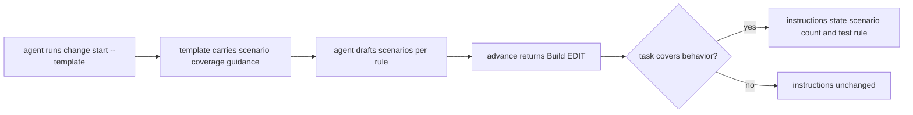

# Design

## Work type

feature

## เส้นทางผู้ใช้

agent เห็นแนวทางความพอของเทสต์ทั้งตอนร่าง spec และตอน Build



## ตารางความล้มเหลว

| Failure | User sees | Recovery | Covers |
|---|---|---|---|
| ไม่ระบุชื่อ skill | ไม่มี field skills ไม่มีชื่อ skill และไม่มีคำสั่งให้โหลด skill | No separate step; the outcome is the handling | build-edit-test-adequacy |

## แผนที่ไฟล์

| Tasks | Paths |
|---|---|
| T001 | `.claude/harness/runtime/workflow/semantic-draft.mjs`, `.claude/harness/tests/semantic-draft.test.mjs` |
| T002 | `.claude/harness/runtime/workflow/advance-runtime.mjs`, `.claude/harness/tests/advance-runtime.test.mjs` |

`+` add · `~` change · `-` remove

```text
.
└── .claude/
    └── harness/
        ├── runtime/
        │   └── workflow/
        │       ├── ~ advance-runtime.mjs
        │       └── ~ semantic-draft.mjs
        └── tests/
            ├── ~ advance-runtime.test.mjs
            └── ~ semantic-draft.test.mjs
```

## แผนที่ test

| Scenario | Level | Check | Task |
|---|---|---|---|
| template มีแนวทาง scenario; ไม่มีโควตาและไม่มีชื่อ skill | task check | `node --test .claude/harness/tests/semantic-draft.test.mjs` | T001 |
| task เปลี่ยนพฤติกรรมและมี claim; งานไม่เปลี่ยนพฤติกรรม; task ไม่มี claim; ไม่ระบุชื่อ skill | task check | `node --test .claude/harness/tests/advance-runtime.test.mjs` | T002 |
