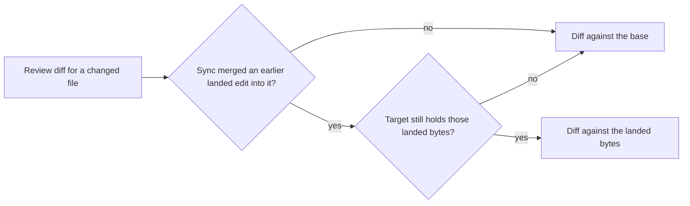

# Design

## Work type

feature

## User flow

How the review diff is chosen for a file of a stacked change



## Failure matrix

| Failure | User sees | Recovery | Covers |
|---|---|---|---|
| Landed bytes that no longer match fall back to the base diff | the hunk is the diff against the base and hides nothing from the reviewer | Nothing to repair; the reviewer sees the larger diff | review-diff-excludes-landed |

## File map

| Tasks | Paths |
|---|---|
| T001 | `.claude/harness/runtime/workflow/sandbox-runtime.mjs`, `.claude/harness/tests/concurrent-same-file.test.mjs` |
| T002 | `.claude/harness/runtime/evidence/review-diff.mjs`, `.claude/harness/runtime/workflow/packet-runtime.mjs`, `.claude/harness/tests/configured-reviewer.test.mjs`, `.claude/harness/tests/packet-value.test.mjs` |
| T003 | `.claude/harness/EVIDENCE.md` |

`+` add · `~` change · `-` remove

```text
.
└── .claude/
    └── harness/
        ├── ~ EVIDENCE.md
        ├── runtime/
        │   ├── evidence/
        │   │   └── ~ review-diff.mjs
        │   └── workflow/
        │       ├── ~ packet-runtime.mjs
        │       └── ~ sandbox-runtime.mjs
        └── tests/
            ├── ~ concurrent-same-file.test.mjs
            ├── ~ configured-reviewer.test.mjs
            └── ~ packet-value.test.mjs
```

## Test map

| Scenario | Level | Check | Task |
|---|---|---|---|
| The root sync records the merged file | task check | `node --test .claude/harness/tests/concurrent-same-file.test.mjs` | T001 |
| A merged file shows only this change's lines; A file no earlier change landed keeps the base diff; Landed bytes that no longer match fall back to the base diff; A file equal to the landed bytes has no change of its own | task check | `node --test .claude/harness/tests/configured-reviewer.test.mjs .claude/harness/tests/packet-value.test.mjs` | T002 |
| A merged file shows only this change's lines; A file no earlier change landed keeps the base diff; Landed bytes that no longer match fall back to the base diff; A file equal to the landed bytes has no change of its own | task check | `bash .claude/tests/docs/run-doc-consistency.sh` | T003 |
