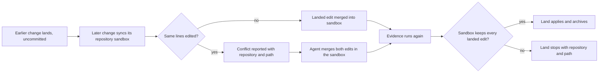

# Design

## Work type

feature

## User flow

How a later change lands in a repository an earlier change already landed in



## Failure matrix

| Failure | User sees | Recovery | Covers |
|---|---|---|---|
| Edits on the same line conflict | sync reports a conflict that names repository backend, the path, and alpha as the landed change | The agent edits the sandbox file into the merge of both edits, keeping all landed content, and resumes Land | repository-landed-replay |
| A merge that drops landed content does not land | Land stops naming repository backend and the path, and the target keeps alpha's landed bytes | The agent restores the landed content in the sandbox file and resumes Land | repository-resolution-accepted |
| A user edit on the same lines stops Land | Land stops with the overwrite error naming repository backend and the path and the target bytes are unchanged | No separate step; the outcome is the handling | repository-user-edit-stops |

## File map

| Tasks | Paths |
|---|---|
| T001 | `.claude/harness/runtime/workflow/sandbox-runtime.mjs`, `.claude/harness/runtime/workflow/target-edits.mjs`, `.claude/harness/tests/concurrent-repositories.test.mjs` (add), `.claude/harness/tests/fixtures/concurrent-repositories.mjs` (add), `.claude/harness/tests/target-edits.test.mjs`, `.claude/tests/run-all.sh`, `.claude/tests/README.md` |
| T002 | `.claude/harness/runtime/workflow/repository-delivery-saga.mjs`, `.claude/harness/tests/repository-delivery-saga.test.mjs` |
| T003 | `WORKFLOW.md`, `website/docs/src/content/docs/loop/land.md`, `website/docs/src/content/docs/th/loop/land.md` |

`+` add · `~` change · `-` remove

```text
.
├── .claude/
│   ├── harness/
│   │   ├── runtime/
│   │   │   └── workflow/
│   │   │       ├── ~ repository-delivery-saga.mjs
│   │   │       ├── ~ sandbox-runtime.mjs
│   │   │       └── ~ target-edits.mjs
│   │   └── tests/
│   │       ├── + concurrent-repositories.test.mjs
│   │       ├── fixtures/
│   │       │   └── + concurrent-repositories.mjs
│   │       ├── ~ repository-delivery-saga.test.mjs
│   │       └── ~ target-edits.test.mjs
│   └── tests/
│       ├── ~ README.md
│       └── ~ run-all.sh
├── website/
│   └── docs/
│       └── src/
│           └── content/
│               └── docs/
│                   ├── loop/
│                   │   └── ~ land.md
│                   └── th/
│                       └── loop/
│                           └── ~ land.md
└── ~ WORKFLOW.md
```

## Test map

| Scenario | Level | Check | Task |
|---|---|---|---|
| Edits on different lines merge; Edits on the same line conflict; A file edited after the landing is not replayed; A file the sandbox did not edit is left alone; A replayed change lands | task check | `node --test .claude/harness/tests/concurrent-repositories.test.mjs .claude/harness/tests/target-edits.test.mjs` | T001 |
| A resolved merge lands; A merge that drops landed content does not land; A resolution does not survive a changed target; A user edit on the same lines stops Land; A sandbox that already carries the edit lands | task check | `node --test .claude/harness/tests/repository-delivery-saga.test.mjs` | T002 |
| Edits on different lines merge; Edits on the same line conflict; A file edited after the landing is not replayed; A file the sandbox did not edit is left alone; A replayed change lands; A resolved merge lands; A merge that drops landed content does not land; A resolution does not survive a changed target | task check | `bash .claude/tests/docs/run-doc-consistency.sh` | T003 |
