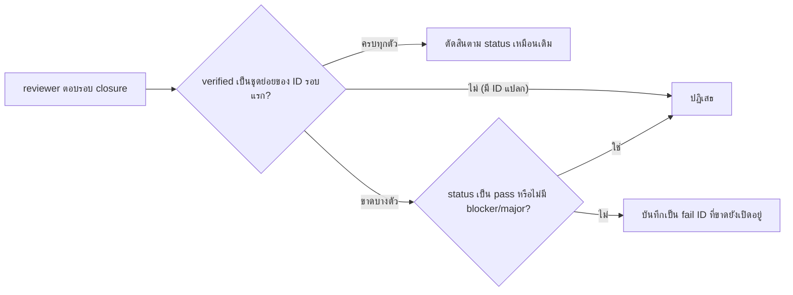

# Design

## Work type

feature

## เส้นทางผู้ใช้

harness ตัดสินผลของรอบ closure อย่างไร



## ตารางความล้มเหลว

| Failure | User sees | Recovery | Covers |
|---|---|---|---|
| pass ที่ปิดไม่ครบถูกปฏิเสธ | ผลถูกปฏิเสธและข้อความระบุว่ารอบ closure ต้อง verify F1 และ F2 ครบ | reviewer ตอบใหม่โดย verify ครบหรือ fail พร้อม finding ที่ยังค้าง | partial-closure-is-a-verdict |
| fail ที่ขาด ID โดยไม่มี finding อธิบายถูกปฏิเสธ | ผลถูกปฏิเสธเพราะไม่มี finding ใดอธิบายส่วนที่ขาด | No separate step; the outcome is the handling | partial-closure-is-a-verdict |
| verified ที่มี ID นอกรอบแรกถูกปฏิเสธ | ผลถูกปฏิเสธและข้อความระบุ F1 เป็น ID ที่รอบ closure อ้างอิงได้ | No separate step; the outcome is the handling | partial-closure-is-a-verdict |

## แผนที่ไฟล์

| Tasks | Paths |
|---|---|
| T001 | `.claude/harness/runtime/evidence/configured-reviewer.mjs`, `.claude/harness/tests/configured-reviewer.test.mjs` |
| T002 | `.claude/harness/runtime/workflow/authority-runtime.mjs`, `.claude/harness/tests/authority-response-validation.test.mjs`, `.claude/harness/tests/workflow-policy.test.mjs` |
| T003 | `.claude/harness/EVIDENCE.md`, `WORKFLOW.md` |

`+` add · `~` change · `-` remove

```text
.
├── .claude/
│   └── harness/
│       ├── ~ EVIDENCE.md
│       ├── runtime/
│       │   ├── evidence/
│       │   │   └── ~ configured-reviewer.mjs
│       │   └── workflow/
│       │       └── ~ authority-runtime.mjs
│       └── tests/
│           ├── ~ authority-response-validation.test.mjs
│           ├── ~ configured-reviewer.test.mjs
│           └── ~ workflow-policy.test.mjs
└── ~ WORKFLOW.md
```

## แผนที่ test

| Scenario | Level | Check | Task |
|---|---|---|---|
| ปิดได้สามจากสี่แล้วยังเห็นปัญหาค้าง; pass ที่ปิดไม่ครบถูกปฏิเสธ; fail ที่ขาด ID โดยไม่มี finding อธิบายถูกปฏิเสธ; verified ที่มี ID นอกรอบแรกถูกปฏิเสธ; ปิดครบทุกตัวคงเดิม; ผลที่บันทึกด้วยมือผ่านกติกาเดียวกัน; คำสั่งของ reviewer อธิบายวิธีตอบเมื่อปิดไม่ครบ | task check | `node --test .claude/harness/tests/configured-reviewer.test.mjs` | T001 |
| ปิดได้สามจากสี่แล้วยังเห็นปัญหาค้าง; pass ที่ปิดไม่ครบถูกปฏิเสธ; fail ที่ขาด ID โดยไม่มี finding อธิบายถูกปฏิเสธ; verified ที่มี ID นอกรอบแรกถูกปฏิเสธ; ปิดครบทุกตัวคงเดิม; ผลที่บันทึกด้วยมือผ่านกติกาเดียวกัน | task check | `node --test .claude/harness/tests/authority-response-validation.test.mjs .claude/harness/tests/workflow-policy.test.mjs` | T002 |
| ปิดได้สามจากสี่แล้วยังเห็นปัญหาค้าง; pass ที่ปิดไม่ครบถูกปฏิเสธ; fail ที่ขาด ID โดยไม่มี finding อธิบายถูกปฏิเสธ; verified ที่มี ID นอกรอบแรกถูกปฏิเสธ; ปิดครบทุกตัวคงเดิม; ผลที่บันทึกด้วยมือผ่านกติกาเดียวกัน | task check | `bash .claude/tests/docs/run-doc-consistency.sh` | T003 |
