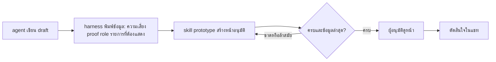

# Design

## Work type

feature, ui

## เส้นทางผู้ใช้

เส้นทางของ agent harness และผู้อนุมัติ ตั้งแต่ draft ถึงการตัดสินใจ รวมกรณีหน้ายังไม่ครบหรือล้าสมัย



## โมเดลโดเมนและโมดูล

| Component | Responsibility | Files | Tasks |
|---|---|---|---|
| prototype-checklist | อนุมานรายการที่หน้าต้องแสดงจาก work type และฟิลด์ใน draft และเทียบกับ covers | .claude/harness/runtime/workflow/prototype-checklist.mjs | T001 |
| prototype-sync | บันทึกและเทียบ digest ของหน้ากับ digest ของข้อมูลที่ harness คำนวณ | .claude/harness/runtime/workflow/prototype-sync.mjs | T002 |
| approval-package | พิมพ์ข้อมูลของ change เป็น JSON แทนการเรนเดอร์ HTML | .claude/harness/runtime/workflow/approval-package.mjs | T003 |
| prototype-skill | สร้างทั้งหน้าอนุมัติ ใช้ design ของ project และประกาศ covers | .claude/skills/prototype/SKILL.md | T004 |

## สัญญา UI

### หน้าอนุมัติ (skill เป็นผู้สร้าง)

| State | Shows | Actions |
|---|---|---|
| ครบและข้อมูลล่าสุด | prototype เป็นมุมมองหลัก ทุกข้อของรายการมีเครื่องหมายประกาศครอบคลุม | — |
| ขาดบางข้อ | ข้อที่ขาดระบุชื่อและบอกว่าต้องเติมอะไร | — |
| ยังไม่มีหน้า | คำถามอนุมัติแสดงสรุปเป็นข้อความและบอกให้ใช้ skill prototype | — |
| ล้าสมัยหรือถูกแก้ | คำเตือนว่าหน้าถูกแก้หลังฉบับล่าสุดหรือข้อมูลของ harness ในหน้าไม่ตรง ไม่กั้นอะไร | — |
| error อ่านข้อมูลบางส่วนไม่ได้ | package พิมพ์คำเตือนของส่วนนั้นและข้อมูลส่วนอื่นยังอยู่ | — |

- **Accessibility:** หน้าและรายการใช้คีย์บอร์ดได้และไม่พึ่งสีอย่างเดียว

## Decisions

- **Decision ID:** DEC-SKILL-AUTHORS-WHOLE-PAGE
  - **Status:** accepted
  - **Decision:** skill prototype สร้างทั้งหน้าอนุมัติ harness ไม่สร้างหน้าหรือภาพใด ๆ เหลือส่งข้อมูลและตรวจ
  - **Why:** ผู้ใช้ตัดสินว่า harness ไม่ควรสร้างอะไร skill prototype ต้องเป็นผู้สร้าง และเลือกให้ skill สร้างทั้งหน้า
  - **Rejected:** none
  - **Consequences:** Not stated in the draft
  - **Decided by:** user
- **Decision ID:** DEC-HARNESS-LISTS-REQUIRED-SURFACES
  - **Status:** accepted
  - **Decision:** harness อนุมานรายการที่หน้าต้องแสดงจาก draft ครบ 26 work type และรายงานว่าครอบคลุมหรือขาด แบบ advisory
  - **Why:** ผู้ใช้ต้องการให้ harness บอกว่า change นี้มี prototype อะไรต้องแสดงบ้างและบอกให้เติมให้ครบ
  - **Rejected:** none
  - **Consequences:** Not stated in the draft
  - **Decided by:** user
- **Decision ID:** DEC-SKILL-KEEPS-CHANGE-IN-SYNC
  - **Status:** accepted
  - **Decision:** เมื่อหน้าถูกแก้ skill ต้อง revise หรือ amend change ให้ตรงในรอบเดียวกัน และหน้าไม่ใช่แหล่งความจริง
  - **Why:** ผู้ใช้สั่งว่าถ้าแก้ prototype ต้องแก้ change ให้ตรงกัน
  - **Rejected:** none
  - **Consequences:** Not stated in the draft
  - **Decided by:** user
- **Decision ID:** DEC-DESIGN-SURFACE-WHEN-AVAILABLE
  - **Status:** accepted
  - **Decision:** ถ้า host มี skill design หรือ Artifact ชนิด design skill ต้องใช้ canvas นั้นเป็นที่สร้างและแก้หน้า จัดเป็นเฟรมต่อหน้าจอหรือสถานะมีเลขลำดับและหัวข้อกลุ่ม และส่งออกไฟล์ใน .foundation/previews ทุกครั้ง
  - **Why:** ผู้ใช้สั่งว่าต้องใช้ design skill เมื่อมี เพราะ canvas ทำงานง่าย (ยกตัวอย่างภาพ canvas หลายเฟรมเรียงเลข) harness ตรวจจากไฟล์จึงต้องส่งออกไฟล์ด้วย
  - **Rejected:** none
  - **Consequences:** Not stated in the draft
  - **Decided by:** user
- **Decision ID:** DEC-PAGE-LIVES-IN-PREVIEWS
  - **Status:** accepted
  - **Decision:** หน้าอนุมัติคือไฟล์ .foundation/previews/<change>/prototype.html ที่ draft ชี้เป็น example ชนิด prototype และ harness ไม่เขียนโฟลเดอร์ packages อีก
  - **Why:** ใช้ path ที่ระบบตรวจรับและเขียนได้อยู่แล้ว ไม่ต้องให้ skill เขียนในโฟลเดอร์ที่ harness เป็นเจ้าของ
  - **Rejected:** none
  - **Consequences:** Not stated in the draft
  - **Decided by:** agent
- **Decision ID:** DEC-DIGEST-WARNINGS-DETECT-DRIFT
  - **Status:** accepted
  - **Decision:** harness จำ digest ของหน้าและ factsDigest แล้วเตือนแบบ advisory ไม่กั้น
  - **Why:** ทำให้กติกาให้แก้ change ตามหน้าและให้แถบข้อเท็จจริงตรงกับ harness ตรวจซ้ำได้โดยอัตโนมัติ
  - **Rejected:** none
  - **Consequences:** Not stated in the draft
  - **Decided by:** agent
- **Decision ID:** DEC-KEEP-VENDOR-MERMAID
  - **Status:** accepted
  - **Decision:** ไม่ลบ vendor/mermaid.min.js แม้ไม่มีตัว render ใช้แล้ว
  - **Why:** เลี่ยงผลกระทบต่อตัวติดตั้งและเอกสารลิขสิทธิ์ ลบได้ใน change แยก
  - **Rejected:** none
  - **Consequences:** Not stated in the draft
  - **Decided by:** agent

## ตารางความล้มเหลว

| Failure | User sees | Recovery | Covers |
|---|---|---|---|
| อ่าน evidence บางส่วนไม่ได้ | ได้ JSON ที่มี warnings ระบุรายการนั้นและข้อมูลส่วนอื่นยังอยู่ | แก้หรือสร้าง receipt แล้วรัน package ใหม่ | approval-data |
| ยังไม่มีหน้า | ข้อความแสดงสรุป 4 บรรทัดเป็นข้อความและบอกว่ายังไม่มีหน้าอนุมัติให้ใช้ skill prototype และไม่หยุดการถาม | agent ใช้ skill prototype สร้างหน้าแล้ว change revise | approval-page-authored-by-skill |
| ชนิดใหม่ที่ยังไม่มีรายการ | ชุดทดสอบล้มและระบุชื่อชนิดที่ไม่มีรายการ | เพิ่มรายการของชนิดนั้นในตารางแล้วรันใหม่ | prototype-checklist |
| ไม่กั้นการเริ่ม | พิมพ์ NOTE ที่ระบุรายการที่หน้าต้องแสดง โดยไม่ EDIT ไม่ถามผู้ใช้ และไม่หยุด | agent ใช้ skill prototype สร้างหน้าแล้ว change revise | prototype-checklist |
| ยังขาด | ข้อแผง API มีสถานะ ยังขาด พร้อมชื่อข้อ | agent เติมส่วนนั้นในหน้าแล้ว change revise | prototype-coverage-declared |
| หน้าอ้าง proof เอง | จำนวน proof ในข้อมูลไม่เพิ่ม และป้ายหลักฐานของ artifact นั้นเป็น none | รัน Prove ให้ได้ receipt ที่ผ่านจริง | facts-from-harness-only |
| ข้อมูลของ harness ในหน้าล้าสมัย | ข้อมูลมี factsStale true และคำถามอนุมัติเตือนให้ skill อัปเดตแถบข้อเท็จจริงในหน้า | skill อัปเดตหน้าด้วย factsDigest ล่าสุด | prototype-sync |
| แก้ไฟล์แต่ไม่แก้ change | คำเตือนยังอยู่ แต่ไม่ถูกนับเป็น EDIT และไม่หยุดการทำงาน | agent เทียบหน้ากับ agreement แล้วรัน change revise หรือ change amend | prototype-sync |
| ยังไม่มี change | skill ไม่สร้างหน้าจากการเดา และบอกให้ทำ change ก่อน | ผู้ใช้หรือ agent รัน change เพื่อสร้าง draft แล้วเรียก skill ใหม่ | prototype-skill-contract |
| ขัดกับ agreement ที่อนุมัติแล้ว | skill ไม่ปล่อยให้ไม่ตรงเงียบ ๆ แต่เสนอ amend หรือยกเลิกการแก้ และไม่ลบ requirement โดยไม่ได้รับอนุมัติ | ผู้ใช้เลือก amend หรือยกเลิกการแก้ | prototype-skill-contract |
| canvas ใช้ไม่ได้ | skill ตกกลับไปเขียนไฟล์ HTML อย่างเดียว บอกผู้ใช้ว่าเหตุใดไม่ได้ใช้ canvas และไม่หยุดงาน | ผู้ใช้สั่งให้ลองสร้างบน canvas ใหม่เมื่อพร้อม | prototype-skill-contract |

## แผนที่ไฟล์

| Tasks | Paths |
|---|---|
| T001 | `.claude/harness/runtime/workflow/prototype-checklist.mjs` (add), `.claude/harness/runtime/workflow/scratch-fields.mjs`, `.claude/harness/tests/prototype-checklist.test.mjs` (add), `.claude/harness/tests/scratch-draft-fields.test.mjs` |
| T001; T002; T003 | `.claude/harness/runtime/workflow/change-lifecycle.mjs` |
| T001; T002 | `.claude/tests/run-all.sh`, `.claude/tests/README.md` |
| T002 | `.claude/harness/runtime/workflow/prototype-sync.mjs` (add), `.claude/harness/tests/prototype-sync.test.mjs` (add) |
| T003 | `.claude/harness/runtime/workflow/approval-package.mjs`, `.claude/harness/runtime/workflow/approval-cards.mjs`, `.claude/harness/runtime/workflow/scratch-blocks.mjs`, `.claude/harness/runtime/workflow/advance-runtime.mjs`, `.claude/harness/foundation.mjs`, `.claude/harness/commands.json`, `.claude/harness/tests/approval-package.test.mjs`, `.claude/harness/tests/approval-lanes.test.mjs`, `.claude/harness/tests/scratch-blocks.test.mjs` |
| T004 | `.claude/skills/prototype/`, `.claude/skills/skill-evaluation/references/evaluation-cases.json`, `.claude/tests/docs/skill-catalog.test.mjs` |
| T005 | `WORKFLOW.md`, `.claude/harness/README.md`, `website/docs/src/content/docs/approval.md`, `website/docs/src/content/docs/th/approval.md`, `CHANGELOG.md` |

`+` add · `~` change · `-` remove

```text
.
├── .claude/
│   ├── harness/
│   │   ├── ~ commands.json
│   │   ├── ~ foundation.mjs
│   │   ├── ~ README.md
│   │   ├── runtime/
│   │   │   └── workflow/
│   │   │       ├── ~ advance-runtime.mjs
│   │   │       ├── ~ approval-cards.mjs
│   │   │       ├── ~ approval-package.mjs
│   │   │       ├── ~ change-lifecycle.mjs
│   │   │       ├── + prototype-checklist.mjs
│   │   │       ├── + prototype-sync.mjs
│   │   │       ├── ~ scratch-blocks.mjs
│   │   │       └── ~ scratch-fields.mjs
│   │   └── tests/
│   │       ├── ~ approval-lanes.test.mjs
│   │       ├── ~ approval-package.test.mjs
│   │       ├── + prototype-checklist.test.mjs
│   │       ├── + prototype-sync.test.mjs
│   │       ├── ~ scratch-blocks.test.mjs
│   │       └── ~ scratch-draft-fields.test.mjs
│   ├── skills/
│   │   ├── ~ prototype/
│   │   └── skill-evaluation/
│   │       └── references/
│   │           └── ~ evaluation-cases.json
│   └── tests/
│       ├── docs/
│       │   └── ~ skill-catalog.test.mjs
│       ├── ~ README.md
│       └── ~ run-all.sh
├── ~ CHANGELOG.md
├── website/
│   └── docs/
│       └── src/
│           └── content/
│               └── docs/
│                   ├── ~ approval.md
│                   └── th/
│                       └── ~ approval.md
└── ~ WORKFLOW.md
```

## แผนที่ test

| Scenario | Level | Check | Task |
|---|---|---|---|
| งาน API; งานข้อมูล; งานหน้าจอ; ครบทุก work type; หลายชนิดรวมกัน; ฟิลด์ไม่ระบุ; งานที่ไม่ต้องมีภาพมาก; ชนิดใหม่ที่ยังไม่มีรายการ; ไม่กั้นการเริ่ม; ครอบคลุมครบ; ยังขาด; ไม่ประกาศ covers; key ที่ไม่รู้จัก; ประกาศไม่ใช่ proof | task check | `node --test .claude/harness/tests/prototype-checklist.test.mjs .claude/harness/tests/scratch-draft-fields.test.mjs` | T001 |
| แก้ไฟล์แล้วเตือน; revise แล้วหายเตือน; ข้อมูลของ harness ในหน้าล้าสมัย; แก้ไฟล์แต่ไม่แก้ change; ไม่มีไฟล์; คำเตือนไม่ใช่หลักฐาน | task check | `node --test .claude/harness/tests/prototype-sync.test.mjs` | T002 |
| พิมพ์ข้อมูลครบ; ค่าที่ไม่ทราบ; อ่าน evidence บางส่วนไม่ได้; change ที่ไม่มี draft แบบ typed; มีหน้าแล้ว; ยังไม่มีหน้า; ไม่เขียนไฟล์หน้า; ตัวอย่างใน draft ยังถูกตรวจ; หน้าอ้าง proof เอง; preview ไม่ใช่ proof; ค่าความเสี่ยงมาจาก draft; คำถามอนุมัติ; ใช้คำสั่งเดิม | task check | `node --test .claude/harness/tests/approval-package.test.mjs .claude/harness/tests/approval-lanes.test.mjs` | T003 |
| ลำดับของหน้า; แถบข้อเท็จจริงคัดลอกจากข้อมูล; ค่าที่ไม่ทราบ; ป้ายไม่ใช่ proof; ไม่พึ่งเครือข่าย; ใช้คีย์บอร์ดและไม่พึ่งสี; อ่าน change ก่อนสร้าง; ยังไม่มี change; รู้เองว่าต้องแสดงอะไร; ทุก work type มีแนวทาง; ใช้ design ของ project; แก้หน้าแล้วแก้ change; ขัดกับ agreement ที่อนุมัติแล้ว; ใช้ canvas เมื่อมี design skill; แก้บน canvas แล้วส่งออกใหม่; canvas ใช้ไม่ได้; ไม่มีที่แสดงผลแบบ design; ไม่แชร์เอง; ครอบคลุมครบ; ยังขาด; ไม่ประกาศ covers; key ที่ไม่รู้จัก; ประกาศไม่ใช่ proof | task check | `node --test .claude/tests/docs/skill-catalog.test.mjs` | T004 |
| คำถามอนุมัติ; ใช้คำสั่งเดิม; พิมพ์ข้อมูลครบ; ค่าที่ไม่ทราบ; อ่าน evidence บางส่วนไม่ได้; change ที่ไม่มี draft แบบ typed; งาน API; งานข้อมูล; งานหน้าจอ; ครบทุก work type; หลายชนิดรวมกัน; ฟิลด์ไม่ระบุ; งานที่ไม่ต้องมีภาพมาก; ชนิดใหม่ที่ยังไม่มีรายการ; ไม่กั้นการเริ่ม | task check | `bash .claude/tests/docs/run-doc-consistency.sh` | T005 |
