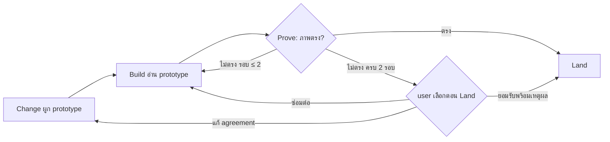

# Design

## Work type

feature

## เส้นทางผู้ใช้

เส้นทางของ prototype ตั้งแต่ Change ถึง Land รวมทางที่ไม่ตรง



## Decisions

- **Decision ID:** DEC-001
  - **Status:** accepted
  - **Decision:** Agent reviewer เทียบภาพและคืนรายการความต่าง
  - **Why:** ผู้ใช้เลือก (a) เพราะทนต่อข้อมูล ฟอนต์ และขนาดจอที่ต่างกันได้ดีกว่า pixel diff
  - **Rejected:** none
  - **Consequences:** ผลตรวจขึ้นกับดุลยพินิจของ reviewer จึงต้องมี finding ที่ระบุหน้าจอและจุดที่ต่าง และมีค่าใช้จ่าย reviewer 1 รอบต่อการตรวจที่ไม่ได้ใช้ผลเดิม
- **Decision ID:** DEC-002
  - **Status:** accepted
  - **Decision:** ซ่อมความต่างด้านภาพเองได้ 2 รอบแล้วส่งให้ user
  - **Why:** ผู้ใช้เลือก (a) เพื่อคุมเวลา
  - **Rejected:** none
  - **Consequences:** visual เป็นข้อยกเว้นของกฎซ่อมไม่จำกัดรอบเมื่อยังคืบหน้า ต้องระบุใน WORKFLOW.md
- **Decision ID:** DEC-003
  - **Status:** accepted
  - **Decision:** ตรวจเข้มเป็นค่าเริ่มต้น ความต่างที่เหลือถามพร้อม Land ไม่หยุด gate อื่น
  - **Why:** ผู้ใช้ต้องการตรวจเข้มแต่ข้ามได้และไม่ block
  - **Rejected:** none
  - **Consequences:** ยังไม่มี Land แบบ risk-accepted การยอมรับความต่างเป็น waiver ของ visual ที่บันทึกด้วย decision-ref และแสดงใน proof
- **Decision ID:** DEC-004
  - **Status:** accepted
  - **Decision:** คัดลอกไฟล์ prototype เข้า openspec/changes/<id>/prototype/
  - **Why:** การอนุมัติ hash เฉพาะไฟล์ใน packet และ .foundation/prototypes ถูกห้ามเป็น reference จึงต้องย้ายเข้า packet เพื่อผูก digest
  - **Rejected:** none
  - **Consequences:** แก้ prototype หลังอนุมัติต้องอนุมัติใหม่ และ prototype ถูก archive ไปกับ change
- **Decision ID:** DEC-005
  - **Status:** accepted
  - **Decision:** Screenshot มาจาก browser/playwright adapter ของโปรเจกต์ในรูป artifact ของ receipt
  - **Why:** ใช้ adapter และ freshness ที่มีอยู่ ไม่ให้ harness ต้องรู้วิธีรันแอปของแต่ละโปรเจกต์
  - **Rejected:** none
  - **Consequences:** โปรเจกต์ต้องตั้ง provider browser หรือ playwright ให้เก็บ screenshot ถ้าไม่มี ผลเป็น inconclusive และ advance คืน REPAIR ให้ตั้งค่า

## ตารางความล้มเหลว

| Failure | User sees | Recovery | Covers |
|---|---|---|---|
| อ้างไฟล์ที่ไม่มีหรืออยู่นอกโปรเจกต์ | change start คืน EDIT ระบุ field prototypeSelection.reference และไม่สร้าง packet | เอเจนต์บันทึกไฟล์ prototype ในโปรเจกต์แล้วแก้ path | prototype-bound-reference |
| covers อ้าง requirement ที่ไม่มี | change start คืน EDIT ระบุ key ที่ไม่รู้จัก | แก้ covers ให้ตรงกับ requirement key | prototype-bound-reference |
| ภาพไม่ตรง | receipt มี status fail และ finding ระบุหน้าจอ จุดที่ต่าง และ severity | finding ระดับ blocker หรือ major เข้า repair batch | visual-check-judgement |
| ไม่มี screenshot | receipt มี status inconclusive และไม่ถูกนับเป็นผ่าน | advance คืน REPAIR ให้ตั้งค่า provider ให้เก็บ screenshot | visual-check-judgement |
| ยอมรับโดยไม่ให้เหตุผล | ระบบปฏิเสธและไม่บันทึก waiver | ถาม user เพื่อขอเหตุผลแล้วบันทึกใหม่ | visual-drift-decision |

## แผนที่ไฟล์

| Tasks | Paths |
|---|---|
| T001 | `.claude/harness/runtime/workflow/semantic-draft.mjs`, `.claude/harness/runtime/workflow/change-lifecycle.mjs`, `.claude/harness/runtime/workflow/prototype-binding.mjs` (add), `.claude/harness/tests/prototype-binding.test.mjs` (add), `.claude/harness/tests/design-render.test.mjs`, `.claude/harness/tests/semantic-draft.test.mjs` |
| T002; T005 | `.claude/harness/runtime/workflow/advance-runtime.mjs` |
| T002 | `.claude/harness/tests/advance-runtime.test.mjs` |
| T003 | `.claude/harness/runtime/evidence/provider-catalog.mjs`, `.claude/harness/runtime/evidence/evidence-contract.mjs`, `.claude/harness/runtime/evidence/configured-reviewer.mjs`, `.claude/harness/runtime/evidence/visual-review.mjs` (add), `.claude/harness/runtime/evidence/receipt-runtime.mjs`, `.claude/harness/runtime/workflow/change-policy.mjs`, `.claude/harness/tests/visual-review.test.mjs` (add), `.claude/harness/tests/provider-input-identity.test.mjs` |
| T004 | `.claude/harness/runtime/evidence/repair-runtime.mjs`, `.claude/harness/runtime/evidence/proof-execution-runtime.mjs`, `.claude/harness/runtime/workflow/advance-recovery.mjs`, `.claude/harness/tests/visual-repair.test.mjs` (add), `.claude/harness/tests/advance-recovery.test.mjs` |
| T005 | `.claude/harness/runtime/workflow/change-validation.mjs`, `.claude/harness/runtime/core/user-decisions.mjs`, `.claude/harness/runtime/evidence/proof-readiness.mjs`, `.claude/harness/runtime/workflow/land-runtime.mjs`, `.claude/harness/tests/visual-drift-decision.test.mjs` (add), `.claude/harness/tests/waive-gate.test.mjs` |
| T006 | `WORKFLOW.md`, `.claude/harness/EVIDENCE.md`, `.claude/harness/README.md`, `.claude/skills/change/references/workflow.md`, `.claude/skills/build/`, `.claude/skills/investigate/references/intent-continuity.md`, `website/docs/src/content/docs/evidence/`, `website/docs/src/content/docs/th/evidence/`, `website/docs/src/content/docs/approval.md`, `website/docs/src/content/docs/th/approval.md`, `.claude/tests/run-all.sh`, `.claude/tests/README.md`, `CHANGELOG.md` |

`+` add · `~` change · `-` remove

```text
.
├── .claude/
│   ├── harness/
│   │   ├── ~ EVIDENCE.md
│   │   ├── ~ README.md
│   │   ├── runtime/
│   │   │   ├── core/
│   │   │   │   └── ~ user-decisions.mjs
│   │   │   ├── evidence/
│   │   │   │   ├── ~ configured-reviewer.mjs
│   │   │   │   ├── ~ evidence-contract.mjs
│   │   │   │   ├── ~ proof-execution-runtime.mjs
│   │   │   │   ├── ~ proof-readiness.mjs
│   │   │   │   ├── ~ provider-catalog.mjs
│   │   │   │   ├── ~ receipt-runtime.mjs
│   │   │   │   ├── ~ repair-runtime.mjs
│   │   │   │   └── + visual-review.mjs
│   │   │   └── workflow/
│   │   │       ├── ~ advance-recovery.mjs
│   │   │       ├── ~ advance-runtime.mjs
│   │   │       ├── ~ change-lifecycle.mjs
│   │   │       ├── ~ change-policy.mjs
│   │   │       ├── ~ change-validation.mjs
│   │   │       ├── ~ land-runtime.mjs
│   │   │       ├── + prototype-binding.mjs
│   │   │       └── ~ semantic-draft.mjs
│   │   └── tests/
│   │       ├── ~ advance-recovery.test.mjs
│   │       ├── ~ advance-runtime.test.mjs
│   │       ├── ~ design-render.test.mjs
│   │       ├── + prototype-binding.test.mjs
│   │       ├── ~ provider-input-identity.test.mjs
│   │       ├── ~ semantic-draft.test.mjs
│   │       ├── + visual-drift-decision.test.mjs
│   │       ├── + visual-repair.test.mjs
│   │       ├── + visual-review.test.mjs
│   │       └── ~ waive-gate.test.mjs
│   ├── skills/
│   │   ├── ~ build/
│   │   ├── change/
│   │   │   └── references/
│   │   │       └── ~ workflow.md
│   │   └── investigate/
│   │       └── references/
│   │           └── ~ intent-continuity.md
│   └── tests/
│       ├── ~ README.md
│       └── ~ run-all.sh
├── ~ CHANGELOG.md
├── website/
│   └── docs/
│       └── src/
│           └── content/
│               └── docs/
│                   ├── ~ approval.md
│                   ├── ~ evidence/
│                   └── th/
│                       ├── ~ approval.md
│                       └── ~ evidence/
└── ~ WORKFLOW.md
```

## แผนที่ test

| Scenario | Level | Check | Task |
|---|---|---|---|
| ผูก prototype จาก investigate; อ้างไฟล์ที่ไม่มีหรืออยู่นอกโปรเจกต์; covers อ้าง requirement ที่ไม่มี; prototype ใน packet ถูกแก้หลังอนุมัติ | task check | `node --test .claude/harness/tests/prototype-binding.test.mjs .claude/harness/tests/design-render.test.mjs .claude/harness/tests/semantic-draft.test.mjs` | T001 |
| task ที่เกี่ยวข้องได้ prototype; task ที่ไม่เกี่ยวข้อง; change ไม่มี prototype | task check | `node --test .claude/harness/tests/advance-runtime.test.mjs` | T002 |
| strict เป็นค่าเริ่มต้น; advisory รายงานอย่างเดียว; ไม่มี prototype; ภาพตรงกัน; ภาพไม่ตรง; ไม่มี screenshot; ใช้ผลเดิมเมื่อไม่มีอะไรเปลี่ยน | task check | `node --test .claude/harness/tests/visual-review.test.mjs .claude/harness/tests/provider-input-identity.test.mjs` | T003 |
| ซ่อมสำเร็จในรอบแรก; ครบ 2 รอบยังไม่ตรง; finding ระดับ minor | task check | `node --test .claude/harness/tests/visual-repair.test.mjs .claude/harness/tests/advance-recovery.test.mjs` | T004 |
| user ยอมรับความต่าง; user ขอซ่อมต่อ; user แก้ agreement; ยอมรับโดยไม่ให้เหตุผล; ภาพเปลี่ยนหลังยอมรับ | task check | `node --test .claude/harness/tests/visual-drift-decision.test.mjs .claude/harness/tests/waive-gate.test.mjs` | T005 |
| ผูก prototype จาก investigate; อ้างไฟล์ที่ไม่มีหรืออยู่นอกโปรเจกต์; covers อ้าง requirement ที่ไม่มี; prototype ใน packet ถูกแก้หลังอนุมัติ; strict เป็นค่าเริ่มต้น; advisory รายงานอย่างเดียว; ไม่มี prototype; user ยอมรับความต่าง; user ขอซ่อมต่อ; user แก้ agreement; ยอมรับโดยไม่ให้เหตุผล; ภาพเปลี่ยนหลังยอมรับ | task check | `bash .claude/tests/docs/run-doc-consistency.sh` | T006 |
