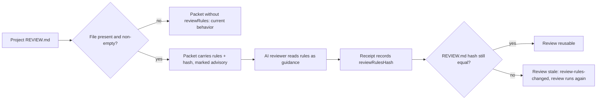

# Design

## สถานะปัจจุบัน

`reviewPacketValue` ใน `runtime/workflow/packet-runtime.mjs` ประกอบ packet จาก intent, claims, decisions, contract artifacts, changed surface, grounding, evidence และ priorReview แล้วคำนวณ `packetDigest` ส่วน `dispatchPacket` ใน `authority-runtime.mjs` เพิ่ม reviewDiff, agreement และ scenarioChecklist สำหรับ AI reviewer และรอบ diff-only ตัดฟิลด์ใน `DIFF_ONLY_OMITTED_FIELDS` ออก

review receipt ใช้ `reviewHash` ของ workspace ใน sandbox และ rebind ด้วย `diffIdentity` + `packetReviewHash` (ครอบเฉพาะไฟล์ใน change packet) ไฟล์ root ที่ไม่ได้ประกาศจะไม่อยู่ใน snapshot ดังนั้นการแก้ REVIEW.md ใน target หลังรีวิวจะไม่ทำให้รีวิวเก่าในทุกเส้นทาง

## Work type

feature

## สถาปัตยกรรม

- `reviewRulesValue(root)` ฟังก์ชัน pure-ish ตัวเดียวใน runtime evidence หรือ workflow คืน `null` (ไม่มีไฟล์หรือว่าง) หรือ `{ path, hash, advisory: true, content? , omitted? }`
- `reviewPacketValue` เรียกฟังก์ชันนี้และใส่ `reviewRules` เมื่อไม่ใช่ `null`
- `configuredReviewPrompt` เพิ่มส่วน "Project review rules (advisory)" เมื่อมีเนื้อหา และไม่เพิ่มอะไรเมื่อไม่มี
- `applyReviewReceipt` เก็บ `review.reviewRulesHash` จาก packet (`null` เมื่อ packet ไม่มี reviewRules)
- `receipt-validity` เทียบ `review.reviewRulesHash` กับค่าปัจจุบันจาก `reviewRulesValue(root)` ก่อนเส้นทาง workspace/rebind เดิม ถ้า receipt ไม่มีฟิลด์นี้เลย (`undefined`) ข้ามการเทียบ

## เส้นทางผู้ใช้

เส้นทางของเกณฑ์รีวิวจากไฟล์ของโปรเจกต์ถึง receipt รวมกรณีไฟล์ถูกแก้หลังรีวิว



## พฤติกรรมขณะทำงาน

- hash = sha256 ของ byte ในไฟล์ ไม่ normalize line ending นอกจากตัดสินว่าไฟล์ว่างด้วย trim
- ขนาดเกิน 32 KiB: มี hash, `omitted: "too-large"`
- อ่านไม่ได้: ไม่มี hash, `omitted: "unreadable"` และ receipt บันทึก `reviewRulesHash: null` ทำให้รอบถัดไปที่อ่านได้ถือว่าเปลี่ยน
- ไม่มีการเรียก network หรือ model เพิ่ม

## Decisions

- **Decision ID:** DEC-001
  - **Status:** accepted
  - **Decision:** อ่าน REVIEW.md จาก root ของโปรเจกต์ (control root) ตอนประกอบ packet ไม่ใช่สำเนาใน sandbox
  - **Why:** เกณฑ์รีวิวเป็นนโยบายของโปรเจกต์ ไม่ใช่ส่วนของ diff ที่กำลังรีวิว
  - **Rejected:** none
  - **Consequences:** Not stated in the draft
- **Decision ID:** DEC-002
  - **Status:** accepted
  - **Decision:** ไฟล์ว่างหรือมีแต่ whitespace ถือว่าไม่มีไฟล์
  - **Why:** template ที่ลบเนื้อหาออกหมดไม่ควรทำให้รีวิวเก่าเพราะ hash ของไฟล์ว่าง
  - **Rejected:** none
  - **Consequences:** Not stated in the draft
- **Decision ID:** DEC-003
  - **Status:** accepted
  - **Decision:** เนื้อหาเกิน 32 KiB ใส่แค่ hash พร้อม omitted: "too-large" ไม่ใส่เนื้อหา
  - **Why:** รักษางบ context ของ reviewer โดยยังผูก hash เพื่อจับการแก้ไข
  - **Rejected:** none
  - **Consequences:** Not stated in the draft
- **Decision ID:** DEC-004
  - **Status:** accepted
  - **Decision:** bump reviewPacketSchema จาก 6 เป็น 7 และคง reviewProtocol ที่ 4
  - **Why:** packet เปลี่ยนรูป แต่ receipt เพิ่มแค่ฟิลด์เสริมที่ receipt เก่าไม่มีก็ยังอ่านได้
  - **Rejected:** none
  - **Consequences:** Not stated in the draft
- **Decision ID:** DEC-005
  - **Status:** accepted
  - **Decision:** template ตั้งต้นอยู่ที่ .claude/harness/templates/REVIEW.md และ ship ผ่าน MANAGED เดิม
  - **Why:** REVIEW.md ที่ root ของ repo นี้เป็นของ repo นี้เอง ส่งให้ผู้ใช้ไม่ได้
  - **Rejected:** none
  - **Consequences:** Not stated in the draft
- **Decision ID:** DEC-ADVISORY-ONLY
  - **Status:** accepted
  - **Context:** finding ระดับ blocker จาก REVIEW.md ทำให้รีวิวไม่ผ่านไหม
  - **Decision:** ไม่ เป็นคำแนะนำทั้งหมด
  - **Why:** No alternative was open; recorded as settled
  - **Rejected:** none
  - **Consequences:** Not stated in the draft
  - **Decided by:** user
- **Decision ID:** DEC-LEGACY-RECEIPTS
  - **Status:** accepted
  - **Context:** receipt ที่ทำก่อนอัปเกรดและไม่มี reviewRulesHash ถือว่าเก่าไหม
  - **Decision:** ไม่ ยังใช้ได้ รีวิวครั้งถัดไปจึงเริ่มผูก hash
  - **Why:** No alternative was open; recorded as settled
  - **Rejected:** none
  - **Consequences:** Not stated in the draft
  - **Decided by:** user
- **Decision ID:** DEC-SEED-TIMING
  - **Status:** accepted
  - **Context:** installer ใส่ REVIEW.md ตั้งต้นเมื่อไหร่
  - **Decision:** ทั้งติดตั้งใหม่และอัปเกรด เฉพาะเมื่อยังไม่มีไฟล์ ไม่เขียนทับ
  - **Why:** No alternative was open; recorded as settled
  - **Rejected:** none
  - **Consequences:** Not stated in the draft
  - **Decided by:** user

## ตารางความล้มเหลว

| Failure | User sees | Recovery | Covers |
|---|---|---|---|
| อ่าน REVIEW.md ไม่ได้ | รีวิวยังรันได้ reviewRules มี omitted: "unreadable" และไม่มี hash | แก้สิทธิ์ไฟล์ รีวิวรอบถัดไปจะใส่เกณฑ์และ hash ตามปกติ | review-rules-in-packet |
| แก้ REVIEW.md หลังรีวิว | receipt เป็น stale ด้วยเหตุผล review-rules-changed | Prove รันรีวิวใหม่ตามกลไก repair เดิม | review-rules-bind-receipt |
| ติดตั้งล้มกลางทาง | REVIEW.md ที่เพิ่งสร้างถูกลบออก | รัน install.sh ใหม่หลังแก้สาเหตุ | starter-review-rules-seeded |

## ความเข้ากันได้และการปล่อย

- `reviewPacketSchema` 6 → 7 ใน `protocol.json`, `foundation.mjs` และ test ที่ pin ค่า
- `reviewProtocol` คงที่ 4 receipt ที่ไม่มี `reviewRulesHash` ยังใช้ได้ (ตัดสินโดย user)
- installer: เพิ่ม `REVIEW.md` ในรายการไฟล์ที่เป็นของโปรเจกต์ (`PROJECT_MUTABLE`), บรรทัดแผน, การ seed เมื่อไม่มี และ git staging แบบเดียวกับ `foundation.json`
- ถอยกลับ: ลบ REVIEW.md ในโปรเจกต์ หรือย้อนเวอร์ชัน harness receipt ใหม่มีฟิลด์เสริมที่เวอร์ชันเก่าไม่อ่าน

## กลยุทธ์การทดสอบ

- `receipt-validity.test.mjs`: ตาราง edit / delete / create / unchanged-with-moved-base / legacy-missing-field
- `packet-value.test.mjs`: present / absent / empty / too-large / unreadable และ version 7
- `configured-reviewer.test.mjs`: prompt มีส่วนคำแนะนำเมื่อมีเนื้อหาและไม่มีเมื่อไม่มี และรอบ diff-only ยังมี reviewRules
- `run-installer-tests.sh`: fresh install, upgrade ไม่มีไฟล์, มีไฟล์อยู่แล้ว byte-for-byte, rollback

## แผนที่ไฟล์

| Tasks | Paths |
|---|---|
| T001 | `.claude/harness/runtime/workflow/packet-runtime.mjs`, `.claude/harness/runtime/workflow/authority-runtime.mjs`, `.claude/harness/runtime/evidence/configured-reviewer.mjs`, `.claude/harness/runtime/core/diagnostics-runtime.mjs`, `.claude/harness/foundation.mjs`, `.claude/harness/protocol.json`, `.claude/harness/tests/packet-value.test.mjs`, `.claude/harness/tests/configured-reviewer.test.mjs`, `.claude/harness/tests/diagnostics-runtime.test.mjs`, `.claude/tests/harness/run-feedback-review-tests.sh` |
| T002 | `.claude/harness/runtime/evidence/receipt-runtime.mjs`, `.claude/harness/runtime/evidence/receipt-validity.mjs`, `.claude/harness/tests/receipt-validity.test.mjs` |
| T003 | `install.sh`, `.claude/harness/templates/REVIEW.md` (add), `.claude/tests/harness/run-installer-tests.sh` |
| T004 | `.claude/harness/EVIDENCE.md`, `.claude/harness/README.md`, `WORKFLOW.md`, `CHANGELOG.md`, `website/docs/src/content/docs/approval.md`, `website/docs/src/content/docs/th/approval.md`, `website/docs/src/content/docs/cli.md`, `website/docs/src/content/docs/th/cli.md` |

`+` add · `~` change · `-` remove

```text
.
├── .claude/
│   ├── harness/
│   │   ├── ~ EVIDENCE.md
│   │   ├── ~ foundation.mjs
│   │   ├── ~ protocol.json
│   │   ├── ~ README.md
│   │   ├── runtime/
│   │   │   ├── core/
│   │   │   │   └── ~ diagnostics-runtime.mjs
│   │   │   ├── evidence/
│   │   │   │   ├── ~ configured-reviewer.mjs
│   │   │   │   ├── ~ receipt-runtime.mjs
│   │   │   │   └── ~ receipt-validity.mjs
│   │   │   └── workflow/
│   │   │       ├── ~ authority-runtime.mjs
│   │   │       └── ~ packet-runtime.mjs
│   │   ├── templates/
│   │   │   └── + REVIEW.md
│   │   └── tests/
│   │       ├── ~ configured-reviewer.test.mjs
│   │       ├── ~ diagnostics-runtime.test.mjs
│   │       ├── ~ packet-value.test.mjs
│   │       └── ~ receipt-validity.test.mjs
│   └── tests/
│       └── harness/
│           ├── ~ run-feedback-review-tests.sh
│           └── ~ run-installer-tests.sh
├── ~ CHANGELOG.md
├── ~ install.sh
├── website/
│   └── docs/
│       └── src/
│           └── content/
│               └── docs/
│                   ├── ~ approval.md
│                   ├── ~ cli.md
│                   └── th/
│                       ├── ~ approval.md
│                       └── ~ cli.md
└── ~ WORKFLOW.md
```

## แผนที่ test

| Scenario | Level | Check | Task |
|---|---|---|---|
| มี REVIEW.md; ไม่มี REVIEW.md; REVIEW.md ว่าง; REVIEW.md ใหญ่เกิน; อ่าน REVIEW.md ไม่ได้; รอบรีวิวแบบส่งแค่ diff; prompt ระบุว่าเป็นคำแนะนำ; ผลตัดสินเหมือนเดิม | task check | `node --test .claude/harness/tests/packet-value.test.mjs .claude/harness/tests/configured-reviewer.test.mjs .claude/harness/tests/diagnostics-runtime.test.mjs && bash .claude/tests/harness/run-feedback-review-tests.sh` | T001 |
| บันทึก hash; แก้ REVIEW.md หลังรีวิว; ลบ REVIEW.md หลังรีวิว; สร้าง REVIEW.md หลังรีวิว; REVIEW.md ไม่เปลี่ยน; receipt เก่าก่อนอัปเกรด; prompt ระบุว่าเป็นคำแนะนำ; ผลตัดสินเหมือนเดิม | task check | `node --test .claude/harness/tests/receipt-validity.test.mjs` | T002 |
| ติดตั้งใหม่; อัปเกรดโปรเจกต์ที่ไม่มีไฟล์; มี REVIEW.md อยู่แล้ว; ติดตั้งล้มกลางทาง | task check | `bash .claude/tests/harness/run-installer-tests.sh` | T003 |
| มี REVIEW.md; ไม่มี REVIEW.md; REVIEW.md ว่าง; REVIEW.md ใหญ่เกิน; อ่าน REVIEW.md ไม่ได้; รอบรีวิวแบบส่งแค่ diff; prompt ระบุว่าเป็นคำแนะนำ; ผลตัดสินเหมือนเดิม; บันทึก hash; แก้ REVIEW.md หลังรีวิว; ลบ REVIEW.md หลังรีวิว; สร้าง REVIEW.md หลังรีวิว; REVIEW.md ไม่เปลี่ยน; receipt เก่าก่อนอัปเกรด; ติดตั้งใหม่; อัปเกรดโปรเจกต์ที่ไม่มีไฟล์; มี REVIEW.md อยู่แล้ว; ติดตั้งล้มกลางทาง | task check | `bash .claude/tests/docs/run-doc-consistency.sh` | T004 |
