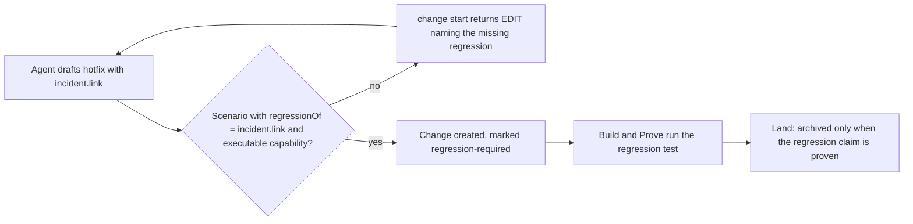

# Design

## Work type

feature

## เส้นทางผู้ใช้

เส้นทางของ hotfix ตั้งแต่ร่างจนถึง archived พร้อม regression ที่ผูกกับ incident รวมกรณีที่ draft ขาด regression



## Decisions

- **Decision ID:** DEC-001
  - **Status:** accepted
  - **Decision:** ตรวจกฎตอน change start และบันทึก regressionRequired ใน state ของ change เพื่อให้ revise ของ change นั้นตรวจต่อ ส่วน change ที่ไม่มีเครื่องหมายไม่ถูกตรวจ
  - **Why:** validator ปกติถูกใช้ร่วมกับ revise การตรวจทุกที่จะบล็อก hotfix ที่ค้างอยู่ก่อนอัปเกรด
  - **Rejected:** none
  - **Consequences:** Not stated in the draft
- **Decision ID:** DEC-002
  - **Status:** accepted
  - **Decision:** ใช้ฟิลด์ scenario regressionOf แสดงใน spec ของ scenario แบบเดียวกับ access ไม่คัดลอกเข้า claim
  - **Why:** ไม่เปลี่ยนรูป evidence.yaml จึงไม่ต้อง bump protocol และ agreement ที่ archive ยังแสดงคู่ incident กับเทสต์
  - **Rejected:** none
  - **Consequences:** Not stated in the draft
- **Decision ID:** DEC-003
  - **Status:** accepted
  - **Decision:** requirement ที่มี scenario regressionOf ต้องมี capability ที่รันได้ (ไม่ใช่ review, acceptance หรือ semantic-acceptance อย่างเดียว)
  - **Why:** regression ต้องเป็นเทสต์ที่รันซ้ำได้ ไม่ใช่การรีวิวครั้งเดียว
  - **Rejected:** none
  - **Consequences:** Not stated in the draft
- **Decision ID:** DEC-004
  - **Status:** accepted
  - **Decision:** harness ใส่ openspec/lessons.md เป็น seed source ของ investigation และ change intake เมื่อไฟล์มีอยู่
  - **Why:** instruction ของ agent เต็มงบ context การแก้ lessons ระหว่างมี change ค้างจะทำให้ agent ได้งาน refresh-source-coverage ซึ่งยอมรับได้
  - **Rejected:** none
  - **Consequences:** Not stated in the draft
- **Decision ID:** DEC-005
  - **Status:** accepted
  - **Decision:** template สำหรับผู้ใช้อยู่ที่ .claude/harness/templates/incidents/ และ templates/lessons.md เป็นกลางไม่อ้าง claude-foundation
  - **Why:** ไฟล์ใน repo นี้เขียนเฉพาะ repo นี้
  - **Rejected:** none
  - **Consequences:** Not stated in the draft
- **Decision ID:** DEC-SHIP-INCIDENT-TEMPLATES
  - **Status:** accepted
  - **Context:** ส่ง incident template และ lessons.md ให้โปรเจกต์ผู้ใช้ไหม
  - **Decision:** ส่ง
  - **Why:** No alternative was open; recorded as settled
  - **Rejected:** none
  - **Consequences:** Not stated in the draft
  - **Decided by:** user
- **Decision ID:** DEC-UPGRADE-SCOPE
  - **Status:** accepted
  - **Context:** กฎ regression ใช้กับ hotfix ที่ค้างอยู่ตอนอัปเกรดไหม
  - **Decision:** ไม่ ใช้กับ hotfix ที่สร้างหลังอัปเกรดเท่านั้น
  - **Why:** No alternative was open; recorded as settled
  - **Rejected:** none
  - **Consequences:** Not stated in the draft
  - **Decided by:** user
- **Decision ID:** DEC-HOTFIX-REGRESSION-MANDATORY
  - **Status:** accepted
  - **Context:** hotfix ต้องมี regression ผูกกับ incident ก่อน archived ไหม
  - **Decision:** บังคับ
  - **Why:** No alternative was open; recorded as settled
  - **Rejected:** none
  - **Consequences:** Not stated in the draft
  - **Decided by:** user

## ตารางความล้มเหลว

| Failure | User sees | Recovery | Covers |
|---|---|---|---|
| hotfix ไม่มี regression | ได้ EDIT ของ agent ที่ระบุว่าต้องมี scenario regressionOf: INC-212 | agent เพิ่ม scenario regressionOf แล้วรันใหม่ | hotfix-regression-required |
| revise hotfix ที่สร้างหลังอัปเกรด | ได้ EDIT ที่ระบุว่าต้องมี scenario regressionOf | agent คืน scenario regression แล้วรันใหม่ | hotfix-regression-required |
| ติดตั้งล้มกลางทาง | ไฟล์ที่เพิ่งสร้างถูกลบ | รัน install.sh ใหม่หลังแก้สาเหตุ | incident-and-lessons-seeded |

## แผนที่ไฟล์

| Tasks | Paths |
|---|---|
| T001; T003 | `.claude/harness/runtime/workflow/`, `.claude/harness/tests/` |
| T002 | `install.sh`, `.claude/harness/templates/`, `.claude/tests/harness/run-installer-tests.sh` |
| T003 | `.claude/harness/runtime/core/` |
| T004 | `WORKFLOW.md`, `.claude/harness/README.md`, `CHANGELOG.md`, `website/docs/src/content/docs/` |

`+` add · `~` change · `-` remove

```text
.
├── .claude/
│   ├── harness/
│   │   ├── ~ README.md
│   │   ├── runtime/
│   │   │   ├── ~ core/
│   │   │   └── ~ workflow/
│   │   ├── ~ templates/
│   │   └── ~ tests/
│   └── tests/
│       └── harness/
│           └── ~ run-installer-tests.sh
├── ~ CHANGELOG.md
├── ~ install.sh
├── website/
│   └── docs/
│       └── src/
│           └── content/
│               └── ~ docs/
└── ~ WORKFLOW.md
```

## แผนที่ test

| Scenario | Level | Check | Task |
|---|---|---|---|
| hotfix ไม่มี regression; regressionOf ไม่ตรง incident; regression ไม่มี capability ที่รันได้; hotfix ครบ; bugfix ที่ไม่ใช่ hotfix; revise hotfix ที่สร้างก่อนอัปเกรด; revise hotfix ที่สร้างหลังอัปเกรด | task check | `node --test .claude/harness/tests/change-atomic-start.test.mjs .claude/harness/tests/change-revise.test.mjs .claude/harness/tests/semantic-draft.test.mjs .claude/harness/tests/work-type-fields.test.mjs` | T001 |
| ติดตั้งใหม่; มีบางไฟล์อยู่แล้ว; ติดตั้งล้มกลางทาง | task check | `bash .claude/tests/harness/run-installer-tests.sh` | T002 |
| มี lessons.md; ไม่มี lessons.md; แก้ lessons.md หลัง intake | task check | `node --test .claude/harness/tests/change-atomic-start.test.mjs .claude/harness/tests/investigation-runtime.test.mjs` | T003 |
| hotfix ไม่มี regression; regressionOf ไม่ตรง incident; regression ไม่มี capability ที่รันได้; hotfix ครบ; bugfix ที่ไม่ใช่ hotfix; revise hotfix ที่สร้างก่อนอัปเกรด; revise hotfix ที่สร้างหลังอัปเกรด; ติดตั้งใหม่; มีบางไฟล์อยู่แล้ว; ติดตั้งล้มกลางทาง; มี lessons.md; ไม่มี lessons.md; แก้ lessons.md หลัง intake | task check | `bash .claude/tests/docs/run-doc-consistency.sh` | T004 |
